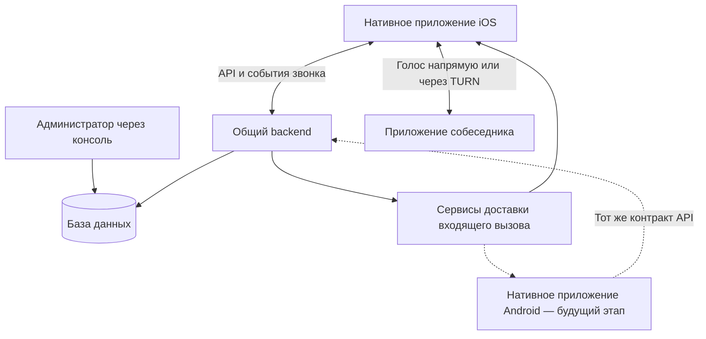

# GChat — обзор приложения

Статус: верхнеуровневое описание продукта и предлагаемой архитектуры. В pnpm-монорепозитории созданы базовое NestJS-приложение backend с `/health`, `/ready`, подключением через Drizzle и локальной PostgreSQL через Compose, а также каркас каталога iOS. Бизнес-функции и нативное приложение ещё не реализованы; доступны требования, базовый дизайн и HTML-прототип.

## Назначение

GChat — закрытое приложение для голосовых интернет-звонков между двумя людьми. Администратор создаёт аккаунты и определяет, кому пользователь может звонить. Пользователь входит, видит доступные контакты и начинает звонок после подтверждения.

Входящий вызов должен поступать на телефон через системный интерфейс: с возможностью ответить или отклонить, в том числе при приложении в фоне и заблокированном экране. Доступность вызова зависит от сети и ограничений платформы; поведение после принудительного закрытия приложения требует отдельной проверки.

Продукт состоит из общего backend и нативных мобильных приложений. Первая платформа — iOS. Android рассматривается как следующий этап; его включение в объём разработки пока не согласовано.

## Участники

| Участник | Возможности |
| --- | --- |
| Пользователь | Войти, просмотреть доступные контакты, позвонить, принять или отклонить вызов, завершить разговор |
| Администратор | Создать аккаунт, выдать данные для входа, настроить доступ к контактам через консоль; отдельная панель в первой версии не требуется |

## Состав системы

| Компонент | Зона ответственности |
| --- | --- |
| Нативное приложение iOS | Экраны и навигация, сессия пользователя, получение контактов, подтверждение звонка, интеграция с системными вызовами iOS, работа с микрофоном и аудиосоединением |
| Нативное приложение Android — в перспективе | Те же продуктовые сценарии и общий backend с адаптацией системных вызовов, уведомлений и интерфейса под Android |
| Backend | Авторизация, разрешённые контакты, устройства, проверка прав, создание и состояние звонков, доставка событий, организация соединения между участниками |
| База данных | Аккаунты, разрешения, сессии, устройства и служебные записи о звонках |
| Сервисы доставки входящего вызова | Доставка события на устройство через механизмы платформы; для iOS предусмотрен APNs VoIP push |
| STUN / TURN | Помощь в установлении аудиосоединения; при необходимости — ретрансляция трафика через TURN |

Backend управляет звонком, а аудио передаётся отдельно. В предлагаемой схеме используется WebRTC: голос идёт между клиентами напрямую или через TURN. Серверные API и push передают команды и события, а не аудиопоток. Подробнее — в [описании backend](backend/README.md).

## Нативные приложения

Каждое приложение реализует общую продуктовую логику через средства своей платформы. Общими остаются аккаунты, разрешения на контакты, контракт API и модель состояний звонка. Системные экраны, уведомления, аудиомаршруты, навигация и разрешения адаптируются к iOS или Android.

Основные экраны:

1. **Вход:** логин и пароль, выданные администратором.
2. **Контакты:** список доступных людей с именами и аватарами. Поиска, добавления контактов и кнопки выхода нет.
3. **Подтверждение:** нажатие на контакт открывает диалог с именем собеседника и действиями «Отмена» / «Позвонить».
4. **Входящий вызов:** системный интерфейс платформы с ответом и отклонением.
5. **Звонок:** имя собеседника, ожидание ответа или время разговора, завершение и результат вызова.

За основу принят [дизайн в стиле Telegram для iOS](design/README.md). Для Android сохраняем визуальное родство и сценарии, адаптируя элементы к платформе. Показанные в макете микрофон, громкая связь и выбор аудиоустройства ещё требуют согласования для первой версии.

Конкретные языки, UI-фреймворки и библиотеки мобильных приложений будут описаны отдельно. HTML-макет служит референсом дизайна и поведения.

## Основные сценарии взаимодействия

### Подготовка доступа и вход

Администратор создаёт аккаунт и разрешает нужные контакты. Пользователь получает данные и входит в приложение. Backend проверяет их, создаёт сессию и возвращает доступный список контактов. Устройство регистрируется для получения входящих вызовов.

### Исходящий звонок

Пользователь выбирает контакт и подтверждает действие. Backend проверяет право на вызов и создаёт звонок с двумя участниками. Получатель получает событие входящего вызова, а вызывающий видит ожидание ответа. При отмене подтверждения звонок не создаётся.

### Ответ и разговор

Получатель отвечает через системный интерфейс. Backend согласует состояние звонка, приложения обмениваются данными для аудиосоединения. После его установления начинается разговор и отображается длительность. Завершение любым участником заканчивает звонок для обоих.

### Неуспешный вызов

При отклонении, отсутствии ответа или невозможности соединения backend фиксирует результат и сообщает его клиентам. Приложение показывает понятное состояние и позволяет вернуться к контактам. Звонок не должен бесконечно оставаться в ожидании.

## Границы ответственности

- Backend является источником актуального состояния звонка и прав доступа. Скрытия контакта в интерфейсе недостаточно: сервер проверяет разрешение на вызов.
- Нативный клиент отвечает за отображение состояния, взаимодействие с системой телефона и передачу аудио.
- Отключение клиента от сети не отменяет серверные таймауты. После восстановления связи приложение получает актуальное состояние.
- Аккаунты и данные общие для поддерживаемых платформ. Правила использования нескольких устройств одним аккаунтом нужно согласовать отдельно.
- Служебные записи о звонках на сервере не означают наличие истории звонков в пользовательском интерфейсе.

## Объём первой версии

В первую версию входят backend, нативное iOS-приложение, вход в заранее созданный аккаунт, настроенные администратором контакты и голосовые звонки один на один с системным входящим вызовом.

В текущий объём не входят Android, самостоятельная регистрация, административная панель, групповые и видеозвонки, переписка, файлы и звонки на обычные телефонные номера. История звонков и дополнительные элементы управления звуком пока не согласованы.

## Связь с существующим репозиторием

Код размещается в `applications/backend` и `applications/ios`. Документация хранится в `docs`; правила работы с workspace описаны в [настройках репозитория](repository-settings/README.md). pnpm управляет JS/TS-зависимостями и общими командами; нативное iOS-приложение собирается средствами Xcode.

В репозитории уже есть конфигурация семейного мессенджера на Mattermost и Jitsi. Новая звонилка описывается как отдельный продукт. Текущая серверная архитектура предложена для самостоятельного backend; решение о переиспользовании аккаунтов или инфраструктуры существующего мессенджера остаётся открытым.

Этот обзор не меняет текущую инфраструктуру и не фиксирует окончательный технологический стек.

## Детализация

- [Бизнес-требования](business-requirements.md) — обязательное поведение, критерии приёмки и открытые вопросы.
- [Базовый дизайн](design/README.md) и [HTML-прототип](design/index.html) — экраны и пользовательские взаимодействия.
- [Backend: технологический стек](backend/README.md) — предлагаемые технологии, данные и жизненный цикл звонка.

Следующие решения: связь с Mattermost, направленность доступа к контактам, правила нескольких устройств и занятости, мобильный стек, поддерживаемые версии ОС и способ распространения приложений.
