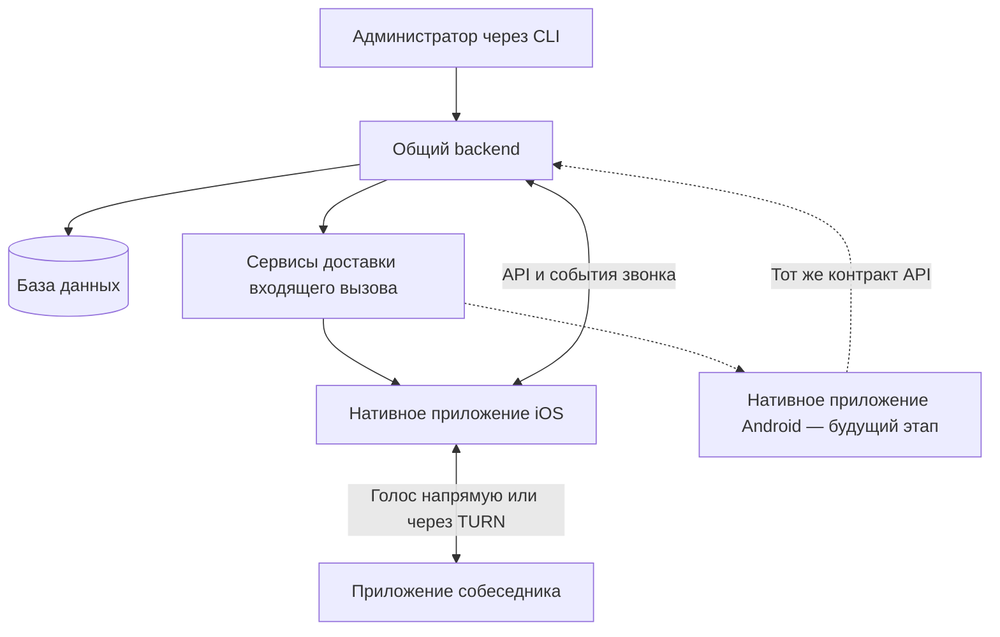

# Архитектура GChat

Этот документ описывает состав системы и взаимодействие компонентов. Контракты модулей находятся в [каталоге документации](../README.md); правила реализации — в [соглашениях backend](../backend/conventions.md). Реализация отдельных компонентов отмечается только в их профильных документах.

## Состав системы

| Компонент | Зона ответственности |
| --- | --- |
| Нативное приложение iOS | Экраны и навигация, сессия пользователя, получение контактов, подтверждение звонка, интеграция с системными вызовами iOS, работа с микрофоном и аудиосоединением |
| Нативное приложение Android — в перспективе | Те же продуктовые сценарии и общий backend с адаптацией системных вызовов, уведомлений и интерфейса под Android |
| Backend | Авторизация, разрешённые контакты, устройства, проверка прав, создание и состояние звонков, доставка событий, организация соединения между участниками |
| Хранилища PostgreSQL и Redis | PostgreSQL: аккаунты, разрешения, устройства и записи о звонках; Redis: сессии и аренды |
| Сервисы доставки входящего вызова | Доставка события на устройство через механизмы платформы; для iOS предусмотрен APNs VoIP push |
| STUN / TURN | Помощь в установлении аудиосоединения; при необходимости — ретрансляция трафика через TURN |

## 1. Базовый подход

Один сервер приложения с модулями авторизации, контактов, устройств и звонков. Отдельно работают PostgreSQL и coturn. Redis предназначен для сессий Auth и блокировок; микросервисы и отдельный медиасервер в первой версии не вводим.

В репозитории уже есть инфраструктура Mattermost и Jitsi. Предложение ниже рассчитано на самостоятельную звонилку с собственной базой данных. GChat использует собственные аккаунты без интеграции с Mattermost. Переиспользование инфраструктуры звонков Mattermost/Jitsi требует отдельного решения. Текущий `docker-compose.yml` этим документом не изменяется.

## 2. Предлагаемый стек

| Область | Технология | Назначение |
| --- | --- | --- |
| Язык | TypeScript со строгой проверкой типов | Серверная логика и контракты данных |
| Среда выполнения | Node.js и pnpm | Точные версии и ограничения — в package.json, .nvmrc и lock-файле |
| Серверный фреймворк | NestJS | HTTP API, модули, внедрение зависимостей и обработка событий |
| HTTP API | REST / JSON через HTTPS | Вход, сессии, разрешённые контакты, устройства и команды звонков |
| События и сигнализация | WebSocket через WSS, адаптер `@nestjs/platform-ws` | Состояния звонка, обмен SDP и ICE-кандидатами; обычный WebSocket без протокола Socket.IO |
| База данных | PostgreSQL | Аккаунты, доступ к контактам, устройства и состояние звонков |
| Доступ к БД и миграции | Drizzle ORM / Drizzle Kit | Типизированные запросы, описание схемы на TypeScript и SQL-миграции |
| Авторизация | Короткоживущий JWT access token + обновляемый refresh token | Доступ к API и WebSocket; сессии можно отзывать на сервере |
| Хеширование паролей | Argon2id | Хранение хеша вместо пароля |
| Аудиотранспорт | WebRTC на клиентах | Передача голоса между участниками |
| Обход NAT и ретрансляция | coturn: STUN / TURN | Подключение клиентов из разных сетей, ретрансляция аудио при невозможности прямого соединения |
| Входящий вызов на iOS | APNs VoIP push по HTTP/2 | Доставка события вызова для обработки через PushKit и CallKit на iPhone |
| Документация контрактов | [Swagger / OpenAPI](../backend/openapi.md) для REST, описание JSON-событий для WebSocket | HTTP-контракт генерируется из контроллеров и DTO; описание WebSocket добавляется вместе с Signaling |
| Тестирование | Jest и Supertest | Бизнес-правила, API и интеграционные сценарии |
| Запуск | Docker Compose | Приложение, БД и TURN; отдельная конфигурация от существующего мессенджера |

## 3. Разделение управления звонком и аудио

Backend проверяет права, создаёт звонок, уведомляет получателя и передаёт сообщения для установления соединения. Само аудио передаётся через WebRTC напрямую между клиентами либо через TURN. Через REST, WebSocket и APNs аудиопоток не идёт.

WebRTC не определяет серверную сигнализацию: обмен SDP и ICE-кандидатами реализуем в нашем WebSocket-протоколе. STUN помогает установить соединение, а TURN даёт путь через ретранслятор, когда прямой путь недоступен. См. [документацию WebRTC](https://webrtc.org/getting-started/peer-connections).

Для двух участников такая схема позволяет начать без групповых комнат и SFU. coturn — отдельный сетевой сервис с публичным адресом и доступными транспортными портами, а не обычный HTTP endpoint за reverse proxy. Клиенты получают временные TURN credentials; общий секрет coturn остаётся на сервере. См. [документацию coturn](https://github.com/coturn/coturn/blob/master/README.turnserver).

## 4. Модули и данные

| Модуль | Ответственность | Основные данные |
| --- | --- | --- |
| Auth | Вход, обновление и отзыв сессий, отключённые аккаунты | `users` в PostgreSQL, сессии в Redis |
| Contacts | Выдача только доступных контактов и проверка разрешения на вызов | `contact_permissions` |
| Devices | Привязка устройств и push-токенов к аккаунту, обработка смены и инвалидности токенов | `devices` |
| Calls | Создание, принятие, отклонение, отмена, завершение и таймауты | `calls`, события доставки |
| Signaling | Авторизованные WebSocket-соединения и обмен SDP / ICE в рамках звонка | Соединения в памяти, ссылка на `call_id` |
| Push | Отправка VoIP push в APNs и обработка результата доставки провайдеру | Задания отправки и результат попытки |

Аккаунты и разрешения администратор создаёт через консоль. Пароль должен попадать в БД уже в виде хеша: при реализации нужен консольный инструмент для его генерации или создания аккаунта. Публичная регистрация и административная панель не требуются.

Вход выполняется по логину и паролю. Несколько устройств на аккаунт разрешены; каждый вход создаёт независимую сессию без предельного срока действия и TTL, до отзыва. Access token действует 120 секунд. Хеши refresh-токенов хранятся в Redis в записях сессий. API и события проверяют не только подлинность пользователя, но и его право на конкретный контакт и звонок. Клиент не получает прямой доступ к БД. Отключение аккаунта или отзыв сессии должны закрывать доступ и к уже установленному WebSocket-соединению.

## 5. Жизненный цикл звонка

1. Пользователь нажимает на контакт и подтверждает действие в приложении. До подтверждения серверный звонок не создаётся.
2. Backend проверяет аккаунты, разрешение на звонок и занятость. Создаёт `call_id` и состояние `ringing` с ограниченным временем ожидания ответа.
3. Для iOS сервер отправляет VoIP push через APNs. Клиент сообщает о входящем вызове в CallKit. Постоянный WebSocket не заменяет этот путь доставки для фонового приложения.
4. При ответе backend атомарно принимает звонок от одного устройства получателя и переводит его в `connecting`. Через WSS участники обмениваются SDP и ICE-кандидатами.
5. После установления медиасоединения фиксируется `active`; при завершении — `ended`. Длительность разговора отсчитывается от соединения, а не от отправки push или нажатия «Ответить».
6. Отклонение, отмена, отсутствие ответа и ошибка имеют отдельную причину завершения. Таймауты контролирует сервер, даже если клиент отключился.

Звонок хранит идентификаторы двух пользователей и устройств, время создания, срок ожидания, состояние и причину завершения. Повторные команды и события не создают второй звонок: используются `call_id`, ключ идемпотентности для создания и проверка допустимости перехода состояния. Одновременные ответы и встречные вызовы обрабатываются транзакционно.

Создание звонка и задания отправки push сохраняются в одной транзакции PostgreSQL. Повторы отправки ограничены сроком жизни вызова. После перезапуска сервер восстанавливает незавершённые задания и завершает просроченные вызовы; восстановление WebSocket начинается с получения актуального состояния. Это позволяет начать без отдельной очереди Redis.

Полученный APNs ответ об успешном приёме запроса не означает, что телефон уже звонит. Клиенты должны корректно обрабатывать повторные события, отменённые и просроченные вызовы. Правила обработки VoIP push на iOS сверяются с [документацией Apple](https://developer.apple.com/documentation/pushkit/responding-to-voip-notifications-from-pushkit).

## 6. Контуры API

Предварительный состав; точные маршруты и поля определяются перед реализацией:

- вход и обновление сессии;
- получение разрешённых контактов;
- регистрация и обновление push-токена устройства;
- создание звонка, получение его состояния, принятие, отклонение и завершение;
- выдача временной конфигурации ICE / TURN авторизованному участнику звонка;
- WebSocket-события об изменении звонка и адресный обмен SDP / ICE между участниками.

Вход валидируется, попытки авторизации и создания вызовов ограничиваются по частоте. Секреты APNs, подписи токенов и coturn передаются через конфигурацию окружения и не включаются в мобильные сборки или репозиторий. Пароли, токены и полные SDP не записываются в обычные логи. Аудио не записывается.

Для локальной разработки нужны mock push-провайдер и два тестовых клиента. Для проверки настоящих входящих вызовов потребуются настроенные Apple App ID / push capabilities, ключ APNs, подписанное приложение и реальные iPhone. Проверка доставки в фоне и на заблокированном экране обязательна.

## 7. Проверки перед первой рабочей версией

Это критерии будущей приёмки бизнес-функций, а не перечень уже выполненных проверок.

- Доступ к контактам и звонку нельзя обойти, подставив чужой ID.
- Неверный пароль, просроченная и отозванная сессии обрабатываются корректно.
- Повтор создания, ответа или завершения не порождает дубликаты и неверные переходы.
- Таймаут, отмена до ответа, встречные вызовы и ответ с двух устройств дают определённый результат.
- Отключение WebSocket и перезапуск сервера не оставляют вечный `ringing`.
- Звонок проходит между разными сетями, в том числе при принудительном использовании TURN.
- Входящий вызов на iPhone проверен при открытом приложении, в фоне и на заблокированном экране.

## 8. Что ещё нужно решить

- Использование отдельного WebRTC-контура зависит от [продуктового решения об инфраструктуре](../product/requirements.md#7-допущения-и-открытые-вопросы).
- Продуктовые вопросы доступа, занятости, мобильных платформ и распространения ведутся в [требованиях](../product/requirements.md#7-допущения-и-открытые-вопросы).
- Техническое предложение для MVP: один активный звонок на пользователя без ожидания второго вызова; решение зависит от согласования продуктового поведения занятости.
- Детали Auth и административного восстановления ведутся только в [Auth](../backend/modules/auth.md#открытые-решения).
- Таймауты ожидания и соединения, политика восстановления после потери сети.
- Размещение сервера, домены, сертификаты, сетевые порты и резервное копирование БД.
- Срок хранения метаданных звонков и логов. Наличие серверных записей не добавляет историю звонков в UI.
- Android push-провайдер и системная интеграция определяются только при включении Android в объём.

## Источники

- [NestJS: WebSocket gateways](https://docs.nestjs.com/websockets/gateways) и [адаптеры](https://docs.nestjs.com/websockets/adapter).
- [Node.js: поддерживаемые ветки](https://github.com/nodejs/Release).
- [Drizzle: миграции](https://orm.drizzle.team/docs/migrations).
- [WebRTC: соединение, сигнализация, STUN / TURN](https://webrtc.org/getting-started/peer-connections).
- [coturn: конфигурация и временные credentials](https://github.com/coturn/coturn/blob/master/README.turnserver).
- [Apple: обработка входящих VoIP push](https://developer.apple.com/documentation/pushkit/responding-to-voip-notifications-from-pushkit).

## Границы ответственности

Backend проверяет права и хранит актуальное состояние звонка; скрытие контакта в UI не заменяет проверку разрешения. Нативный клиент управляет системным интерфейсом и аудио. Потеря связи не отменяет серверные таймауты, восстановление начинается с актуального состояния. Аккаунты общие для клиентских платформ, правила устройств и сессий принадлежат Auth. Серверные метаданные не добавляют историю звонков в UI.
