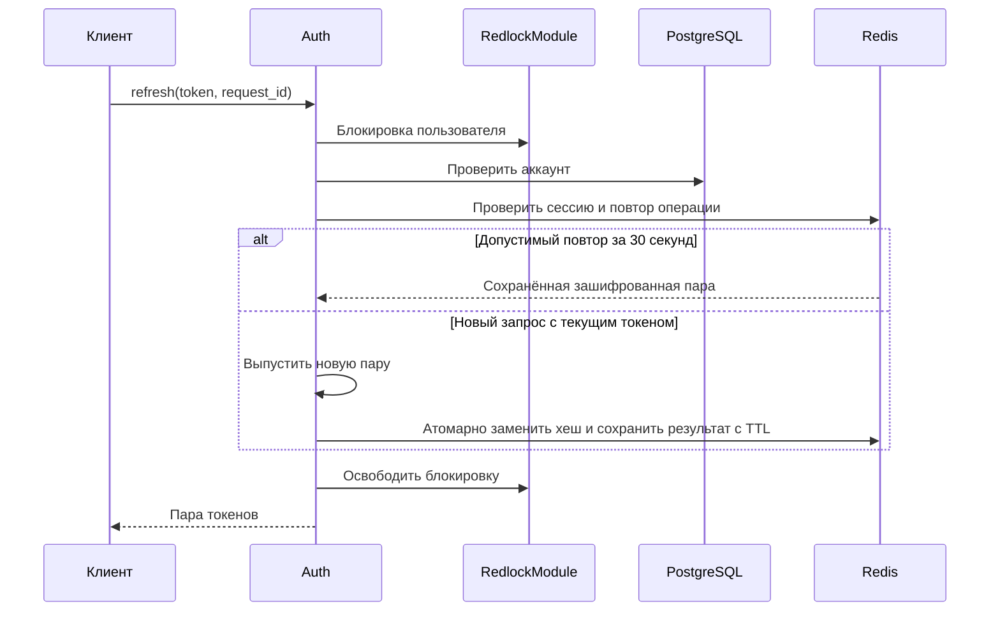
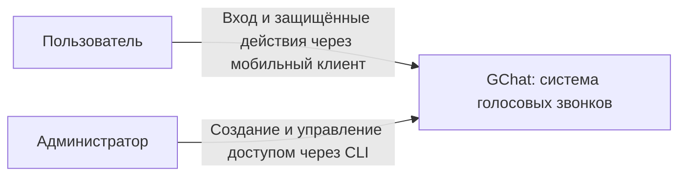
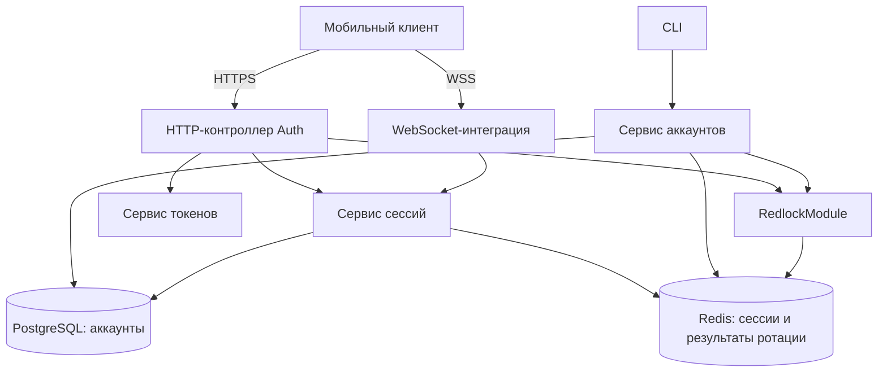

# Auth

## Назначение и границы

GChat использует собственные аккаунты, независимые от Mattermost. Auth является модулем общего NestJS backend, а не отдельным микросервисом. Он устанавливает личность пользователя и управляет сессиями для HTTP API и WebSocket.

В объём входят вход по логину и паролю, обновление токенов, выход, проверка доступа и CLI управления аккаунтами. Самостоятельной регистрации, административного HTTP API и операций редактирования логина или имени нет. Разрешения на контакты и звонки проверяют соответствующие бизнес-модули.

Хранение токенов на клиенте описывается в документации клиента. Общий формат ошибок описывается в [документации ErrorModule](errors.md); здесь определены HTTP-статусы и смысл кодов.

## Публичный API

### HTTP API

#### POST /auth/login

```json
{"login":"andrey","password":"..."}
```

Нормализует логин, проверяет пароль и состояние аккаунта, сохраняет новую сессию. Только после успешного сохранения возвращает 200:

```json
{"access_token":"...","refresh_token":"...","token_type":"Bearer"}
```

Ответы с токенами запрещено кешировать. Пароли и токены не записываются в логи.

| Статус | Код | Условие |
| --- | --- | --- |
| 400 | `VALIDATION_ERROR` | Неверный формат запроса |
| 401 | `INVALID_CREDENTIALS` | Неизвестный логин, неверный пароль или отключённый аккаунт; одинаковый ответ |
| 429 | `RATE_LIMITED` | Превышен лимит |
| 503 | `SERVICE_UNAVAILABLE` | Недоступна зависимость или не получена блокировка |

#### POST /auth/refresh

Access token не требуется.

```json
{"refresh_token":"...","request_id":"UUID"}
```

Новая операция использует новый `request_id`. Повтор после потери ответа использует прежний ID и прежний refresh token. Успех: 200 с той же структурой, что при входе.

| Ситуация | Результат |
| --- | --- |
| Текущий токен и новая операция | Ротация, новая пара |
| Тот же запрос и использованный токен в пределах 30 секунд | Исходная пара, без новой ротации |
| Истёк TTL, неизвестный или старый токен без подходящего результата | 401 `SESSION_INVALID`, без отзыва сессии |
| Аккаунт отключён или сессия отсутствует | 401 `SESSION_INVALID`, кешированный ответ не возвращается |

Повтор не продлевает срок access token. Следующая успешная ротация заменяет предыдущий временный результат. Обновления клиент выполняет последовательно, одной общей операцией.

Дополнительные ошибки: 400 `VALIDATION_ERROR`, 429 `RATE_LIMITED`, 503 `SERVICE_UNAVAILABLE`. После сетевого сбоя, 429 или 503 повторяется тот же запрос с прежним ID. Для 429 учитывается `Retry-After`.

#### POST /auth/logout

```json
{"refresh_token":"..."}
```

Работает без действующего access token. При распознанном токене отзывает текущую сессию, остальные сохраняются. Возвращает 204 без тела также для неизвестного токена и уже удалённой сессии. Неверный формат — 400, недоступная зависимость — 503; при 503 отзыв не считается подтверждённым.

Сервер распознаёт текущий токен и предыдущий только пока существует временная запись ротации. Произвольный более старый токен не позволяет отозвать сессию: он получает идемпотентный 204 без изменения данных.

Метаданные пользователя возвращаются в JWT; отдельный endpoint профиля не предусмотрен. Клиент получает логин и отображаемое имя из claims `login` и `display_name`. Актуальные значения включаются в JWT при входе и обновлении токенов.

### Защищённые HTTP-запросы

Клиент передаёт `Authorization: Bearer <access_token>`. Guard проверяет подпись, разрешённый алгоритм, издателя, получателя, срок, наличие сессии, принадлежность сессии пользователю и состояние аккаунта. Проверки выполняются до бизнес-операции.

| Статус | Код | Ожидаемое действие клиента |
| --- | --- | --- |
| 401 | `ACCESS_TOKEN_EXPIRED` | Обновить токены и повторить запрос один раз |
| 401 | `ACCESS_TOKEN_INVALID` | Перейти к входу |
| 401 | `SESSION_INVALID` | Удалить токены и перейти к входу |
| 403 | `FORBIDDEN` | Отказ бизнес-модуля; сессия сохраняется |
| 503 | `SERVICE_UNAVAILABLE` | Повторить позже; токены сохраняются |

Проверка только подписи JWT недостаточна: необходимы актуальные аккаунт в PostgreSQL и сессия в Redis.

### WebSocket

При WSS-подключении access token передаётся в заголовке Authorization, не в URL. Выполняются проверки как для HTTP. Создаётся сессия соединения в памяти backend, привязанная к пользователю и сессии входа.

После установления соединения истечение access token не завершает WebSocket. Переавторизация внутри соединения и отдельный refresh token для WebSocket не нужны.

Перед каждой командой проверяются актуальный аккаунт, сессия и права на действие. Каждые 5 секунд проверяется действительность аккаунта и сессии; при отзыве или отключении соединение закрывается. При недоступности БД или Redis периодическая проверка также закрывает соединение. К интервалу добавляется время таймаута зависимостей.

Pub/Sub и специальный метод массового закрытия соединений не вводятся. После обрыва клиент заново подключается с действующим access token, предварительно обновляя его при необходимости. Новое соединение получает новую сессию WebSocket; состояние звонка восстанавливается отдельно.

Закрытие сигнализации само по себе не гарантирует остановку прямого WebRTC-аудио. Поведение активного звонка при отзыве доступа относится к модулю Calls и требует отдельного определения.

### CLI

CLI реализуется на TypeScript в backend с использованием общих сервисов. Точные имена команд определяются при реализации.

| Операция | Результат |
| --- | --- |
| Создать аккаунт | Сохранить валидированные данные и хеш пароля |
| Сменить пароль | Сменить хеш, отозвать все сессии |
| Отключить | Установить disabled_at, отозвать все сессии |
| Включить | Завершить отзыв всех старых сессий и результатов ротации, затем очистить disabled_at; при ошибке оставить аккаунт отключённым |

По умолчанию генерируются логин вида `user-7k3m9x2p` и пароль из 24 символов криптографически стойким генератором, без визуально неоднозначных знаков. Коллизия логина приводит к повторной генерации. Имя задаёт администратор. Допускается явный логин и скрытый интерактивный ввод пароля. Пароль не передаётся аргументом командной строки.

Сгенерированные данные показываются один раз после успешного создания или смены пароля; не попадают в логи. Команды возвращают понятный результат и код завершения.

#### Последовательности административных операций

Отключение: сохранить disabled_at в PostgreSQL → удалить сессии и результаты ротации из Redis.

Включение отключённого аккаунта: под общей блокировкой пользователя завершить удаление всех старых сессий и результатов ротации из Redis → только после подтверждённого отзыва очистить disabled_at в PostgreSQL. Это правило действует и после частичного сбоя отключения. При ошибке или неизвестном результате отзыва аккаунт остаётся отключённым, CLI сообщает об ошибке; повтор безопасно завершает отзыв и включение.

Смена пароля: временно отключить аккаунт → изменить хеш → удалить сессии и результаты ротации → включить обратно, только если до операции аккаунт был включён.

Общей транзакции PostgreSQL и Redis нет. При сбое аккаунт остаётся отключённым, CLI сообщает об ошибке. Повтор должен безопасно завершать операцию. Для корректного восстановления необходимо сохранять исходное состояние аккаунта и ход операции устойчивым способом; конкретный механизм является задачей реализации. Нельзя автоматически включать аккаунт, если он был отключён до смены пароля.

Поле auth_version не вводится.

### Последовательность обновления



## Правила и инварианты

### Аккаунт

Таблица `users`:

| Поле | Значение |
| --- | --- |
| `id` | Постоянный UUID пользователя |
| `login` | Уникальный нормализованный логин |
| `display_name` | Отображаемое имя |
| `password_hash` | Хеш Argon2id |
| `disabled_at` | Время отключения; NULL означает включённый аккаунт |
| `created_at` | Время создания |
| `updated_at` | Время последнего изменения |

Логин: 3–32 символа; латинские буквы, цифры, точка, дефис и подчёркивание. Пробелы по краям удаляются, буквы приводятся к нижнему регистру. Уникальность обеспечивает БД.

Пароль: 15–128 символов, допускаются пробелы и Unicode. Значение не обрезается и не нормализуется. Обязательного состава символов нет.

Имя: 1–80 символов после удаления пробелов по краям; уникальность не требуется. Роли администратора в аккаунте нет: административные операции доступны через CLI.

Отключение запрещает вход и использование существующих сессий. Повторное включение не восстанавливает старые сессии. Удаление аккаунтов и освобождение логинов в первой версии не предусмотрены.

### Сессии и токены

Каждый успешный вход создаёт независимую сессию. Несколько устройств разрешены. Сессия не имеет предельного срока или TTL и действует до отзыва.

Access token — JWT со сроком действия **120 секунд**. Состав:

| Claim | Назначение |
| --- | --- |
| `sub` | ID пользователя |
| `sid` | ID сессии |
| `login` | Логин |
| `display_name` | Имя |
| `iat`, `exp` | Время выпуска и истечения |
| `iss`, `aud` | Издатель GChat и получатель GChat API |

Точные строковые значения `iss` и `aud`, алгоритм подписи и управление ключами определяются конфигурацией реализации. Сервер проверяет фиксированный разрешённый алгоритм. Метаданные перечитываются из БД при выпуске нового токена. JWT не содержит секретов. Отдельные `user`, `expires_in` и `expires_at` в HTTP-ответах отсутствуют.

Refresh token заменяется при каждом успешном обновлении. В постоянной записи сессии хранится только его хеш. Формат refresh token ещё не определён; реализация должна обеспечить безопасный поиск сессии и проверку секрета. История ротаций не хранится.

### Redis

| Ключ | Содержимое | TTL |
| --- | --- | --- |
| `auth:session:<session_id>` | ID пользователя, хеш текущего refresh token, время создания и последнего обновления | Нет |
| `auth:user-sessions:<user_id>` | Множество ID сессий пользователя | Нет |
| `auth:rotation:<session_id>` | ID запроса, хеш использованного токена, зашифрованная пара токенов | 30 секунд |

Создание сессии и обновление множества выполняются атомарно. Ротация атомарно заменяет хеш и сохраняет результат с TTL. Выход удаляет запись сессии, результат ротации и членство в множестве. Отзыв всех сессий использует множество пользователя, без сканирования всего Redis. Удалённая сессия недействительна; запись об отзыве не хранится.

Redis является хранилищем доступа: требуется сохранение на диск и запрет вытеснения сессий. Конкретные настройки описываются в RedisModule. Потеря данных сессий приводит к повторному входу. Отозванные сессии не должны восстанавливаться из устаревшей резервной копии без отдельного плана восстановления доступа.

### Блокировки

Общий Redis-ключ блокировки на пользователя используется для входа, обновления, выхода, смены пароля, отключения и включения. Пользователь определяется до захвата, но все значимые проверки повторяются под блокировкой. При неверном токене нельзя доверять одному идентификатору сессии.

Обычные HTTP-запросы и проверки WebSocket блокировку не берут.

Срок аренды, продление, ограниченное ожидание и освобождение владельцем определяет RedlockModule. Потеря блокировки прерывает операцию; завершённые изменения не считаются автоматически отменёнными. Неудача захвата: HTTP 503, CLI — ошибка. Сценарии частичного выполнения требуют безопасного повтора.

### Лимиты

| Операция | Ограничение |
| --- | --- |
| Вход по нормализованному логину | 5 неудачных попыток за 5 минут |
| Обновление по сессии | 10 новых операций за минуту |

Ограничений по IP нет. Лимит логина одинаков для известных и неизвестных аккаунтов. Повтор того же request_id не расходует лимит новых обновлений. Неизвестный refresh token возвращает 401. Превышение — 429 и Retry-After в секундах, без отключения аккаунта. Значения настраиваются. На первом этапе счётчики в памяти единственного backend, сбрасываются при перезапуске; перенос их в Redis отдельно не согласован.

## Зависимости и регистрация

### C1: контекст GChat

Диаграмма отражает контекст доступа; внешние системы доставки звонков здесь опущены.



### Компоненты авторизации



| Компонент | Ответственность |
| --- | --- |
| HTTP-контроллер | Вход, обновление токенов и выход |
| Сервис аккаунтов | Создание, смена пароля, отключение и включение через CLI |
| Сервис сессий | Создание, проверка, отзыв и ротация |
| Сервис токенов | Выпуск и проверка JWT, генерация refresh token |
| HTTP Guard | Проверка защищённых запросов |
| WebSocket-интеграция | Проверка подключения, привязка к сессии и периодический контроль доступа |

Зависимости: PostgreSQL через существующий слой БД; RedisModule для клиента Redis; RedlockModule для блокировок; ErrorModule для оформления ошибок. Контракты описаны в [RedisModule](redis.md) и [RedlockModule](redlock.md). Применяется один Redis: это не конфигурация Redlock с несколькими независимыми узлами. Ограничения блокировок при сбое или переключении узла принимаются для MVP.

## Ошибки и частичное выполнение

Недоступность PostgreSQL или Redis: операции Auth и защищённые запросы возвращают 503; бизнес-операции не выполняются. Новые WebSocket-подключения отклоняются, существующие закрываются при проверке. Сбой зависимости не отзывает сессию и не является основанием для удаления токенов клиентом.

После временного сбоя клиент переподключается с увеличивающейся задержкой и случайным разбросом, максимум раз в 30 секунд. Детали реализации находятся в документации клиента.

Секреты подписи JWT и шифрования результатов ротации передаются через защищённую конфигурацию. Ответы, пароли, refresh token и заголовки авторизации не включаются в обычные логи. При смене ключа шифрования необходимо учитывать ещё живущие результаты ротации.

## Конфигурация

Параметры JWT и криптографические ключи задаются конфигурацией будущей реализации. Численные продуктовые ограничения определены в правилах этого контракта; настройки подключения и аренд принадлежат Redis и RedLock.

## Критерии приёмки и проверки

- Создание CLI генерирует валидные уникальные данные; БД не содержит открытого пароля.
- Вход создаёт независимую сессию; ответ содержит только два токена и token_type.
- JWT действует 120 секунд и содержит согласованные метаданные. Сессия не имеет TTL.
- Неверный логин, пароль и отключённый аккаунт дают одинаковый отказ входа.
- Просроченный access token не запускает бизнес-операцию; неверный или отозванный доступ отклоняется.
- Ротация и временный результат записываются атомарно. Параллельные повторы одной операции дают ту же пару и расходуют лимит как одна операция.
- После 30 секунд или замещения результата старый токен отклоняется без отзыва сессии.
- Выход идемпотентен, удаляет только текущую сессию и её временный результат.
- Смена пароля и отключение удаляют все сессии; повторное включение не возвращает старый доступ.
- После частичного сбоя отключения команда включения сначала завершает отзыв всех старых сессий и результатов ротации. При ошибке или неизвестном результате отзыва аккаунт остаётся отключённым; включение выполняется только после подтверждённого отзыва.
- Сбой CLI на каждом шаге оставляет безопасное состояние и допускает повтор; изначально отключённый аккаунт не включается автоматически.
- Истечение access token не закрывает действующий WebSocket; отзыв обнаруживается проверкой перед командой или периодической проверкой.
- Недоступность БД, Redis и блокировки даёт согласованное временное поведение без утечки секретов.
- Лимиты не используют IP; 429 содержит Retry-After.

Реализации и тестов Auth ещё нет. Общие правила проверки — в [соглашениях backend](../conventions.md).

## Открытые решения

До реализации определить формат refresh token и поиск сессии, параметры Argon2id, алгоритм подписи JWT, значения iss/aud, ключи шифрования результатов ротации и устойчивое хранение хода CLI-операций. Описать клиентское хранение токенов и точные бюджеты ожидания. В Calls определить поведение активного аудио при отзыве доступа.

Настройки Redis и RedLock уже реализованы; проверка production-нагрузки и процедура восстановления остаются отдельными задачами. См. [восстановление](../operations/recovery.md).
