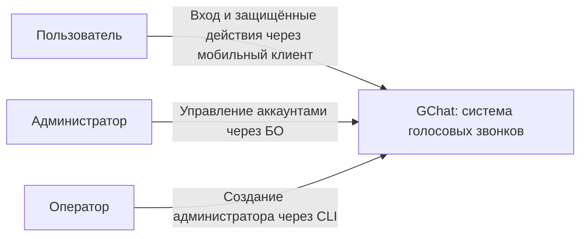
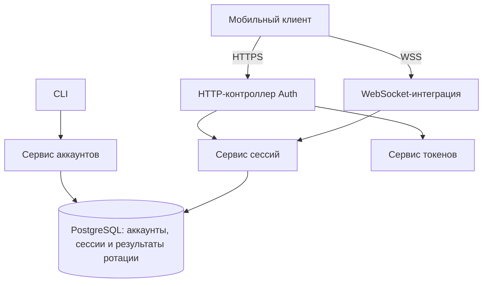

# Auth

## Назначение и границы

GChat использует собственные аккаунты, независимые от Mattermost. Auth является модулем общего NestJS backend, а не отдельным микросервисом. Он устанавливает личность пользователя и управляет сессиями для HTTP API и WebSocket.

В объём входят вход по логину и паролю, обновление токенов, выход, проверка доступа и операции управления аккаунтами. Роли, веб-бэк-офис и административный HTTP API для веба и CLI только для создания администраторов заданы новыми [бизнес-требованиями](../../product/backoffice.md); их технический проект описан в [Backoffice](backoffice.md). Роли и административный HTTP API реализованы; веб-интерфейс в объём backend не входит. Самостоятельная регистрация и операции редактирования логина или имени не предусмотрены. Разрешения на контакты и звонки проверяют соответствующие бизнес-модули.

Хранение токенов на клиенте описывается в документации клиента. Общий формат ошибок описывается в [документации ErrorModule](errors.md); здесь определены HTTP-статусы и смысл кодов.

### Текущий этап реализации

HTTP Auth и WS-интеграция используют PostgreSQL для сессий, встроенных результатов ротации, WS-билетов и счётчиков их выдачи по [D006](../../architecture/decisions/D006-auth-sessions-postgresql.md). AuthAccounts реализует внутренние административные операции; HTTP-контроллер принадлежит Backoffice. CLI создаёт только новых администраторов. Совместимость со старыми Redis-сессиями и перенос действующих данных не предусмотрены: продукт ещё не вышел в production.

Access token действует 120 секунд; сессия остаётся бессрочной до отзыва. HTTP Guard проверяет актуальные аккаунт и сессию при каждом запросе, поэтому отключённый аккаунт теряет доступ на следующем запросе, без ожидания истечения JWT. Сокращение TTL сессии до двух минут не согласовано.

AuthModule импортирует DatabaseModule и RedlockModule.forFeature(), экспортирует AuthService, AuthGuard, AuthWsTickets и AuthAccounts. Redlock используется только cron-очисткой. Guard подключается явно к защищённым контроллерам и сохраняет проверенную личность с актуальной ролью в `request.user`. WS-интеграцией владеет Signaling.

## Публичный API

### Permissions приложения — запланировано

Общий HTTP-endpoint permissions приложения относится к модулю авторизации. Он проектируется без dialog_id и не вычисляет контекстные права конкретного диалога. В предполагаемом общем ответе предусмотрен объект dialogs, однако его глобальные поля и полный контракт ещё требуется определить; can_read/can_send для конкретного собеседника нельзя подменять общим разрешением аккаунта. Endpoint пока не реализован, расширение не готово к написанию кода.

Отдельный ресурсный `GET /dialogs/:dialog_id/permissions` принадлежит DialogsModule. Его форма ответа и правила — в [профильном контракте](dialogs/README.md#permissions). Auth предоставляет проверенную личность/сессию; контроллер ресурсных permissions находится в Dialogs, поэтому обратный импорт DialogsModule в AuthModule ради этого маршрута не требуется. Текущие сценарии Auth реализованы; будущие общие permissions пока отсутствуют, общий implementation_status остаётся partial.

`lockActiveAccountRoles(tx, userIds)` возвращает `{id, role}` активных аккаунтов, блокируя строки `FOR SHARE` в порядке UUID до завершения переданной транзакции. DirectCalls использует метод для проверки текущей роли инициатора вместе с активностью участников; `lockActiveAccounts` сохраняет выдачу только идентификаторов.

### Транзакционная проверка сессии для Dialogs — реализовано

Согласованы два новых внутренних метода AuthService; оба используют переданный `DatabaseTransaction`, без независимой транзакции. Блокировки удерживаются до её завершения:

- `lockAccountStates(tx, userIds)` возвращает `{id, role, disabledAt}` найденных аккаунтов, включая отключённых, блокируя строки `FOR SHARE` по возрастанию UUID. Он не заменяет `lockActiveAccountRoles`, который сохраняет фильтрацию активных аккаунтов. Потребитель проверяет активность actor и применяет матрицу доступа к состоянию peer.
- `lockSession(tx, userId, sessionId)` блокирует сессию `FOR SHARE` и проверяет владельца. Отсутствующая сессия или несовпадение владельца дают `SESSION_INVALID`. Метод не создаёт сессию автоматически; её наличие не заменяет проверку активности аккаунта.

Расширение реализовано. Граница допуска при гонке с logout и общий порядок блокировок определены в [контракте Dialogs](dialogs/README.md#порядок-блокировок-и-граница-допуска). Эти методы не заменяют проверку подписи и срока access token в HTTP guard.

### HTTP API

#### POST /auth/login

```json
{ "login": "andrey", "password": "..." }
```

Нормализует логин, проверяет пароль и состояние аккаунта, сохраняет новую сессию. Только после успешного сохранения возвращает 200:

```json
{ "access_token": "...", "refresh_token": "...", "token_type": "Bearer" }
```

Ответы с токенами запрещено кешировать. Пароли и токены не записываются в логи.

| Статус | Код                   | Условие                                                                      |
| ------ | --------------------- | ---------------------------------------------------------------------------- |
| 400    | `VALIDATION_ERROR`    | Неверный формат запроса                                                      |
| 401    | `INVALID_CREDENTIALS` | Неизвестный логин, неверный пароль или отключённый аккаунт; одинаковый ответ |
| 429    | `RATE_LIMITED`        | Превышен лимит                                                               |
| 503    | `SERVICE_UNAVAILABLE` | Недоступна зависимость                                                       |

#### POST /auth/refresh

Access token не требуется.

```json
{ "refresh_token": "...", "request_id": "UUID" }
```

Новая операция использует новый `request_id`. Повтор после потери ответа использует прежний ID и прежний refresh token. Успех: 200 с той же структурой, что при входе.

| Ситуация                                                           | Результат                                                 |
| ------------------------------------------------------------------ | --------------------------------------------------------- |
| Текущий токен и новая операция                                     | Ротация, новая пара                                       |
| Тот же запрос и использованный токен в пределах 30 секунд          | Исходная пара, без новой ротации                          |
| Истёк TTL, неизвестный или старый токен без подходящего результата | 401 `SESSION_INVALID`, без отзыва сессии                  |
| Аккаунт отключён или сессия отсутствует                            | 401 `SESSION_INVALID`, кешированный ответ не возвращается |

Повтор не продлевает срок access token. Следующая успешная ротация заменяет предыдущий временный результат. Обновления клиент выполняет последовательно, одной общей операцией.

Дополнительные ошибки: 400 `VALIDATION_ERROR`, 429 `RATE_LIMITED`, 503 `SERVICE_UNAVAILABLE`. После сетевого сбоя, 429 или 503 повторяется тот же запрос с прежним ID. Для 429 учитывается `Retry-After`.

#### POST /auth/logout

```json
{ "refresh_token": "..." }
```

Работает без действующего access token. При распознанном токене отзывает текущую сессию, остальные сохраняются. Возвращает 204 без тела также для неизвестного токена и уже удалённой сессии. Неверный формат — 400, недоступная зависимость — 503; при 503 отзыв не считается подтверждённым.

Сервер распознаёт текущий токен и предыдущий только пока существует временная запись ротации. Произвольный более старый токен не позволяет отозвать сессию: он получает идемпотентный 204 без изменения данных.

Метаданные пользователя возвращаются в JWT; отдельный endpoint профиля не предусмотрен. Клиент получает логин и отображаемое имя из claims `login` и `display_name`. Актуальные значения включаются в JWT при входе и обновлении токенов.

### Защищённые HTTP-запросы

Клиент передаёт `Authorization: Bearer <access_token>`. Guard проверяет подпись, разрешённый алгоритм, издателя, получателя, срок, наличие сессии, принадлежность сессии пользователю и состояние аккаунта. Проверки выполняются до бизнес-операции.

| Статус | Код                    | Ожидаемое действие клиента                  |
| ------ | ---------------------- | ------------------------------------------- |
| 401    | `ACCESS_TOKEN_EXPIRED` | Обновить токены и повторить запрос один раз |
| 401    | `ACCESS_TOKEN_INVALID` | Перейти к входу                             |
| 401    | `SESSION_INVALID`      | Удалить токены и перейти к входу            |
| 403    | `FORBIDDEN`            | Отказ бизнес-модуля; сессия сохраняется     |
| 503    | `SERVICE_UNAVAILABLE`  | Повторить позже; токены сохраняются         |

Проверка только подписи JWT недостаточна: необходимы актуальные аккаунт и принадлежащая ему сессия в PostgreSQL. Auth добавляет в проверенную личность актуальную роль из этой же записи аккаунта; AdminGuard разрешает административные операции по ней, а не по claim JWT. Дополнительный запрос к БД только ради роли не требуется. Роль в JWT предназначена для отображения раздела клиентом; проверка реализована в AdminGuard.

### WebSocket

При WSS-подключении access token передаётся в заголовке Authorization, не в URL. Выполняются проверки как для HTTP. Создаётся сессия соединения в памяти backend, привязанная к пользователю и сессии входа.

После установления соединения истечение access token не завершает WebSocket. Переавторизация внутри соединения и отдельный refresh token для WebSocket не нужны.

Перед каждой командой проверяются актуальный аккаунт, сессия и права на действие. Каждые 5 секунд проверяется действительность аккаунта и сессии; при отзыве или отключении соединение закрывается. При недоступности PostgreSQL периодическая проверка также закрывает соединение. К интервалу добавляется время таймаута зависимостей.

Pub/Sub и специальный метод массового закрытия соединений не вводятся. После обрыва клиент заново подключается с действующим access token, предварительно обновляя его при необходимости. Новое соединение получает новую сессию WebSocket; состояние звонка восстанавливается отдельно.

Закрытие сигнализации само по себе не гарантирует остановку WebRTC-аудио. Поведение активного звонка при отзыве доступа определено в [DirectCalls](direct-calls/README.md#проверка-доступа-во-время-звонка).

### Браузерный WS-билет — реализовано

HTTP API и браузерный handshake реализованы для [веб-клиента GChat](../../web/README.md). Билеты и ограничение выдачи хранятся в PostgreSQL. Мотивация — в [D005](../../architecture/decisions/D005-web-client.md). Описанный выше handshake с Authorization сохраняется для нативных клиентов.

#### POST /auth/ws-ticket

Запрос содержит `Authorization: Bearer <access_token>`, точный Origin страницы и пустой JSON-объект `{}`. Используется существующая HTTP-проверка JWT, аккаунта и текущей сессии. Пользователь, session_id и Origin не принимаются из JSON. Endpoint доступен только для Origin, разрешённого браузерным контуром Signaling; отсутствие или запрещённый Origin даёт `403 FORBIDDEN`.

Успех — HTTP 200:

```json
{
  "ticket": "<43 символа base64url без padding>",
  "expires_at": "2026-11-03T12:30:30.000Z"
}
```

Билет — 32 криптографически случайных байта, закодированных base64url. Это секрет для одной попытки handshake, не JWT, не refresh token и не новая сессия. Срок — 30 секунд от выдачи по серверному времени, без продления. `expires_at` сериализуется в UTC с миллисекундами. Ответы не кешируются (`Cache-Control: no-store`); билеты не попадают в логи и диагностику. Их передача при upgrade и проверка Origin определены только в [Signaling](signaling.md#браузерный-handshake--реализовано).

Билет хранится в PostgreSQL по уникальному SHA-256 хешу секрета. Запись содержит ссылку на сессию, привязку к Origin, время выдачи и истечения; пользователь определяется через сессию; исходный секрет не сохраняется. Срок определяется временем БД. Случайная коллизия хеша требует нового секрета, а не перезаписи существующего билета. Успех выдачи возвращается только после подтверждённого COMMIT. Схема определена в разделе хранения PostgreSQL и реализована в auth.schema.ts.

Лимит выдачи — 10 билетов за 60 секунд на текущую Auth-сессию, окно начинается с первой выдачи. Состояние окна и счётчик хранятся в строке сессии PostgreSQL. Проверка актуальных аккаунта и сессии, проверка/увеличение счётчика и сохранение билета выполняются одной транзакцией, сериализованной по сессии; параллельные выдачи не обходят лимит. При отказе по лимиту возвращаются `429 RATE_LIMITED` и `Retry-After`; при отказе БД — `503 SERVICE_UNAVAILABLE`, без обхода ограничения. Запрос не продлевает сессию и не отзывает другие выданные билеты. Ограничение должно работать между процессами backend, а не только в памяти одного процесса.

Остальные HTTP-ошибки следуют действующему Auth/Error: `400 VALIDATION_ERROR`, `401 ACCESS_TOKEN_EXPIRED`, `401 ACCESS_TOKEN_INVALID`, `401 SESSION_INVALID`, `503 SERVICE_UNAVAILABLE`. Клиент может обновить истёкший access token по действующему refresh-контракту. При потерянном ответе на выдачу запрашивается новый билет; неизвестный клиенту билет самостоятельно истечёт, новый звонок от выдачи не создаётся.

#### Погашение до upgrade

Auth экспортирует `AuthWsTickets` с методами `issue(identity, origin)` и `redeem(ticket, origin)`. Это отдельные методы, не изменения семантики текущего `authenticate(token)`. Разрешение Origin проверяет Signaling; Auth хранит привязку и сверяет переданное значение.

После структурных проверок handshake билет атомарно извлекается и удаляется из PostgreSQL через `DELETE ... RETURNING` с подтверждённым COMMIT. Только одна конкурирующая попытка может получить запись. Затем по времени БД проверяются срок, совпадение Origin, существование/активность аккаунта и принадлежность действующей сессии пользователю. Погашение не откатывается из-за последующего отказа проверки или upgrade. Если подтверждение COMMIT потеряно, возвращается отказ зависимости; клиент запрашивает новый билет, прежний не считается пригодным для повтора. Из записи восстанавливается личность соединения; выбранное устройство определяется позже через существующий `device.register`.

Неизвестный, просроченный или уже погашенный билет даёт одинаковый безопасный `401 ACCESS_TOKEN_INVALID`; несовпадение Origin — `403 FORBIDDEN`; существующая запись билета с уже недействительной сессией или отключённым аккаунтом — `401 SESSION_INVALID`. При удалении сессии её билеты удаляются каскадно, поэтому последующее предъявление такого билета даёт общий `401 ACCESS_TOKEN_INVALID`, как неизвестный билет. Недоступность зависимости даёт `503 SERVICE_UNAVAILABLE`, а не признание сессии отозванной. Если билет уже погашен, но последующая проверка или upgrade не завершились, он не восстанавливается. Клиент получает новый билет для новой попытки.

Билет подтверждает ограниченную по времени авторизацию выдачи. Истечение JWT после выдачи не отменяет оставшийся срок билета: handshake всё равно проверяет актуальные аккаунт и сессию, а срок самого билета не превышает 30 секунд. Отзыв сессии делает непригодными и ещё не использованные билеты, даже если срок билета пока не истёк. После успешного upgrade применяются действующие проверки WS-сессии; срок билета больше не управляет соединением.

HTTP/интеграционные проверки PostgreSQL-билетов находятся в `test/auth.integration.spec.ts` и `test/backoffice.integration.spec.ts`, проверка Origin — также в `browser-origin.spec.ts`. Они не заменяют проверку конфигурации рабочего proxy.

### Внутренний API для звонков — реализовано

Существующий `authenticate(token)` проверяет JWT и текущий доступ для HTTP. Для [Signaling](signaling.md), [Devices](devices.md) и [DirectCalls](direct-calls/README.md) реализованы отдельные методы:

- `checkSession(userId, sessionId)` возвращает `{accountActive, sessionActive}` по актуальным данным PostgreSQL в одном снимке, проверяя принадлежность сессии пользователю. Ошибка зависимости выбрасывается через ErrorService, а не превращается в `false`. Метод не проверяет срок ранее использованного JWT и не продлевает сессию.
- `lockActiveAccounts(tx, userIds)` блокирует строки аккаунтов `FOR SHARE` в переданной транзакции PostgreSQL в порядке UUID и возвращает `string[]` идентификаторов существующих активных аккаунтов. Отсутствующий/отключённый адресат отображается DirectCalls безопасным `CALL_NOT_ALLOWED`; отсутствие доступа самого отправителя — базовым отказом Auth. Проверка сессии выполняется отдельно через `checkSession` в PostgreSQL. Её включение в общую транзакцию DirectCalls необходимо согласовать с контрактом владельца; сам метод по-прежнему проверяет только аккаунты.

AuthModule экспортирует AuthService для этих потребителей; не импортирует модули звонков. Прямое чтение auth-ключей и SQL аккаунтов потребителями не допускается. Периодические проверки звонков, задержки обнаружения, порядок конкуренции и причины завершения принадлежат DirectCalls; Pub/Sub и новая очередь отзывов не вводятся. HTTP DTO при добавлении внутренних методов не меняются.

### CLI

CLI предназначен только для создания нового аккаунта администратора, включая первого. Он запускается оператором в окружении backend, использует внутренние сервисы Auth и не требует административной HTTP-сессии. Создание обычных пользователей, назначение/снятие роли существующего аккаунта, смена пароля, отключение и включение в CLI отсутствуют; управление существующими аккаунтами выполняется через бэк-офис.

Обязательны явно заданные имя и логин, а также пароль, вводимый скрыто в интерактивном режиме. Роль всегда `admin`, выбрать её параметром нельзя. Группа необязательна: без неё создаётся администратор без членства; доступ к собеседникам определяется [Groups](groups.md#выдача-клиенту--реализовано), исходящие звонки — [DirectCalls](direct-calls/README.md#доступ-администратора--согласовано). При заданной группе применяются правила Groups. Пароль не передаётся аргументом командной строки, не выводится обратно и не попадает в логи. Имя, логин и пароль валидируются по общим правилам Auth. Команда: `pnpm --filter @gchat/backend admin:create --display-name "Имя" --login admin` после сборки; необязательный параметр `--group "Название"`. Требуется интерактивный терминал. Запускается отдельный Nest application context без HTTP, Redis и cron; соединения закрываются после результата.

Ниже перечислены операции бэк-офиса, а не команды CLI. Устойчивый журнал и автоматическое восстановление не требуются; частичное выполнение и неизвестный результат обрабатываются по описанным далее правилам.

| Операция        | Результат                                                                                                                     |
| --------------- | ----------------------------------------------------------------------------------------------------------------------------- |
| Создать аккаунт | Сохранить валидированные данные и хеш пароля; назначить группу по запросу согласно контракту Groups                           |
| Сменить пароль  | Сменить хеш, отозвать все сессии                                                                                              |
| Отключить       | Установить disabled_at, отозвать все сессии                                                                                   |
| Включить        | Завершить отзыв всех старых сессий и результатов ротации, затем очистить disabled_at; при ошибке оставить аккаунт отключённым |

При создании аккаунта через бэк-офис backend по умолчанию генерирует логин вида `user-7k3m9x2p`; коллизия приводит к повторной генерации. Имя задаёт администратор, допускается явный логин. Пароль генерирует браузер криптографически стойким генератором либо задаёт администратор вручную. При создании и смене пароля административный API требует готовый пароль, проверяет его по правилам Auth и сохраняет только хеш; серверная генерация пароля и возврат пароля в HTTP-ответе не предусмотрены. При создании администратора через CLI пароль вводится скрыто; передача пароля аргументом командной строки запрещена.

После подтверждённого успешного создания или смены пароля браузер однократно показывает отправленный пароль из памяти для копирования и очищает его при закрытии окна результата. Повторного получения пароля с backend нет. Пароли не попадают в логи. CLI возвращает понятный результат и код завершения.

При создании обычного пользователя через БО группа обязательна; при создании администратора через CLI — необязательна. Если группа задана, существующая используется, отсутствующая создаётся, аккаунт включается в неё. Правила этой операции принадлежат [Groups](groups.md#создание-через-cli--реализовано).

#### Последовательности административных операций

Каждая операция выполняется одной транзакцией PostgreSQL после блокировки аккаунта и повторной проверки прав исполнителя:

- Отключение: установить `disabled_at`, удалить все сессии аккаунта вместе с результатами ротации, зафиксировать транзакцию. При уже отключённой цели исходный `disabled_at` сохраняется, оставшиеся сессии и результаты удаляются; операция возвращает успех.
- Включение отключённого аккаунта: удалить оставшиеся сессии и результаты ротации, очистить `disabled_at`, зафиксировать транзакцию. Повторное включение уже активного аккаунта возвращает успех с текущим состоянием и не отзывает новые сессии. Оба повтора требуют обычной проверки действующего доступа исполнителя; запрет самоотключения сохраняется.
- Смена пароля: обновить хеш и удалить все сессии с результатами ротации, сохранив `disabled_at` без изменения. Временное отключение и последующее включение не нужны. Хеширование выполняется до транзакции через AuthCrypto.

При подтверждённом откате изменений нет; ошибка включения оставляет исходно отключённый аккаунт отключённым. Потеря подтверждения COMMIT означает неизвестный результат всей транзакции, а не частичный отзыв между хранилищами. Успех возвращается только после подтверждённого COMMIT. Устойчивый журнал, автоматическое восстановление и поле `auth_version` не вводятся.

#### Последовательность обновления

```mermaid
sequenceDiagram
  participant C as Клиент
  participant A as Auth
  participant P as PostgreSQL
  C->>A: refresh(token, request_id)
  A->>P: BEGIN; блокировать аккаунт, затем сессию
  A->>P: Проверить аккаунт, токен и срок результата
  alt Допустимый повтор за 30 секунд
    P-->>A: Сохранённая зашифрованная пара
  else Текущий токен и новая операция
    A->>A: Выпустить пару
    A->>P: Обновить хеш и временный результат
  end
  A->>P: COMMIT
  A-->>C: Пара токенов после подтверждения COMMIT
```

## Правила и инварианты

### Аккаунт

Таблица `gchat_users`:

| Поле            | Значение                                           |
| --------------- | -------------------------------------------------- |
| `id`            | Постоянный UUID пользователя                       |
| `login`         | Уникальный нормализованный логин                   |
| `display_name`  | Отображаемое имя                                   |
| `password_hash` | Хеш Argon2id                                       |
| `disabled_at`   | Время отключения; NULL означает включённый аккаунт |
| `created_at`    | Время создания                                     |
| `updated_at`    | Время последнего изменения                         |

Логин: 3–32 символа; латинские буквы, цифры, точка, дефис и подчёркивание. Пробелы по краям удаляются, буквы приводятся к нижнему регистру. Уникальность обеспечивает БД.

Пароль: 15–128 символов, допускаются пробелы и Unicode. Значение не обрезается и не нормализуется. Обязательного состава символов нет.

Имя: 1–80 символов после удаления пробелов по краям; уникальность не требуется. Согласованное расширение схемы — обязательное текстовое `role` с CHECK `user | admin` и default `user`. БО создаёт только `user`, CLI — только `admin`; клиент роль не выбирает, смена роли существующего аккаунта не предусмотрена. Поле роли и CHECK реализованы в схеме аккаунта. HTTP-контракт административных операций принадлежит [Backoffice](backoffice.md).

Отключение запрещает вход и использование существующих сессий. Повторное включение не восстанавливает старые сессии. Удаление аккаунтов и освобождение логинов в первой версии не предусмотрены.

### Пароли и pepper

Хеширование — Argon2id с памятью 65536 KiB (64 MiB), тремя проходами, параллелизмом 4, случайной солью 16 байт и результатом 32 байта. Параметры сохраняются вместе с хешем. Одновременно выполняются не более двух проверок пароля на процесс, при занятости возвращается 503 без неограниченной очереди; стоимость проверяется на целевом сервере. Для неизвестного логина выполняется проверка фиктивного хеша с теми же параметрами, ответ остаётся общим `INVALID_CREDENTIALS`.

Каждый хеш создаётся единым методом `AuthCrypto.hashPassword` (общая функция `auth.password.ts` используется также подготовкой E2E). Обязательный `AUTH_PASSWORD_PEPPER` передаётся как секретный вход Argon2 (`secret`) при хешировании и проверке, включая фиктивную проверку неизвестного аккаунта. Это независимые случайные 32 байта, закодированные каноническим base64, без значения по умолчанию. Секрет не включается в строку хеша и хранится отдельно от БД в защищённой конфигурации; он отличается между окружениями и не используется для JWT или шифрования ротации. Соль по-прежнему случайна для каждого пароля. Лимит двух одновременных операций на процесс общий для хеширования и проверки через AuthCrypto.

Совместимость со старыми хешами без pepper не поддерживается; автоматического перехода при входе нет. Их проверка возвращает обычный отказ входа. Схема БД не меняется. При внедрении или смене pepper требуется заново установить пароли; потеря секрета также требует сброса. Новый секрет необходимо согласованно развернуть на всех экземплярах backend. Смена pepper сама по себе не отзывает существующие сессии: при сбросе паролей или компрометации оператор должен отдельно отозвать сессии и результаты ротации по правилам Auth. Поддержка нескольких pepper и их плавная ротация не реализованы. CLI использует этот же метод для создания администратора; команды сброса в CLI нет.

### Сессии и токены

Каждый успешный вход создаёт независимую сессию. Несколько устройств разрешены. Сессия не имеет предельного срока или TTL и действует до отзыва.

Claim `role` включается при входе и обновлении токенов. Владелец может прочитать свою роль в JWT; административные DTO раскрывают роли администратору, обычные списки собеседников их не содержат. Guard проверяет актуальную роль аккаунта, а не право из claim.

Access token — JWT со сроком действия `AUTH_ACCESS_TOKEN_TTL_SECONDS` (по умолчанию **120 секунд**). Состав:

| Claim          | Назначение                            |
| -------------- | ------------------------------------- |
| `sub`          | ID пользователя                       |
| `sid`          | ID сессии                             |
| `login`        | Логин                                 |
| `display_name` | Имя                                   |
| `role`         | `user` или `admin`                    |
| `iat`, `exp`   | Время выпуска и истечения             |
| `iss`, `aud`   | Издатель GChat и получатель GChat API |

При проверке `jose` учитывает подписанный `exp` и максимальный возраст от `iat`, заданный текущим `AUTH_ACCESS_TOKEN_TTL_SECONDS`. Срок уже выданного JWT не сравнивается на точное равенство с новой настройкой: увеличение TTL не продлевает старый `exp`, уменьшение может раньше вернуть `ACCESS_TOKEN_EXPIRED` по возрасту и потребовать refresh. Положительный интервал `exp > iat`, подпись, обязательные claims, issuer/audience и актуальная сессия проверяются как прежде. Настройка применяется после перезапуска backend.

Это время жизни access token, а не серверной сессии или refresh token. Записи сессий по-прежнему не имеют TTL и действуют до отзыва; изменение JWT TTL не разлогинивает пользователей само по себе. Уже установленный WS не закрывается из-за истечения access JWT.

Подпись — Ed25519, JWT-заголовок `alg=EdDSA`; сервер допускает только этот алгоритм и ключи Ed25519. Выпуск и проверка выполняются готовой JWT-библиотекой. Значения `iss=gchat` и `aud=gchat-api` фиксированы. Активный приватный ключ подписывает новые токены; набор доверенных публичных ключей выбирается по `kid`. Старый публичный ключ сохраняется на время действия ранее выпущенных токенов. Ключи различаются между окружениями. Метаданные перечитываются из БД при выпуске нового токена. JWT не содержит секретов. Отдельные `user`, `expires_in` и `expires_at` в HTTP-ответах отсутствуют.

Refresh token заменяется при каждом успешном обновлении. В постоянной записи сессии хранится только его хеш. Формат refresh token: `v1.<session_id>.<secret>`, где `session_id` — UUID, а `secret` — 32 криптографически случайных байта в base64url без padding. Сессия ищется по UUID; подлинность подтверждается сравнением SHA-256 всего токена с сохранённым хешем. Сам UUID не подтверждает доступ. ID пользователя берётся из серверной записи сессии. История ротаций не хранится.

### Хранение сессий в PostgreSQL — реализовано

Согласованы две таблицы: `gchat_auth_sessions` и `gchat_auth_ws_tickets`. Они принадлежат Auth. Последний результат refresh и счётчик выдачи WS-билетов находятся в строке сессии; отдельных таблиц результатов, истории ротаций или счётчиков нет. Схема находится в auth.schema.ts, миграция — `0004_backoffice.sql`.

#### gchat_auth_sessions

| Поле                          | Тип и ограничение                                         | Назначение                                  |
| ----------------------------- | --------------------------------------------------------- | ------------------------------------------- |
| `id`                          | UUID, PK                                                  | ID сессии из токенов, генерируется backend  |
| `user_id`                     | UUID, NOT NULL, FK на `gchat_users.id`, ON DELETE CASCADE | Владелец сессии                             |
| `refresh_token_hash`          | text, NOT NULL                                            | SHA-256 текущего refresh token              |
| `created_at`, `updated_at`    | timestamptz, NOT NULL                                     | Время создания и изменения                  |
| `rotation_request_id`         | UUID, nullable                                            | ID последнего успешного refresh             |
| `rotation_token_hash`         | text, nullable                                            | Хеш токена, предъявленного при этом refresh |
| `rotation_encrypted`          | text, nullable                                            | Зашифрованная пара для повтора              |
| `rotation_expires_at`         | timestamptz, nullable                                     | Конец окна допустимого повтора              |
| `ws_ticket_window_started_at` | timestamptz, nullable                                     | Начало текущего окна выдачи билетов         |
| `ws_ticket_count`             | integer, NOT NULL, default 0                              | Число выданных билетов в окне               |

CHECK требует, чтобы четыре поля `rotation_*` были либо все NULL, либо все заполнены. Успешная ротация атомарно обновляет текущий хеш и заменяет все поля результата. Для счётчика CHECK запрещает отрицательные значения и требует согласованную пару: отсутствующее окно и нулевой счётчик либо заданное окно и положительный счётчик. Новое окно задаётся при первой выдаче; истёкшее окно сбрасывается при следующей выдаче либо фоновой очисткой.

Индексы: по `user_id` для отзыва всех сессий; частичный по `rotation_expires_at` для заполненных результатов; частичный по `ws_ticket_window_started_at` для заполненных окон. PK используется для проверки и блокировки одной сессии. Физическое удаление сессии удаляет встроенный результат и счётчик вместе с ней.

#### gchat_auth_ws_tickets

| Поле          | Тип и ограничение                                                 | Назначение                                    |
| ------------- | ----------------------------------------------------------------- | --------------------------------------------- |
| `ticket_hash` | text, PK                                                          | SHA-256 секрета билета; секрет не сохраняется |
| `session_id`  | UUID, NOT NULL, FK на `gchat_auth_sessions.id`, ON DELETE CASCADE | Сессия, выдавшая билет                        |
| `origin`      | text, NOT NULL                                                    | Разрешённый Origin при выдаче                 |
| `issued_at`   | timestamptz, NOT NULL                                             | Время выдачи по БД                            |
| `expires_at`  | timestamptz, NOT NULL, CHECK `expires_at > issued_at`             | Конец срока действия                          |

Индексы: по `session_id` для каскадного удаления; по `expires_at` для фоновой очистки. Аккаунт определяется через сессию и не дублируется в таблице билетов. При удалении сессии её билеты удаляются автоматически в той же транзакции, включая logout, отключение и смену пароля.

Сессии бессрочны до отзыва; результат повтора доступен 30 секунд. Срок проверяется явно по времени БД после ожидания блокировок; наличие просроченных полей результата не даёт права использовать их. Права и сроки не зависят от физической очистки. Схема и операции сессий реализованы в Auth; Redis не участвует в этих транзакциях.

Временный результат ротации шифруется AES-256-GCM с отдельным ключом и новым случайным nonce для каждой записи. ID сессии и запроса включаются в аутентифицируемые дополнительные данные (AAD). Контейнер — стандартный JWE Flattened JSON Serialization из `jose`: `alg=dir`, `enc=A256GCM`, `kid` в защищённом заголовке; `iv`, `ciphertext`, `tag` и `aad` формируются библиотекой. При чтении разрешены только эти алгоритмы, после проверки подлинности AAD сравнивается с ожидаемыми ID сессии и запроса. Новые записи используют активный ключ; старые ключи сохраняются до истечения результатов, зашифрованных ими.

Удалённая сессия недействительна, отдельная запись об отзыве не хранится. Восстановление старой резервной копии PostgreSQL может вернуть отозванные сессии; при неизвестной актуальности данных требуется их инвалидация до открытия доступа. Исполняемый production-runbook сейчас не проектируется.

### Фоновая очистка — реализовано

Для очистки используется официальный пакет `@nestjs/schedule`. `ScheduleModule.forRoot()` регистрируется один раз в AppModule, Auth регистрирует собственный сервис очистки. Задача реализована в AuthCleanup; точная версия пакета задана в package.json и lock-файле. Существующие фоновые задачи других модулей этим решением не переделываются.

Метод очистки запускается через `@Cron(CronExpression.EVERY_MINUTE, { waitForCompletion: true })`. Наложение запусков в одном процессе запрещено. Для координации между процессами каждый запуск использует `RedlockService.withLock` с общим логическим ресурсом `auth:cleanup`. Сервис сам добавляет `lock:` и префикс окружения; все backend-процессы используют одинаковый ресурс. Без подтверждённого захвата очистка не запускается. Задача:

- удаляет истёкшие WS-билеты;
- обнуляет весь набор полей истёкшего результата refresh в строке сессии, сохраняя саму сессию и текущий хеш refresh token;
- обнуляет `ws_ticket_window_started_at` и сбрасывает `ws_ticket_count` в 0 для истёкших окон выдачи, сохраняя сессию.

Каждый запуск обрабатывает по одной пачке до 100 строк для каждого из трёх видов очистки в коротких транзакциях с бюджетами Database. Для работы нескольких backend-процессов выбор пачек использует `FOR UPDATE SKIP LOCKED`: строки, занятые другим процессом или текущим refresh, пропускаются. Условие истечения проверяется под блокировкой по времени БД; очистка не может стереть новый результат ротации или действующее окно выдачи. Redlock координирует cron-задачу между процессами, а SQL-блокировки и проверка срока сохраняют корректность данных, в том числе при потере аренды: аренда Redis не обеспечивает fencing для PostgreSQL. `SKIP LOCKED` остаётся дополнительной защитой и не заменяет Redlock.

Callback проверяет `context.assertHeld()` после ожиданий и перед следующей пачкой и учитывает `context.signal`. При потере аренды новые шаги прекращаются; уже отправленный SQL может завершиться, поэтому SQL-очистка должна быть безопасна при повторе. Продление и освобождение выполняются существующим RedlockService по [контракту RedLock](redlock.md). Неизвестное освобождение не вызывает автоматического повтора callback; следующий запуск по расписанию заново получает аренду.

Занятый ресурс или недоступность Redis не разрешают запуск без блокировки. Очистка откладывается до следующего расписания, срок действия данных при этом не продлевается. Ошибка логируется через LoggerService безопасным сообщением без токенов, билетов или зашифрованных пар. Запуск завершается, следующая попытка происходит по очередному расписанию. Пропущенные во время остановки приложения запуски не воспроизводятся: последующая очистка выбирает накопившиеся просроченные данные. Незавершённая транзакция откатывается; задаче не нужен устойчивый журнал выполнения. При остановке приложения новые запуски прекращаются, выполняющаяся пачка завершается в ограниченный бюджет до закрытия пула БД.

Сроки билетов, результатов refresh и окон проверяются при каждом использовании независимо от очистки. Остановка или задержка задачи не продлевает доступ. Сами бессрочные сессии фоновая очистка не удаляет.

### Redis

Сессии, результаты ротации, WS-билеты и ограничение их выдачи хранятся в PostgreSQL. Auth использует Redis только через Redlock для фоновой очистки. Отказ Redis откладывает очистку, но не продлевает сроки данных и не мешает операциям сессий/билетов. Применения Redis в DirectCalls и RedLock этим решением не меняются.

### Конкурентные операции

Login, refresh, logout и массовый отзыв используют транзакции PostgreSQL. Порядок блокировок — сначала аккаунт, затем сессии. Вход и refresh удерживают разделяемую блокировку строки аккаунта до окончания записи сессии/ротации. Административное изменение доступа удерживает исключительную блокировку той же строки до COMMIT. Для refresh/logout изменение одной сессии дополнительно сериализуется её блокировкой `FOR UPDATE`.

Проверка пароля при login выполняется до транзакции, затем под блокировкой повторно проверяются активность и неизменность проверенного хеша. При refresh после получения блокировок перечитываются активность аккаунта, текущий хеш токена и действующий результат повтора. Повтор той же операции в пределах 30 секунд получает исходную пару; другая операция со старым токеном получает 401 без отзыва сессии. Ротация атомарно сохраняет новый хеш и результат.

Logout под блокировкой проверяет принадлежность сессии и хеш предъявленного токена по текущему состоянию и ещё действующему результату. Отсутствующая сессия или нераспознанный токен дают идемпотентный успех. Конкурентная ротация не воскрешает удалённую сессию.

Таким образом, сессия либо создаётся/обновляется до отзыва и удаляется им, либо ожидает административную транзакцию и проверяет уже изменённый аккаунт. Начатый до смены пароля login со старым хешем не создаёт сессию после неё. Завершившийся до отключения вход может вернуть уже отозванные токены — они не дают доступ.

HTTP guard читает аккаунт и сессию в согласованном снимке PostgreSQL. WS-проверки и погашение билетов также используют новое хранилище сессий. Уже допущенный запрос может завершиться; особое правило встречных отключений требует повторной проверки исполнителя внутри административной транзакции, см. [Backoffice](backoffice.md#создание-администраторов--только-cli).

Redlock не используется для транзакций сессий; session-level advisory locks между хранилищами и `auth_version` для сессий не нужны. Redlock применяется отдельно к фоновой очистке. Блокировка PostgreSQL для встречных отключений администраторов остаётся отдельным правилом Backoffice. Неизвестный результат COMMIT не вызывает слепой повтор записи: refresh повторяется по своему `request_id`, административные операции — после проверки состояния и явного решения администратора.

### Лимиты

| Операция                        | Ограничение                    |
| ------------------------------- | ------------------------------ |
| Вход по нормализованному логину | 5 неудачных попыток за 5 минут |
| Обновление по сессии            | 10 новых операций за минуту    |

Ограничений по IP нет. Лимит логина одинаков для известных и неизвестных аккаунтов. Повтор того же request_id не расходует лимит новых обновлений. Неизвестный refresh token возвращает 401. Превышение — 429 и Retry-After в секундах, без отключения аккаунта. Значения настраиваются. На первом этапе счётчики в памяти единственного backend, сбрасываются при перезапуске; перенос их в Redis отдельно не согласован.

Окно скользящее: каждая учтённая попытка исключается независимо после своего срока. `RateLimiterMemory` из `rate-limiter-flexible` использует фиксированное окно и не является совместимой заменой текущего поведения. Поэтому текущий AuthLimits сохраняется; замена с изменением алгоритма требует отдельного согласования.

## Зависимости и регистрация

### C1: контекст GChat

Диаграмма отражает контекст доступа; внешние системы доставки звонков здесь опущены.



### Компоненты авторизации



| Компонент            | Ответственность                                                          |
| -------------------- | ------------------------------------------------------------------------ |
| HTTP-контроллер      | Вход, обновление токенов и выход                                         |
| Сервис аккаунтов     | Создание администратора через CLI; управление аккаунтами через БО        |
| Сервис сессий        | Создание, проверка, отзыв и ротация                                      |
| Сервис токенов       | Выпуск и проверка JWT, генерация refresh token                           |
| HTTP Guard           | Проверка защищённых запросов                                             |
| WebSocket-интеграция | Проверка подключения, привязка к сессии и периодический контроль доступа |

Зависимости: PostgreSQL через существующий слой БД; ErrorModule для оформления ошибок; `@nestjs/schedule` для фоновой очистки. AuthModule импортирует `RedlockModule.forFeature()` для cron-задачи; RedlockService получает глобальный RedisService. Повторный `RedisModule.forRoot()` в Auth не добавляется. Сессии и WS-билеты хранятся в PostgreSQL; Redis остаётся зависимостью фоновой очистки.

## Ошибки и частичное выполнение

Недоступность PostgreSQL даёт 503 для операций Auth и защищённых запросов; новые WS-подключения отклоняются, существующие закрываются при проверке доступа. Сбой зависимости не отзывает сессию и не требует удаления токенов клиентом. Отказ Redis не влияет непосредственно на операции сессий, выдачу/погашение билетов и проверку PostgreSQL-сессий, но откладывает cron-очистку, требующую Redlock. Другие модули и общая readiness могут по-прежнему зависеть от Redis по своим контрактам.

После временного сбоя клиент переподключается с увеличивающейся задержкой и случайным разбросом, максимум раз в 30 секунд. Детали реализации находятся в документации клиента.

Секреты подписи JWT и шифрования результатов ротации передаются через защищённую конфигурацию. Ответы, пароли, refresh token и заголовки авторизации не включаются в обычные логи. При смене ключа шифрования необходимо учитывать ещё живущие результаты ротации.

## Конфигурация

Конфигурация задаёт активный ID и приватный ключ JWT, доверенные публичные ключи по ID, активный ID и набор ключей шифрования результатов ротации. Секреты обязательны, без значений по умолчанию; некорректная конфигурация отклоняется при запуске. Переменные окружения:

| Переменная                      | Формат                                                                  |
| ------------------------------- | ----------------------------------------------------------------------- |
| `AUTH_ACCESS_TOKEN_TTL_SECONDS` | Срок и максимальный возраст access JWT в секундах; по умолчанию 120     |
| `AUTH_PASSWORD_PEPPER`          | Обязательные независимые 32 случайных байта в каноническом base64       |
| `AUTH_JWT_ACTIVE_KID`           | ID активного ключа подписи                                              |
| `AUTH_JWT_PRIVATE_KEY`          | Приватный Ed25519-ключ в PEM; допускаются экранированные переводы строк |
| `AUTH_JWT_PUBLIC_KEYS`          | JSON-объект ID → публичный PEM-ключ                                     |
| `AUTH_ROTATION_ACTIVE_KID`      | ID активного ключа шифрования                                           |
| `AUTH_ROTATION_KEYS`            | JSON-объект ID → 32 байта в base64                                      |
| `AUTH_LOGIN_MAX_FAILURES`       | По умолчанию 5                                                          |
| `AUTH_LOGIN_WINDOW_MS`          | По умолчанию 300000                                                     |
| `AUTH_REFRESH_MAX_OPERATIONS`   | По умолчанию 10                                                         |
| `AUTH_REFRESH_WINDOW_MS`        | По умолчанию 60000                                                      |

Все численные настройки — положительные целые. Пример окружения и генерация локальных ключей описаны в [README backend](../../../applications/backend/README.md#настройка-http-auth).

Используются существующие бюджеты Database; их исчерпание преобразуется в 503 по правилам отказов зависимости. Бюджеты Redis применяются к Redlock при очистке. Новые значения таймаутов без измерений не вводятся. Численные продуктовые ограничения определены в правилах этого контракта; настройки подключений принадлежат Database и Redis соответственно.

## Критерии приёмки и проверки

- CLI создаёт только администратора с явно заданными именем и логином, скрытым вводом пароля и необязательной группой. Занятый логин отклоняется; БД не содержит открытого пароля.
- Хеши требуют правильных пароля и pepper; старые хеши без pepper отклоняются, неверная конфигурация pepper запрещает запуск.
- Вход создаёт независимую сессию; ответ содержит только два токена и token_type.
- JWT действует заданное `AUTH_ACCESS_TOKEN_TTL_SECONDS` время (по умолчанию 120 секунд) и содержит согласованные метаданные. Сессия не имеет TTL.
- Неверный логин, пароль и отключённый аккаунт дают одинаковый отказ входа.
- Просроченный access token не запускает бизнес-операцию; неверный или отозванный доступ отклоняется.
- Последний результат хранится в строке сессии, заменяется следующей ротацией и удаляется вместе с сессией; отдельная история не создаётся. Ротация и временный результат записываются атомарно. Параллельные повторы одной операции дают ту же пару и расходуют лимит как одна операция.
- После 30 секунд или замещения результата старый токен отклоняется без отзыва сессии.
- Выход идемпотентен, удаляет только текущую сессию с её результатом, счётчиком и билетами. Проверяются FK, каскадное удаление, индексы и CHECK согласованности встроенных полей.
- Смена пароля и отключение удаляют все сессии; повторное включение не возвращает старый доступ.
- Смена пароля, отключение и включение атомарны с отзывом сессий и результатов в PostgreSQL. Подтверждённый откат не оставляет изменений; неизвестный COMMIT не выдаётся за подтверждённый отказ.
- Гонки login/refresh с отключением и сменой пароля не оставляют пригодных старых сессий. Проверяются ожидание блокировок, откат и потеря подтверждения COMMIT. Изначально отключённый аккаунт не включается при смене пароля.
- Истечение access token не закрывает действующий WebSocket; отзыв обнаруживается проверкой перед командой или периодической проверкой.
- Недоступность PostgreSQL даёт согласованное временное поведение Auth без утечки секретов; отказ Redis откладывает cron-очистку, но не нарушает операции сессий и WS-билетов.
- Очистка не накладывается сама на себя в одном процессе; между процессами использует Redlock на общий ресурс. Проверяются занятая аренда, отказ захвата, потеря продления и неизвестное освобождение без слепого повтора callback. Очистка безопасна при нескольких процессах, не удаляет сессии и не затирает конкурентно обновлённые результаты/окна. Проверяются отказ БД, следующий запуск после ошибки и освобождение ресурсов при остановке.
- PostgreSQL-билеты погашаются однократно при конкуренции; подтверждённое погашение сохраняется при последующей ошибке Origin/сессии/upgrade. Лимит выдачи общий для процессов и атомарен с записью билета. Проверяются срок 30 секунд, окно 60 секунд, их границы и независимость от физической очистки.
- Лимиты не используют IP; 429 содержит Retry-After.

Юнит-тесты проверяют криптографию, повторную проверку состояния, лимиты, аргументы CLI и поведение очистки при отказах БД/аренды. `test/auth.integration.spec.ts` проверяет HTTP Auth с PostgreSQL-сессиями, конкурентные повторы, сроки результатов, отзыв, билеты, лимиты и независимость от Redis. Включается через `AUTH_INTEGRATION_DATABASE_URL` и `AUTH_INTEGRATION_REDIS_URL`. `test/backoffice.integration.spec.ts` проверяет административные транзакции, гонки, ограничения схемы, очистку и неизвестный COMMIT. Подробности запуска — в README backend; WS-проверки описаны в Signaling. Нагрузочная проверка на целевом сервере остаётся отдельной проверкой. Общие правила — в [соглашениях backend](../conventions.md).

## Открытые решения

Для объёма бэк-офиса и переноса Auth открытых архитектурных решений нет. Согласованы две таблицы, встроенный результат refresh и счётчик билетов, транзакционные правила, PostgreSQL-хранение билетов и cron-очистка с Redlock. Точные версии пакетов и команды заданы в package.json и lock-файле, SQL-миграция и внутренние методы — в исходниках.

Производительность Argon2id, бюджеты запросов и размер пачек очистки проверяются измерениями при реализации. Production-runbook восстановления не входит в текущий проект. Ограничения резервного восстановления находятся в [эксплуатационных правилах](../operations/recovery.md); поведение активного аудио при отзыве доступа — в [DirectCalls](direct-calls/README.md#проверка-доступа-во-время-звонка).
