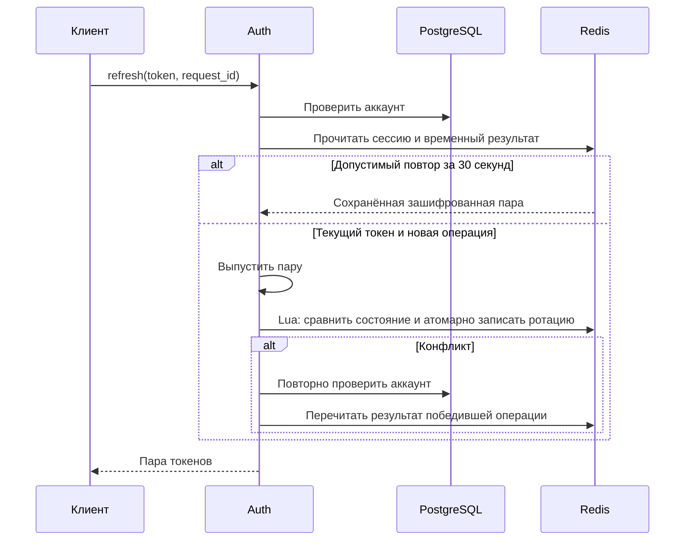
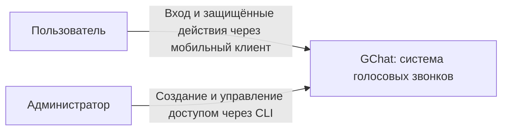
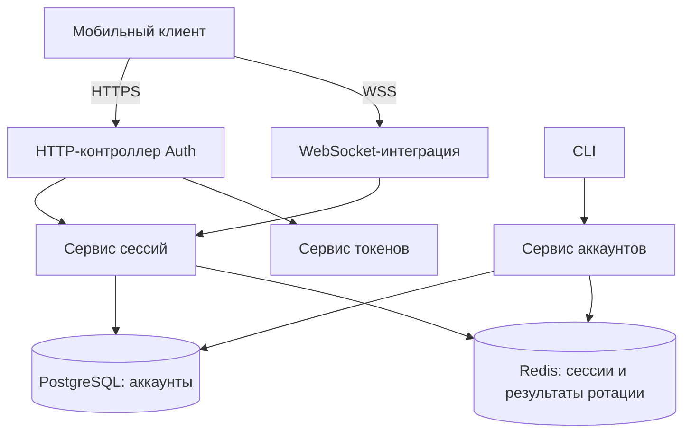

# Auth

## Назначение и границы

GChat использует собственные аккаунты, независимые от Mattermost. Auth является модулем общего NestJS backend, а не отдельным микросервисом. Он устанавливает личность пользователя и управляет сессиями для HTTP API и WebSocket.

В объём входят вход по логину и паролю, обновление токенов, выход, проверка доступа и будущие операции управления аккаунтами. Роли, веб-бэк-офис и общий административный HTTP API для веба и будущего CLI заданы новыми [бизнес-требованиями](../../product/backoffice.md); их технический контракт ещё предстоит согласовать. В текущей реализации ролей и административного HTTP API нет. Самостоятельная регистрация и операции редактирования логина или имени не предусмотрены. Разрешения на контакты и звонки проверяют соответствующие бизнес-модули.

Хранение токенов на клиенте описывается в документации клиента. Общий формат ошибок описывается в [документации ErrorModule](errors.md); здесь определены HTTP-статусы и смысл кодов.

### Текущий этап реализации

На текущем этапе реализуются `POST /auth/login`, `POST /auth/refresh`, `POST /auth/logout` и HTTP Guard, включая необходимые хранение аккаунтов и сессий и проверки доступа.

CLI управления аккаунтами отложен; WebSocket-интеграция реализована в Signaling. Планируемое управление аккаунтами через веб и будущий CLI определяется [требованиями бэк-офиса](../../product/backoffice.md); прежнее ограничение «только через CLI, без административного API» для будущего этапа заменено этими требованиями. Самостоятельная регистрация не добавляется. Описанный ниже контракт CLI сохраняется как требование будущего этапа, но не означает поручения реализовать CLI сейчас. Таблица восстановления административных операций сейчас не добавляется; механизм восстановления остаётся открытым решением.

Access token действует 120 секунд; сессия остаётся бессрочной до отзыва. HTTP Guard проверяет актуальные аккаунт и сессию при каждом запросе, поэтому отключённый аккаунт теряет доступ на следующем запросе, без ожидания истечения JWT. Сокращение TTL сессии до двух минут не согласовано.

Технические решения для этого этапа согласованы и описаны ниже. HTTP Auth реализован без Redlock; CLI остаётся будущим этапом; WS-интеграцией владеет Signaling. AuthModule импортирует DatabaseModule, экспортирует AuthService и AuthGuard. Guard подключается явно к защищённым контроллерам и сохраняет проверенную личность в `request.user`.

## Публичный API

### HTTP API

#### POST /auth/login

```json
{ "login": "andrey", "password": "..." }
```

Нормализует логин, проверяет пароль и состояние аккаунта, сохраняет новую сессию. Только после успешного сохранения возвращает 200:

```json
{ "access_token": "...", "refresh_token": "...", "token_type": "Bearer" }
```

Ответы с токенами запрещено кешировать. Пароли и токены не записываются в логи.

| Статус | Код                   | Условие                                                                      |
| ------ | --------------------- | ---------------------------------------------------------------------------- |
| 400    | `VALIDATION_ERROR`    | Неверный формат запроса                                                      |
| 401    | `INVALID_CREDENTIALS` | Неизвестный логин, неверный пароль или отключённый аккаунт; одинаковый ответ |
| 429    | `RATE_LIMITED`        | Превышен лимит                                                               |
| 503    | `SERVICE_UNAVAILABLE` | Недоступна зависимость                                                       |

#### POST /auth/refresh

Access token не требуется.

```json
{ "refresh_token": "...", "request_id": "UUID" }
```

Новая операция использует новый `request_id`. Повтор после потери ответа использует прежний ID и прежний refresh token. Успех: 200 с той же структурой, что при входе.

| Ситуация                                                           | Результат                                                 |
| ------------------------------------------------------------------ | --------------------------------------------------------- |
| Текущий токен и новая операция                                     | Ротация, новая пара                                       |
| Тот же запрос и использованный токен в пределах 30 секунд          | Исходная пара, без новой ротации                          |
| Истёк TTL, неизвестный или старый токен без подходящего результата | 401 `SESSION_INVALID`, без отзыва сессии                  |
| Аккаунт отключён или сессия отсутствует                            | 401 `SESSION_INVALID`, кешированный ответ не возвращается |

Повтор не продлевает срок access token. Следующая успешная ротация заменяет предыдущий временный результат. Обновления клиент выполняет последовательно, одной общей операцией.

Дополнительные ошибки: 400 `VALIDATION_ERROR`, 429 `RATE_LIMITED`, 503 `SERVICE_UNAVAILABLE`. После сетевого сбоя, 429 или 503 повторяется тот же запрос с прежним ID. Для 429 учитывается `Retry-After`.

#### POST /auth/logout

```json
{ "refresh_token": "..." }
```

Работает без действующего access token. При распознанном токене отзывает текущую сессию, остальные сохраняются. Возвращает 204 без тела также для неизвестного токена и уже удалённой сессии. Неверный формат — 400, недоступная зависимость — 503; при 503 отзыв не считается подтверждённым.

Сервер распознаёт текущий токен и предыдущий только пока существует временная запись ротации. Произвольный более старый токен не позволяет отозвать сессию: он получает идемпотентный 204 без изменения данных.

Метаданные пользователя возвращаются в JWT; отдельный endpoint профиля не предусмотрен. Клиент получает логин и отображаемое имя из claims `login` и `display_name`. Актуальные значения включаются в JWT при входе и обновлении токенов.

### Защищённые HTTP-запросы

Клиент передаёт `Authorization: Bearer <access_token>`. Guard проверяет подпись, разрешённый алгоритм, издателя, получателя, срок, наличие сессии, принадлежность сессии пользователю и состояние аккаунта. Проверки выполняются до бизнес-операции.

| Статус | Код                    | Ожидаемое действие клиента                  |
| ------ | ---------------------- | ------------------------------------------- |
| 401    | `ACCESS_TOKEN_EXPIRED` | Обновить токены и повторить запрос один раз |
| 401    | `ACCESS_TOKEN_INVALID` | Перейти к входу                             |
| 401    | `SESSION_INVALID`      | Удалить токены и перейти к входу            |
| 403    | `FORBIDDEN`            | Отказ бизнес-модуля; сессия сохраняется     |
| 503    | `SERVICE_UNAVAILABLE`  | Повторить позже; токены сохраняются         |

Проверка только подписи JWT недостаточна: необходимы актуальные аккаунт в PostgreSQL и сессия в Redis.

### WebSocket

При WSS-подключении access token передаётся в заголовке Authorization, не в URL. Выполняются проверки как для HTTP. Создаётся сессия соединения в памяти backend, привязанная к пользователю и сессии входа.

После установления соединения истечение access token не завершает WebSocket. Переавторизация внутри соединения и отдельный refresh token для WebSocket не нужны.

Перед каждой командой проверяются актуальный аккаунт, сессия и права на действие. Каждые 5 секунд проверяется действительность аккаунта и сессии; при отзыве или отключении соединение закрывается. При недоступности БД или Redis периодическая проверка также закрывает соединение. К интервалу добавляется время таймаута зависимостей.

Pub/Sub и специальный метод массового закрытия соединений не вводятся. После обрыва клиент заново подключается с действующим access token, предварительно обновляя его при необходимости. Новое соединение получает новую сессию WebSocket; состояние звонка восстанавливается отдельно.

Закрытие сигнализации само по себе не гарантирует остановку WebRTC-аудио. Поведение активного звонка при отзыве доступа определено в [DirectCalls](direct-calls/README.md#проверка-доступа-во-время-звонка).

### Браузерный WS-билет — реализовано

Расширение реализовано для [веб-клиента GChat](../../web/README.md) после поручения перейти от документации к реализации. Мотивация — в [D005](../../architecture/decisions/D005-web-client.md). Описанный выше handshake с Authorization сохраняется для нативных клиентов.

#### POST /auth/ws-ticket

Запрос содержит `Authorization: Bearer <access_token>`, точный Origin страницы и пустой JSON-объект `{}`. Используется существующая HTTP-проверка JWT, аккаунта и текущей сессии. Пользователь, session_id и Origin не принимаются из JSON. Endpoint доступен только для Origin, разрешённого браузерным контуром Signaling; отсутствие или запрещённый Origin даёт `403 FORBIDDEN`.

Успех — HTTP 200:

```json
{
  "ticket": "<43 символа base64url без padding>",
  "expires_at": "2026-11-03T12:30:30.000Z"
}
```

Билет — 32 криптографически случайных байта, закодированных base64url. Это секрет для одной попытки handshake, не JWT, не refresh token и не новая сессия. Срок — 30 секунд от выдачи по серверному времени, без продления. `expires_at` сериализуется в UTC с миллисекундами. Ответы не кешируются (`Cache-Control: no-store`); билеты не попадают в логи и диагностику. Их передача при upgrade и проверка Origin определены только в [Signaling](signaling.md#браузерный-handshake--реализовано).

Логический ключ Redis: `auth:ws-ticket:<sha256(ticket)>`, с обязательным `RedisService.key()` и TTL 30 секунд. Значение содержит `userId`, `sessionId`, `origin`, `issuedAt` и `expiresAt`; исходный секрет билета не хранится. SQL-таблица билетов не нужна. Для выдачи используется запись с NX; случайная коллизия требует нового секрета, а не перезаписи существующего билета. Ошибка записи не подтверждает выдачу.

Лимит выдачи — 10 билетов за 60 секунд на текущую Auth-сессию, с атомарным счётчиком Redis и сроком окна от первой выдачи. При отказе по лимиту возвращаются `429 RATE_LIMITED` и `Retry-After`; при ошибке Redis лимит не обходится. Счётчик также принадлежит Auth: `auth:ws-ticket-rate:<session_id>`, TTL до конца окна. Запрос не продлевает сессию и не отзывает другие выданные билеты.

Остальные HTTP-ошибки следуют действующему Auth/Error: `400 VALIDATION_ERROR`, `401 ACCESS_TOKEN_EXPIRED`, `401 ACCESS_TOKEN_INVALID`, `401 SESSION_INVALID`, `503 SERVICE_UNAVAILABLE`. Клиент может обновить истёкший access token по действующему refresh-контракту. При потерянном ответе на выдачу запрашивается новый билет; неизвестный клиенту билет самостоятельно истечёт, новый звонок от выдачи не создаётся.

#### Погашение до upgrade

Auth экспортирует `AuthWsTickets` с методами `issue(identity, origin)` и `redeem(ticket, origin)`. Это отдельные методы, не изменения семантики текущего `authenticate(token)`. Разрешение Origin проверяет Signaling; Auth хранит привязку и сверяет переданное значение.

После структурных проверок handshake билет атомарно извлекается и удаляется из Redis через GETDEL либо эквивалентную атомарную операцию. Только одна конкурирующая попытка может получить запись. Затем проверяются серверный срок, совпадение Origin, существование/активность аккаунта и принадлежность действующей сессии пользователю. Из записи восстанавливается личность соединения; выбранное устройство определяется позже через существующий `device.register`.

Неизвестный, просроченный или уже погашенный билет даёт одинаковый безопасный `401 ACCESS_TOKEN_INVALID`; несовпадение Origin — `403 FORBIDDEN`; отозванная сессия или отключённый аккаунт — `401 SESSION_INVALID`. Недоступность зависимости даёт `503 SERVICE_UNAVAILABLE`, а не признание сессии отозванной. Если билет уже погашен, но последующая проверка или upgrade не завершились, он не восстанавливается. Клиент получает новый билет для новой попытки.

Билет подтверждает ограниченную по времени авторизацию выдачи. Истечение JWT после выдачи не отменяет оставшийся срок билета: handshake всё равно проверяет актуальные аккаунт и сессию, а срок самого билета не превышает 30 секунд. Отзыв сессии делает непригодными и ещё не использованные билеты, даже если их Redis TTL пока не истёк. После успешного upgrade применяются действующие проверки WS-сессии; срок билета больше не управляет соединением.

Предлагаемые проверки: одновременное погашение, срок и точная граница истечения, Origin, отзыв между выдачей и upgrade, потерянные ответы, отказ Redis до и после погашения, лимит выдачи и отсутствие секретов в HTTP/WS-логах. Автоматические проверки находятся в `auth.integration.spec.ts` и `browser-origin.spec.ts`; они не заменяют проверку конфигурации рабочего proxy.

### Внутренний API для звонков — реализовано

Существующий `authenticate(token)` проверяет JWT и текущий доступ для HTTP. Для [Signaling](signaling.md), [Devices](devices.md) и [DirectCalls](direct-calls/README.md) реализованы отдельные методы:

- `checkSession(userId, sessionId)` возвращает `{accountActive, sessionActive}` по актуальным PostgreSQL и Redis, проверяя принадлежность сессии пользователю. Ошибка зависимости выбрасывается через ErrorService, а не превращается в `false`. Метод не проверяет срок ранее использованного JWT и не продлевает сессию.
- `lockActiveAccounts(tx, userIds)` блокирует строки аккаунтов `FOR SHARE` в переданной транзакции PostgreSQL в порядке UUID и возвращает `string[]` идентификаторов существующих активных аккаунтов. Отсутствующий/отключённый адресат отображается DirectCalls безопасным `CALL_NOT_ALLOWED`; отсутствие доступа самого отправителя — базовым отказом Auth. Проверка сессии остаётся отдельной операцией Redis, общей транзакции с PostgreSQL нет.

AuthModule экспортирует AuthService для этих потребителей; не импортирует модули звонков. Прямое чтение auth-ключей и SQL аккаунтов потребителями не допускается. Периодические проверки звонков, задержки обнаружения, порядок конкуренции и причины завершения принадлежат DirectCalls; Pub/Sub и новая очередь отзывов не вводятся. HTTP DTO при добавлении внутренних методов не меняются.

### CLI

Будущий CLI выполняет административные операции через общий с веб-бэк-офисом API согласно [бизнес-требованиям](../../product/backoffice.md). Прежнее предложение прямого использования сервисов backend из CLI заменено этим требованием. Технический контракт API и точные имена команд определяются отдельно до реализации. Устойчивый журнал операций, автоматическое восстановление после сбоя и гарантия определения результата прерванной команды не требуются. Частичное выполнение и неизвестный результат допустимы; проверка фактического состояния и исправление выполняются администратором вручную.

| Операция        | Результат                                                                                                                     |
| --------------- | ----------------------------------------------------------------------------------------------------------------------------- |
| Создать аккаунт | Сохранить валидированные данные и хеш пароля; назначить группу по параметру CLI согласно контракту Groups                     |
| Сменить пароль  | Сменить хеш, отозвать все сессии                                                                                              |
| Отключить       | Установить disabled_at, отозвать все сессии                                                                                   |
| Включить        | Завершить отзыв всех старых сессий и результатов ротации, затем очистить disabled_at; при ошибке оставить аккаунт отключённым |

По умолчанию генерируются логин вида `user-7k3m9x2p` и пароль из 24 символов криптографически стойким генератором, без визуально неоднозначных знаков. Коллизия логина приводит к повторной генерации. Имя задаёт администратор. Допускается явный логин и скрытый интерактивный ввод пароля. Пароль не передаётся аргументом командной строки.

Сгенерированные данные показываются один раз после успешного создания или смены пароля; не попадают в логи. Команды возвращают понятный результат и код завершения.

При создании пользователя CLI принимает параметр группы: существующая группа используется, отсутствующая создаётся, пользователь включается в неё. Правила этой операции принадлежат [Groups](groups.md#создание-через-cli--принято-не-реализовано).

#### Последовательности административных операций

Отключение: сохранить disabled_at в PostgreSQL → удалить сессии и результаты ротации из Redis.

Включение отключённого аккаунта: завершить удаление всех старых сессий и результатов ротации из Redis → только после подтверждённого отзыва очистить disabled_at в PostgreSQL. Это правило действует и после частичного сбоя отключения. При ошибке или неизвестном результате отзыва аккаунт остаётся отключённым, CLI сообщает об ошибке. После прерывания команды результат проверяется вручную.

Смена пароля: временно отключить аккаунт → изменить хеш → удалить сессии и результаты ротации → включить обратно, только если до операции аккаунт был включён.

Общей транзакции PostgreSQL и Redis нет. При сбое аккаунт остаётся отключённым, CLI сообщает об ошибке. После прерывания CLI не гарантирует восстановление исходного состояния и продолжение операции; администратор проверяет и исправляет состояние вручную. Исходное состояние аккаунта хранится только в памяти выполняемой команды. Нельзя автоматически включать аккаунт, если он был отключён до смены пароля.

Поле auth_version не вводится.

### Последовательность обновления



## Правила и инварианты

### Аккаунт

Таблица `gchat_users`:

| Поле            | Значение                                           |
| --------------- | -------------------------------------------------- |
| `id`            | Постоянный UUID пользователя                       |
| `login`         | Уникальный нормализованный логин                   |
| `display_name`  | Отображаемое имя                                   |
| `password_hash` | Хеш Argon2id                                       |
| `disabled_at`   | Время отключения; NULL означает включённый аккаунт |
| `created_at`    | Время создания                                     |
| `updated_at`    | Время последнего изменения                         |

Логин: 3–32 символа; латинские буквы, цифры, точка, дефис и подчёркивание. Пробелы по краям удаляются, буквы приводятся к нижнему регистру. Уникальность обеспечивает БД.

Пароль: 15–128 символов, допускаются пробелы и Unicode. Значение не обрезается и не нормализуется. Обязательного состава символов нет.

Имя: 1–80 символов после удаления пробелов по краям; уникальность не требуется. В текущей схеме роли администратора нет. Требуемая ролевая модель и открытые вопросы её назначения описаны в [бизнес-требованиях бэк-офиса](../../product/backoffice.md#роли-и-доступ); изменение схемы и JWT будет определено отдельным техническим проектом.

Отключение запрещает вход и использование существующих сессий. Повторное включение не восстанавливает старые сессии. Удаление аккаунтов и освобождение логинов в первой версии не предусмотрены.

### Пароли и pepper

Хеширование — Argon2id с памятью 65536 KiB (64 MiB), тремя проходами, параллелизмом 4, случайной солью 16 байт и результатом 32 байта. Параметры сохраняются вместе с хешем. Одновременно выполняются не более двух проверок пароля на процесс, при занятости возвращается 503 без неограниченной очереди; стоимость проверяется на целевом сервере. Для неизвестного логина выполняется проверка фиктивного хеша с теми же параметрами, ответ остаётся общим `INVALID_CREDENTIALS`.

Каждый хеш создаётся единым методом `AuthCrypto.hashPassword` (общая функция `auth.password.ts` используется также подготовкой E2E). Обязательный `AUTH_PASSWORD_PEPPER` передаётся как секретный вход Argon2 (`secret`) при хешировании и проверке, включая фиктивную проверку неизвестного аккаунта. Это независимые случайные 32 байта, закодированные каноническим base64, без значения по умолчанию. Секрет не включается в строку хеша и хранится отдельно от БД в защищённой конфигурации; он отличается между окружениями и не используется для JWT или шифрования ротации. Соль по-прежнему случайна для каждого пароля. Лимит двух одновременных операций на процесс общий для хеширования и проверки через AuthCrypto.

Совместимость со старыми хешами без pepper не поддерживается; автоматического перехода при входе нет. Их проверка возвращает обычный отказ входа. Схема БД не меняется. При внедрении или смене pepper требуется заново установить пароли; потеря секрета также требует сброса. Новый секрет необходимо согласованно развернуть на всех экземплярах backend. Смена pepper сама по себе не отзывает существующие сессии: при сбросе паролей или компрометации оператор должен отдельно отозвать сессии и результаты ротации по правилам Auth/Redis. Поддержка нескольких pepper и их плавная ротация не реализованы. Управление аккаунтами через CLI остаётся будущим этапом; новый метод хеширования не означает наличия команды сброса.

### Сессии и токены

Каждый успешный вход создаёт независимую сессию. Несколько устройств разрешены. Сессия не имеет предельного срока или TTL и действует до отзыва.

Access token — JWT со сроком действия `AUTH_ACCESS_TOKEN_TTL_SECONDS` (по умолчанию **120 секунд**). Состав:

| Claim          | Назначение                            |
| -------------- | ------------------------------------- |
| `sub`          | ID пользователя                       |
| `sid`          | ID сессии                             |
| `login`        | Логин                                 |
| `display_name` | Имя                                   |
| `iat`, `exp`   | Время выпуска и истечения             |
| `iss`, `aud`   | Издатель GChat и получатель GChat API |

При проверке `jose` учитывает подписанный `exp` и максимальный возраст от `iat`, заданный текущим `AUTH_ACCESS_TOKEN_TTL_SECONDS`. Срок уже выданного JWT не сравнивается на точное равенство с новой настройкой: увеличение TTL не продлевает старый `exp`, уменьшение может раньше вернуть `ACCESS_TOKEN_EXPIRED` по возрасту и потребовать refresh. Положительный интервал `exp > iat`, подпись, обязательные claims, issuer/audience и актуальная сессия проверяются как прежде. Настройка применяется после перезапуска backend.

Это время жизни access token, а не серверной сессии или refresh token. Записи сессий по-прежнему не имеют TTL и действуют до отзыва; изменение JWT TTL не разлогинивает пользователей само по себе. Уже установленный WS не закрывается из-за истечения access JWT.

Подпись — Ed25519, JWT-заголовок `alg=EdDSA`; сервер допускает только этот алгоритм и ключи Ed25519. Выпуск и проверка выполняются готовой JWT-библиотекой. Значения `iss=gchat` и `aud=gchat-api` фиксированы. Активный приватный ключ подписывает новые токены; набор доверенных публичных ключей выбирается по `kid`. Старый публичный ключ сохраняется на время действия ранее выпущенных токенов. Ключи различаются между окружениями. Метаданные перечитываются из БД при выпуске нового токена. JWT не содержит секретов. Отдельные `user`, `expires_in` и `expires_at` в HTTP-ответах отсутствуют.

Refresh token заменяется при каждом успешном обновлении. В постоянной записи сессии хранится только его хеш. Формат refresh token: `v1.<session_id>.<secret>`, где `session_id` — UUID, а `secret` — 32 криптографически случайных байта в base64url без padding. Сессия ищется по UUID; подлинность подтверждается сравнением SHA-256 всего токена с сохранённым хешем. Сам UUID не подтверждает доступ. ID пользователя берётся из серверной записи сессии. История ротаций не хранится.

### Redis

| Ключ                           | Содержимое                                                                          | TTL       |
| ------------------------------ | ----------------------------------------------------------------------------------- | --------- |
| `auth:session:<session_id>`    | ID пользователя, хеш текущего refresh token, время создания и последнего обновления | Нет       |
| `auth:user-sessions:<user_id>` | Множество ID сессий пользователя                                                    | Нет       |
| `auth:rotation:<session_id>`   | ID запроса, хеш использованного токена, зашифрованная пара токенов                  | 30 секунд |

Чтение сессии и результата ротации выполняется атомарно; ключ неверного Redis-типа приводит к 503, а не к признанию сессии отсутствующей или подтверждённому выходу. Истечение результата ротации между чтением и записью не мешает операции с текущим токеном, если сессия не изменилась. Предыдущий токен после истечения результата больше не разрешает отзыв. Изменившийся живой результат ротации остаётся конфликтом предусловий.

Создание сессии и обновление множества выполняются атомарно. Ротация атомарно заменяет хеш и сохраняет результат с TTL. Выход удаляет запись сессии, результат ротации и членство в множестве. Отзыв всех сессий использует множество пользователя, без сканирования всего Redis. Удалённая сессия недействительна; запись об отзыве не хранится.

Временный результат ротации шифруется AES-256-GCM с отдельным ключом и новым случайным nonce для каждой записи. ID сессии и запроса включаются в аутентифицируемые дополнительные данные (AAD). Контейнер — стандартный JWE Flattened JSON Serialization из `jose`: `alg=dir`, `enc=A256GCM`, `kid` в защищённом заголовке; `iv`, `ciphertext`, `tag` и `aad` формируются библиотекой. При чтении разрешены только эти алгоритмы, после проверки подлинности AAD сравнивается с ожидаемыми ID сессии и запроса. Новые записи используют активный ключ; старые ключи сохраняются до истечения результатов, зашифрованных ими.

Redis является хранилищем доступа: требуется сохранение на диск и запрет вытеснения сессий. Конкретные настройки описываются в RedisModule. Потеря данных сессий приводит к повторному входу. Отозванные сессии не должны восстанавливаться из устаревшей резервной копии без отдельного плана восстановления доступа.

### Конкурентные операции

HTTP Auth не использует Redlock и ключи аренд. Короткие Lua-скрипты атомарно проверяют предусловия и меняют сессию, индекс и результат ротации. Создание требует отсутствия сессии; ротация сравнивает прочитанную запись с текущей (compare-and-set). Исчезновение временного результата по TTL допустимо при неизменной сессии, другая живая запись является конфликтом.

При конфликте refresh перечитывает актуальный аккаунт, сессию и результат. Повторы одной операции получают пару победившего запроса; другая операция со старым токеном получает 401 без отзыва. Цикл ограничен тремя попытками; исчерпание даёт 503. Неизвестный результат Redis-команды не вызывает автоматическую повторную запись: клиент повторяет исходный запрос по правилам идемпотентности.

Logout в Lua проверяет принадлежность сессии пользователю и хеш предъявленного токена по актуальной сессии и ещё живому результату ротации. Отсутствующая сессия или нераспознанный токен дают идемпотентный успех без изменения данных. Конкурентная ротация не воскрешает удалённую сессию.

Общей транзакции PostgreSQL и Redis нет. Временный CLI допускает частичное выполнение и неизвестный результат по правилам раздела [CLI](#cli); отдельный протокол гарантированного восстановления административных операций не требуется.

### Лимиты

| Операция                        | Ограничение                    |
| ------------------------------- | ------------------------------ |
| Вход по нормализованному логину | 5 неудачных попыток за 5 минут |
| Обновление по сессии            | 10 новых операций за минуту    |

Ограничений по IP нет. Лимит логина одинаков для известных и неизвестных аккаунтов. Повтор того же request_id не расходует лимит новых обновлений. Неизвестный refresh token возвращает 401. Превышение — 429 и Retry-After в секундах, без отключения аккаунта. Значения настраиваются. На первом этапе счётчики в памяти единственного backend, сбрасываются при перезапуске; перенос их в Redis отдельно не согласован.

Окно скользящее: каждая учтённая попытка исключается независимо после своего срока. `RateLimiterMemory` из `rate-limiter-flexible` использует фиксированное окно и не является совместимой заменой текущего поведения. Поэтому текущий AuthLimits сохраняется; замена с изменением алгоритма требует отдельного согласования.

## Зависимости и регистрация

### C1: контекст GChat

Диаграмма отражает контекст доступа; внешние системы доставки звонков здесь опущены.



### Компоненты авторизации



| Компонент            | Ответственность                                                          |
| -------------------- | ------------------------------------------------------------------------ |
| HTTP-контроллер      | Вход, обновление токенов и выход                                         |
| Сервис аккаунтов     | Создание, смена пароля, отключение и включение через CLI                 |
| Сервис сессий        | Создание, проверка, отзыв и ротация                                      |
| Сервис токенов       | Выпуск и проверка JWT, генерация refresh token                           |
| HTTP Guard           | Проверка защищённых запросов                                             |
| WebSocket-интеграция | Проверка подключения, привязка к сессии и периодический контроль доступа |

Зависимости: PostgreSQL через существующий слой БД; RedisModule для клиента Redis; ErrorModule для оформления ошибок. Контракты описаны в [RedisModule](redis.md) и [RedlockModule](redlock.md). Применяется один Redis; автоматическое переключение на устаревшую реплику не входит в схему.

## Ошибки и частичное выполнение

Недоступность PostgreSQL или Redis: операции Auth и защищённые запросы возвращают 503; бизнес-операции не выполняются. Новые WebSocket-подключения отклоняются, существующие закрываются при проверке. Сбой зависимости не отзывает сессию и не является основанием для удаления токенов клиентом.

После временного сбоя клиент переподключается с увеличивающейся задержкой и случайным разбросом, максимум раз в 30 секунд. Детали реализации находятся в документации клиента.

Секреты подписи JWT и шифрования результатов ротации передаются через защищённую конфигурацию. Ответы, пароли, refresh token и заголовки авторизации не включаются в обычные логи. При смене ключа шифрования необходимо учитывать ещё живущие результаты ротации.

## Конфигурация

Конфигурация задаёт активный ID и приватный ключ JWT, доверенные публичные ключи по ID, активный ID и набор ключей шифрования результатов ротации. Секреты обязательны, без значений по умолчанию; некорректная конфигурация отклоняется при запуске. Переменные окружения:

| Переменная                      | Формат                                                                  |
| ------------------------------- | ----------------------------------------------------------------------- |
| `AUTH_ACCESS_TOKEN_TTL_SECONDS` | Срок и максимальный возраст access JWT в секундах; по умолчанию 120     |
| `AUTH_PASSWORD_PEPPER`          | Обязательные независимые 32 случайных байта в каноническом base64       |
| `AUTH_JWT_ACTIVE_KID`           | ID активного ключа подписи                                              |
| `AUTH_JWT_PRIVATE_KEY`          | Приватный Ed25519-ключ в PEM; допускаются экранированные переводы строк |
| `AUTH_JWT_PUBLIC_KEYS`          | JSON-объект ID → публичный PEM-ключ                                     |
| `AUTH_ROTATION_ACTIVE_KID`      | ID активного ключа шифрования                                           |
| `AUTH_ROTATION_KEYS`            | JSON-объект ID → 32 байта в base64                                      |
| `AUTH_LOGIN_MAX_FAILURES`       | По умолчанию 5                                                          |
| `AUTH_LOGIN_WINDOW_MS`          | По умолчанию 300000                                                     |
| `AUTH_REFRESH_MAX_OPERATIONS`   | По умолчанию 10                                                         |
| `AUTH_REFRESH_WINDOW_MS`        | По умолчанию 60000                                                      |

Все численные настройки — положительные целые. Пример окружения и генерация локальных ключей описаны в [README backend](../../../applications/backend/README.md#настройка-http-auth).

Используются существующие бюджеты БД и Redis; их исчерпание преобразуется в 503 по правилам отказов зависимости. Новые значения таймаутов без измерений не вводятся. Численные продуктовые ограничения определены в правилах этого контракта; настройки подключения принадлежат Redis.

## Критерии приёмки и проверки

- Создание CLI генерирует валидные уникальные данные; БД не содержит открытого пароля.
- Хеши требуют правильных пароля и pepper; старые хеши без pepper отклоняются, неверная конфигурация pepper запрещает запуск.
- Вход создаёт независимую сессию; ответ содержит только два токена и token_type.
- JWT действует заданное `AUTH_ACCESS_TOKEN_TTL_SECONDS` время (по умолчанию 120 секунд) и содержит согласованные метаданные. Сессия не имеет TTL.
- Неверный логин, пароль и отключённый аккаунт дают одинаковый отказ входа.
- Просроченный access token не запускает бизнес-операцию; неверный или отозванный доступ отклоняется.
- Ротация и временный результат записываются атомарно. Параллельные повторы одной операции дают ту же пару и расходуют лимит как одна операция.
- После 30 секунд или замещения результата старый токен отклоняется без отзыва сессии.
- Выход идемпотентен, удаляет только текущую сессию и её временный результат.
- Смена пароля и отключение удаляют все сессии; повторное включение не возвращает старый доступ.
- После частичного сбоя отключения команда включения сначала завершает отзыв всех старых сессий и результатов ротации. При ошибке или неизвестном результате отзыва аккаунт остаётся отключённым; включение выполняется только после подтверждённого отзыва.
- При обнаруженной ошибке CLI сообщает о ней; после прерывания допустим неизвестный или частичный результат без автоматического восстановления. Изначально отключённый аккаунт не включается автоматически.
- Истечение access token не закрывает действующий WebSocket; отзыв обнаруживается проверкой перед командой или периодической проверкой.
- Недоступность БД и Redis даёт согласованное временное поведение без утечки секретов.
- Лимиты не используют IP; 429 содержит Retry-After.

Юнит-тесты проверяют криптографию, обработку отказов, повторную проверку состояния и лимиты. `test/auth.integration.spec.ts` проверяет HTTP Auth с настоящими PostgreSQL и Redis, включая параллельные повторы, TTL результатов, отзыв, отключение аккаунта, лимиты, недоступность Redis и гонку refresh с logout и конфликты compare-and-set. Тест включается через `AUTH_INTEGRATION_DATABASE_URL` и `AUTH_INTEGRATION_REDIS_URL`, создаёт отдельную БД и префикс Redis; подробности запуска — в README backend. CLI пока не реализован; WS-проверки описаны в контракте Signaling. Общие правила проверки — в [соглашениях backend](../conventions.md).

## Открытые решения

Вопрос восстановления административных операций закрыт: CLI является временным решением, устойчивое хранение хода операций и гарантированное определение результата после сбоя не требуются; действуют ограничения раздела [CLI](#cli). Клиентское хранение токенов определяется в документации клиента; поведение активного аудио при отзыве доступа — в [DirectCalls](direct-calls/README.md#проверка-доступа-во-время-звонка). Производительность Argon2id и существующие бюджеты ожидания проверяются измерениями перед production.

Настройки Redis и RedLock уже реализованы; проверка production-нагрузки и процедура восстановления остаются отдельными задачами. См. [восстановление](../operations/recovery.md).
