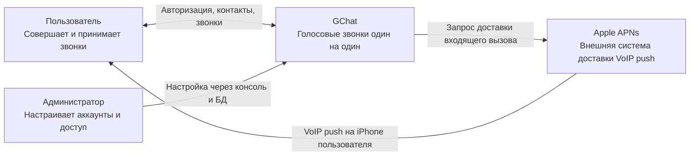
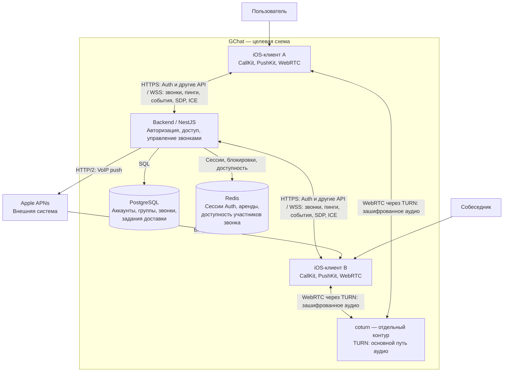
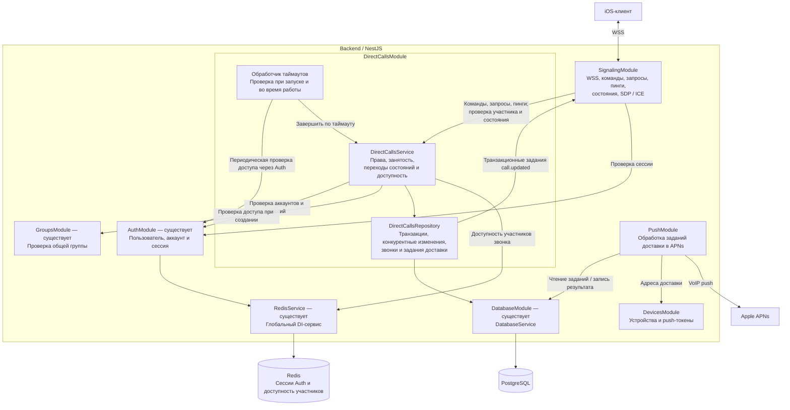

# D003: транспорт DirectCalls — solution record

Дата: 2026-11-03.

Статус решения: accepted в части разделения транспорта. Внутренняя декомпозиция на C3 отражает целевую архитектуру; действующее поведение ведётся в [контракте DirectCallsModule](README.md).

## Контекст

DirectCalls требуется управление состоянием звонка, доставка изменений клиентам и обмен данными для установления аудиосоединения. Входящий вызов должен поступать и в фоне приложения. Команды, сигнализация, пробуждение приложения и аудио имеют разные задачи.

Рассмотрена замена WebSocket на HTTP long polling с отправкой SDP / ICE через HTTP. Такой вариант требует повторяющихся ожидающих запросов, курсоров и отдельного механизма хранения и выдачи событий. Для текущего решения этот вариант отклонён; сохраняется WebSocket.

## Решение

- Обычный WebSocket через WSS в Signaling: JSON-команды управления звонком, запрос состояния по `call_id` и «мой текущий звонок», прикладные пинги, изменения состояния, адресный обмен SDP и ICE-кандидатами. Запросы и ответы связываются через `request_id`. Socket.IO не используется. Правила пингов находятся в [контракте](README.md#проверка-доступности-во-время-звонка--согласовано).
- APNs VoIP push: доставка входящего вызова на iOS для обработки PushKit / CallKit, включая фоновое приложение. WebSocket не заменяет этот путь.
- HTTPS REST: чтение [бессрочной истории завершённых звонков](history-api.md), согласовано пользователем 2026-11-11. Управление и запрос актуального состояния звонка сохраняют WSS.
- WebRTC: основной путь аудио через собственный coturn в отдельном контуре GChat, без переиспользования Mattermost/Jitsi. Клиентская политика и поведение при отказе TURN определены в [контракте аудиотранспорта](README.md#аудиотранспорт-через-coturn--согласовано). Аудио не проходит через HTTP API, WebSocket или APNs.

DirectCalls владеет жизненным циклом звонка; Signaling — соединениями и сигнализацией. Состояние звонка хранится в PostgreSQL, соединения WebSocket не являются источником истины.

## C1 — контекст системы

На этом уровне GChat показан целиком: приложения, backend и собственная инфраструктура. APNs — внешняя система. Администратор настраивает аккаунты и доступ через консоль и БД; наличие административного CLI не подразумевается.

## C2 — контейнеры

Целевая схема принятого отдельного WebRTC-контура, а не описание готовой реализации. Продуктовый выбор инфраструктуры зафиксирован в требованиях. Два экземпляра iOS-клиента показаны для объяснения аудиосоединения между участниками.

## C3 — компоненты backend вокруг DirectCalls

Auth, Groups, Database, DirectCalls, Signaling, Devices и Push присутствуют в backend. Подключение APNs и coturn и клиентское поведение проверяются отдельно. Декомпозиция и взаимодействия соответствуют принятым контрактам; сигнатуры и гарантии находятся в контрактах владельцев. Обработчики показаны внутри одного backend, отдельный процесс очереди не предполагается.

Задания передачи состояния, периодический контроль отзыва и транзакционная проверка Groups описаны в [контракте DirectCalls](README.md); их мотивация — в [D004](D004-direct-calls-consistency.md). Диаграмма показывает взаимодействия модулей; текущие границы реализации и непроверенные сценарии перечислены в контрактах владельцев. Backend использует существующий RedisService через DI.

## Последствия

coturn выбран основным путём аудио, чтобы использовать единый маршрут через управляемый ретранслятор без зависимости от возможности прямого соединения клиентов. Это требует пропускной способности для всего аудиотрафика и делает доступность coturn необходимой для звонков. Действующие правила находятся в [контракте аудиотранспорта](README.md#аудиотранспорт-через-coturn--согласовано).

Backend поддерживает HTTPS и WSS. Signaling должен обеспечивать проверку прав, отзыв доступа и восстановление соединения с получением актуального состояния звонка. Потребность в APNs для входящего вызова сохраняется. Команды и пинги DirectCalls используют WSS; HTTPS используется для Auth, истории завершённых звонков и остальных HTTP API. Обрыв WSS прекращает пинги и может привести к завершению звонка по правилам [контракта](README.md#обрыв-websocket--согласовано), даже при работающем WebRTC-аудио.

Замена WSS на HTTP long polling и отдельный EventsModule в это решение не входят. Отказ от long polling не отменяет необходимости определить порядок, повторы и восстановление WebSocket-событий.

Таймауты, политика занятости, устройство хранения и поведение при отзыве доступа не входят в область этого транспортного решения. Их согласование, открытые вопросы и критерии приёмки ведутся в [контракте DirectCallsModule](README.md).
