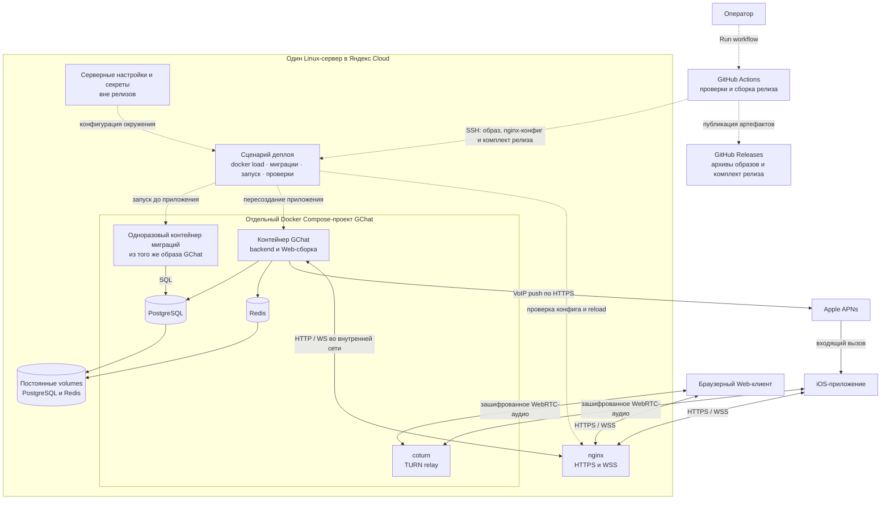

# Развёртывание GChat на одном сервере

Документ описывает целевой процесс и требования к будущей реализации. Согласованная основа: ручной запуск GitHub Actions, сборка Docker-образа и конфига nginx, передача релиза по SSH на существующий сервер в Яндекс Cloud, применение миграций и перезапуск приложения. Мотивация — [D009](../architecture/decisions/D009-manual-deployment.md). Детализация ниже имеет статус draft до согласования; наличие документа не означает готовность инфраструктуры.

## Цель и границы

Базовый вариант — развёртывание самостоятельного GChat на одном Linux-сервере без сборки приложения на целевом хосте и без Docker Registry. Backend, Web, PostgreSQL, Redis и coturn относятся только к GChat. Корневые `docker-compose.yml` и `setup.sh` обслуживают legacy Mattermost/Jitsi и не используются этим процессом.

Не добавляем платные сервисы: используем существующий сервер и GitHub Actions в пределах включённой квоты. Это не отменяет текущую оплату сервера, диска и трафика Яндекс Cloud. Превышение квоты Actions не должно автоматически приводить к платному расходу: владелец настраивает ограничение расходов в GitHub.

Первый этап — доставка серверного приложения. Сборка и распространение нативного iOS-приложения, Kubernetes, несколько серверов и обновление без перерыва в работе не входят в объём. Во время пересоздания приложения возможны разрывы WSS и активных звонков.

## Текущее состояние

- Есть локальный Compose PostgreSQL/Redis: [запуск backend](../../applications/backend/README.md). Это окружение разработки, не production-комплект.
- Есть отдельные команды миграций и создания администратора. [Миграции](../backend/operations/migrations.md) выполняются до запуска новой версии HTTP-приложения.
- Есть [CI для backend-api и Web](../../.github/workflows/backend-api.yml); workflow доставки, production Dockerfile, nginx-конфиг и серверный сценарий деплоя ещё не реализованы.
- Web имеет `build:server` для `/apps/client`, однако серверная раздача этой сборки ещё не реализована. Production-загрузку нужно завершить и проверить по [D008](../architecture/decisions/D008-capacitor-bridge.md) и [README Web](../../applications/web/README.md).

## Состав окружения

| Компонент   | Назначение и жизненный цикл                                                                       |
| ----------- | ------------------------------------------------------------------------------------------------- |
| Образ GChat | Backend, собранный Web, SQL-миграции и production-зависимости. Заменяется при выпуске приложения. |
| PostgreSQL  | Собственные аккаунты и данные GChat; постоянное хранилище.                                        |
| Redis       | Состояние и блокировки по контрактам модулей; постоянное хранилище.                               |
| coturn      | Отдельный TURN-сервис с доступными клиентам сетевыми портами.                                     |
| nginx       | HTTPS, HTTP proxy и WSS upgrade; конфигурация входит в релиз.                                     |
| Мигратор    | Одноразовый процесс из того же образа, что и новая версия приложения.                             |

Предлагается отдельный Compose-проект GChat. Обычный выпуск приложения не пересоздаёт PostgreSQL, Redis и coturn и не обновляет версии их образов. Изменение инфраструктурных зависимостей выполняется отдельной обслуживающей операцией.

PostgreSQL и Redis недоступны из интернета. Backend доступен только nginx и внутренним проверкам. Наружу открываются HTTPS, необходимые порты TURN и ограниченный административный SSH-доступ. TURN не проксируется через HTTP nginx; конкретные адреса, порты и диапазон relay согласуются с сетью сервера.

## Диаграмма базового варианта

Целевая схема первого этапа: один сервер в Яндекс Cloud, Docker Compose и ручная доставка готового релиза. Сплошные линии показывают взаимодействия работающей системы, пунктирные — управление выпуском. Диаграмма описывает проектируемое размещение, а не уже развёрнутое окружение.

nginx показан внутри сервера, но вне границы Compose: его размещение на хосте или в контейнере ещё не выбрано. Web-сборка входит в образ GChat; конкретный способ её раздачи остаётся открытым. Стрелка nginx ↔ приложение не фиксирует реализацию раздачи статики. Клиенты получают временные TURN credentials от backend, а аудио передают через coturn, минуя nginx и backend. APNs — внешний сервис Apple, а не контейнер на нашем сервере.

Volumes и серверные секреты переживают замену релиза. PostgreSQL, Redis и coturn запускаются при подготовке окружения; обычный выпуск меняет приложение и при необходимости nginx-конфиг. Мигратор завершается до запуска новой версии приложения.

Базовый способ оркестрации — Docker Compose. Для более сложных окружений предоставляются Docker-образы собственных серверных компонентов GChat; модель поставки описана ниже. Kubernetes-манифесты и Helm charts в текущий объём поставки не входят.

## Поставка для сложных окружений

Для более сложного деплоя проект предоставляет готовые версионируемые Docker-образы всех собственных серверных компонентов. Владелец окружения самостоятельно выбирает оркестратор, размещение компонентов, внешние зависимости, сеть, секреты, постоянные хранилища и процесс обновления. Образы собираются в CI и не привязаны к SSH-сценарию базовой установки.

В текущем проекте единица поставки — образ GChat с backend и Web-сборкой. Мигратор запускается отдельной командой из того же образа. Это не вводит новые сервисы и не требует отдельного образа для каждого backend-модуля. Если в будущем появятся другие самостоятельно развёртываемые серверные компоненты GChat, для каждого будет предоставляться собственный образ. Нативное iOS-приложение распространяется отдельно.

PostgreSQL, Redis, coturn и nginx — внешние зависимости: используем образы их поставщиков либо совместимые сервисы окружения. Собственные копии этих образов не выпускаем. Для базовой установки сохраняется отдельный комплект с nginx-конфигом и Compose.

Вместе с нашими образами документируются команды запуска приложения и миграций, обязательные настройки, сетевые интерфейсы, проверки готовности и требования к постоянным данным. Версии идентифицируются однозначно; секреты окружения в образы не включаются. Один и тот же образ релиза используется в базовом и сложном вариантах размещения.

Все Docker-образы собственных компонентов GChat публикуются в GitHub Releases соответствующей версии приложения как скачиваемые архивы `docker save` со сжатием (`.tar.gz`). Вместе с ними публикуются manifest и контрольные суммы. Владелец установки скачивает нужный архив, проверяет checksum и загружает образ через `docker load`; Docker Registry для получения образов не требуется. Образы внешних зависимостей остаются у их поставщиков.

Публикуемые архивы и комплект, передаваемый по SSH на наш сервер, относятся к одной сборке и содержат те же образы без повторной сборки. Публикация GitHub Release сама по себе не развёртывает приложение; наш workflow деплоя остаётся ручным.

Готовые Helm charts, Kubernetes-манифесты и отдельный pipeline для чужого оркестратора не входят в обязательства текущего этапа. Возможность их добавления в будущем не считается согласованным планом реализации.

## Состав релиза

Предлагаемый комплект одной версии:

| Артефакт             | Содержание                                                                                                    |
| -------------------- | ------------------------------------------------------------------------------------------------------------- |
| `gchat-image.tar.gz` | Экспорт Docker-образа через `docker save` со сжатием.                                                         |
| `nginx.conf`         | Проверяемая конфигурация GChat без приватных ключей.                                                          |
| `compose.yaml`       | Описание приложения и отдельного запуска мигратора; инфраструктурные сервисы запускаются явно при подготовке. |
| `deploy.sh`          | Серверный сценарий проверки, установки и диагностики релиза.                                                  |
| `release.json`       | SHA исходников, уникальный ID сборки, платформа, тег и image ID, версия формата комплекта.                    |
| `SHA256SUMS`         | Контроль целостности переданных файлов.                                                                       |

Имена артефактов — проектируемые, сами файлы пока отсутствуют. Тег образа включает SHA коммита и ID запуска/попытки сборки: повторная сборка одного SHA не перезаписывает идентичность предыдущего релиза. `latest` не используется для выбора версии. Образ собирается под платформу целевого сервера, которую нужно подтвердить до реализации.

Образ создаётся многостадийной сборкой. Версии Node.js и pnpm берутся из `.nvmrc` и `package.json`, зависимости — из `pnpm-lock.yaml` с frozen lockfile. В финальный образ входят `dist`, каталог `drizzle`, Web-сборка и production-зависимости; секреты, `.env`, APNs-ключ и инструменты разработки туда не включаются. Процесс приложения запускается от непривилегированного пользователя.

Комплект публикуется как вложения GitHub Release вместе с архивами всех наших образов этой версии и доставляется напрямую по SSH. GitHub Actions Artifacts не является каналом поставки. Релиз связывает версию приложения с полным SHA и идентификаторами сборки/образов из manifest; опубликованные файлы не заменяются другой сборкой под той же версией. Повторная установка возможна из GitHub Release или сохранённого серверного комплекта.

## Запуск GitHub Actions

Единственный триггер workflow доставки — `workflow_dispatch` через **Run workflow**. Пуш, pull request и создание тега не запускают выкладку. Обычный CI может продолжать работать автоматически.

Оператор выбирает ref в интерфейсе GitHub. Workflow фиксирует полный SHA checkout и использует его во всех шагах; во время передачи или установки не выполняется повторный checkout подвижной ветки. До передачи показываются SHA и целевое окружение без секретов.

Последовательность:

1. Checkout, установка версий инструментов из репозитория и зависимостей из lock-файла.
2. Проверки backend и Web: typecheck, относящиеся тесты, сборка, проверка SDK-контракта и документации. Интеграционные сценарии требуют отдельного тестового окружения; отсутствие такого окружения не считается успешным прогоном.
3. Сборка Web и production-образа, проверка наличия Web и миграций в образе; подготовка nginx-конфига и остальных артефактов.
4. Проверка Compose и nginx-конфига в тестовом окружении, формирование manifest и checksum.
5. Публикация архивов всех собственных Docker-образов и комплекта с manifest/checksum в GitHub Release соответствующей версии приложения. Ошибка публикации останавливает процесс до выкладки.
6. Передача того же комплекта по SSH в отдельный входящий каталог релиза на сервере.
7. Запуск серверного сценария и ожидание его итогового статуса.

Одновременно допускается только одна выкладка в окружение. Workflow использует общую concurrency-группу без отмены активного запуска, серверный сценарий — локальную блокировку на весь процесс. Отмена Actions не является откатом и не должна запускать конкурирующий мигратор; повторный запуск допускается после завершения серверной операции и проверки её состояния.

## Настройки и секреты

GitHub хранит только доступ доставки: SSH host/port/user, ключ доступа и заранее проверенный host key сервера; также задаются путь установки и целевое окружение. Проверка host key обязательна, отключение StrictHostKeyChecking не используется. Аккаунт доставки получает только необходимые права; доступ к Docker фактически даёт высокие привилегии на хосте и учитывается при настройке аккаунта.

На сервере вне каталогов релиза хранятся:

- `.env` приложения: подключения к БД/Redis, ключи Auth, TURN и параметры APNs/Origin по [примеру backend](../../applications/backend/.env.example) и контрактам владельцев.
- APNs `.p8`, TLS-сертификат и приватный ключ; файлы подключаются только нужным процессам, по возможности read-only.
- Постоянные volumes PostgreSQL и Redis, резервные копии и сведения о текущем/предыдущем релизе.

Секреты генерируются при подготовке окружения и не меняются при повторном деплое. Локальные пароли из `.env.example` в production не используются. `.env` не загружается в CI и не попадает в manifest, образ, архив или логи. Backend в контейнере слушает контейнерный интерфейс, а URLs PostgreSQL/Redis используют адреса внутренней сети, а не loopback хоста.

## Подготовка сервера и первый запуск

До первого workflow оператор устанавливает Docker Engine и Compose, настраивает пользователя доставки, отдельные каталоги GChat и доступ к серверу. Нужны свободное место для текущего и нового образов, публичный адрес, DNS, TLS и сетевые правила Яндекс Cloud/хоста. Конкретная структура каталогов и способ выпуска/продления TLS остаются открытыми.

Инфраструктурные сервисы впервые запускаются отдельной подготовительной операцией. Проверяются их готовность, persistence Redis, резервное копирование PostgreSQL и соответствие TURN shared secret настройкам backend. Правила хранения/восстановления — в [контрактах восстановления](../backend/operations/recovery.md); подробности не дублируются в этом документе.

Первый релиз затем проходит тот же серверный сценарий, что и обновления. После миграций администратор создаётся интерактивной CLI-командой из образа по [контракту Auth](../backend/modules/auth.md#cli), без передачи пароля через Actions или аргументы командной строки. Это отдельная первоначальная операция, не часть каждого деплоя.

Исходная цель «одна команда для другого владельца установки» сохраняется как последующий удобный интерфейс к этому комплекту. Самодостаточный установщик, автоматически подготавливающий чистый сервер, на первом этапе не обещается.

## Серверная установка релиза

1. Получить блокировку, проверить полноту и checksum комплекта, соответствие manifest и платформы. Неполный входящий каталог не считается релизом.
2. Загрузить образ через `docker load`, проверить его image ID и тег. Проверить Compose, наличие обязательной конфигурации и файлов без вывода секретов.
3. Подготовить и проверить nginx-конфиг в фактическом серверном контексте. Ошибка проверки останавливает обновление до остановки приложения.
4. Проверить готовность PostgreSQL/Redis и наличие пригодной резервной копии БД перед изменением схемы. Сбой подготовки оставляет текущую версию работающей.
5. Остановить контейнер приложения и выполнить миграции отдельным одноразовым контейнером новой версии. Это простая схема с обслуживающим перерывом, не требующая совместной работы старого приложения с новой схемой. Миграторы не запускаются параллельно.
6. При успешных миграциях запустить новую версию приложения, дождаться внутреннего `/ready` с ограниченным временем ожидания.
7. Установить подготовленный nginx-конфиг, выполнить `nginx -t` и reload. Если nginx ещё не запущен, выполнить его первоначальный запуск. Проверить внешний HTTPS-маршрут готовности, HTML и статические ресурсы Web, прямую загрузку вложенного клиентского URL.
8. Только после успешных проверок записать релиз как текущий, сохранить предыдущий комплект и завершить workflow успешно.

Для повторного запуска завершённого релиза сценарий сначала сверяет текущую версию и готовность. Частично выполненный релиз диагностируется по фактическому состоянию; новый запуск не должен удалять постоянные данные или безусловно повторять первоначальную настройку.

## nginx и Web

Сохраняется один HTTPS-origin для Web, API и WSS. `/api/*` проксируется в backend без префикса `/api`; `/ws` сохраняет исходный Origin и поддерживает WebSocket upgrade. Допустимый origin настраивается в backend явно. Внешняя проверка `/api/ready` соответствует внутреннему `/ready`.

Целевые пути серверной Web-сборки — `/apps/client` и `/apps/static/`, дополнительные публичные файлы — под `/apps/`. SPA fallback не должен перехватывать API, WS и отсутствующие статические файлы или терять path/query. Правила приложения принадлежат [Web](../../applications/web/README.md) и [D008](../architecture/decisions/D008-capacitor-bridge.md).

Как именно раздаётся Web из единого образа и как nginx запускается на существующем хосте, нужно уточнить до реализации. Нельзя считать готовой интеграцией просто наличие `build:server`. Публичный маршрут `/` и способ перехода к клиенту также остаются открытыми.

## Ошибки и возврат предыдущей версии

Ошибка любого обязательного шага означает неуспешный workflow. В итоговом отчёте показываются SHA, ID релиза, этап отказа и состояние приложения; секреты и строки подключения не публикуются.

До остановки приложения ошибка подготовки не меняет текущий релиз. После остановки сервер сообщает о перерыве; успех `/ready` сам по себе не доказывает работоспособность схемы, авторизации, APNs или аудио — [границы healthcheck](../backend/modules/healthcheck.md).

Автоматический возврат старого образа после миграций не обещается. Предыдущая версия запускается вручную только при подтверждённой совместимости со схемой. Down-миграции не выполняются; восстановление БД и согласование состояния Redis требуют отдельной процедуры восстановления. При ошибке nginx восстанавливается предыдущий конфиг, но весь релиз остаётся неуспешным до проверки итогового состояния приложения.

Очистка старых комплектов выполняется только после успешной выкладки, с сохранением текущего и предыдущего. Не применяются `down -v` и глобальная очистка Docker, способная затронуть данные GChat или другие приложения сервера.

## Критерии приёмки будущей реализации

- Пуши и теги не доставляют код на сервер; Run workflow разворачивает выбранный SHA.
- Приложение на сервере не собирается, registry и облачные секреты Яндекс Cloud для SSH-доставки не нужны.
- GitHub Release содержит архивы всех собственных Docker-образов версии, manifest и checksum; скачанные образы загружаются через `docker load` и совпадают с доставленными на сервер. Публикация релиза не запускает деплой автоматически.
- На подготовленном сервере выполняются первый запуск и повторная установка того же релиза.
- Конкурирующая выкладка не запускает второй мигратор; проверено поведение при отмене workflow и обрыве SSH.
- Обновление сохраняет аккаунты, секреты и постоянные данные; инфраструктурные контейнеры не пересоздаются обычным выпуском приложения.
- Проверены отказ передачи, неверная checksum, нехватка места, ошибка nginx, миграций и readiness. Ни один отказ не выдаётся за успешную выкладку.
- Проверены HTTPS, API, WSS с авторизованным клиентом, SPA fallback и загрузка Web по серверным путям. Реальные APNs и TURN-аудио проверяются отдельно, не подменяются healthcheck.
- Продемонстрирован ручной возврат предыдущего образа при совместимой схеме; описан порядок восстановления при несовместимой.
- Проверено отсутствие секретов в слоях образа, артефактах и выводе workflow.

## Открытые решения

Перед реализацией уточнить:

- Архитектуру CPU, ОС и свободные ресурсы существующего сервера, установленные Docker/nginx и соседние приложения.
- Домен, публичный адрес, доступные TURN-порты и способ выпуска/продления TLS.
- Размещение nginx: на хосте или в контейнере; способ серверной раздачи Web и поведение `/`.
- SSH-пользователя, путь установки, формат серверных настроек и время ожидания готовности.
- Доступные APNs-реквизиты, место хранения резервных копий, срок хранения и проверку восстановления.
- Допустимые refs для ручного деплоя и права запуска workflow; ручной запуск сам по себе не ограничивает выбор кода.

Эти вопросы не меняют согласованный ручной способ доставки, но не считаются уже принятыми решениями.
