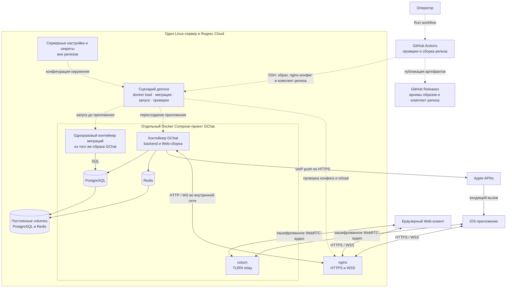

# Развёртывание GChat на одном сервере

Документ описывает процесс публикации и развёртывания. Согласованная основа: ручной запуск GitHub Actions, сборка Docker-образа и конфига nginx, передача релиза по SSH на существующий сервер в Яндекс Cloud, применение миграций и перезапуск приложения. Мотивация — [D009](../architecture/decisions/D009-manual-deployment.md). Дополнительно согласованы nginx на хосте, раздача Web из backend под `/apps/client` с перенаправлением `/` и TLS через Let’s Encrypt с автоматическим продлением. Параметры существующего сервера заполняются после подготовки workflow. Документ сохраняет статус draft для оставшихся эксплуатационных деталей; наличие комплекта не означает, что production-сервер настроен или нагрузочная приёмка выполнена.

## Цель и границы

Базовый вариант — развёртывание самостоятельного GChat на одном Linux-сервере без сборки приложения на целевом хосте и без Docker Registry. Backend, Web, PostgreSQL, Redis и coturn относятся только к GChat. Корневые `docker-compose.yml` и `setup.sh` обслуживают legacy Mattermost/Jitsi и не используются этим процессом.

Не добавляем платные сервисы: используем существующий сервер и GitHub Actions в пределах включённой квоты. Это не отменяет текущую оплату сервера, диска и трафика Яндекс Cloud. Превышение квоты Actions не должно автоматически приводить к платному расходу: владелец настраивает ограничение расходов в GitHub.

Первый этап — доставка серверного приложения. Сборка и распространение нативного iOS-приложения, Kubernetes, несколько серверов и обновление без перерыва в работе не входят в объём. Во время пересоздания приложения возможны разрывы WSS и активных звонков.

## Целевая нагрузка и предварительные ресурсы

Согласованная базовая нагрузка — 8 одновременных голосовых звонков один на один, то есть 16 одновременно разговаривающих пользователей. Аудио всех звонков проходит через собственный coturn по [контракту DirectCalls](../backend/modules/direct-calls/README.md#аудиотранспорт-через-coturn--согласовано).

Предварительный бюджет для одного сервера GChat: 2 vCPU с гарантированной долей 100%, 4 ГБ RAM и 40 ГБ SSD. Это оценка для планирования, а не подтверждённая нагрузочным тестом ёмкость. Ресурсы соседних приложений учитываются дополнительно. На диске предусматриваются постоянные данные, ограниченные по размеру логи, текущий и предыдущий релизы, а также место для установки нового; резервные копии хранятся отдельно от сервера.

Для расчёта сети закладывается 100 Кбит/с на один исходящий аудиопоток клиента с запасом на служебные данные. Это расчётное допущение, а не установленный в клиенте лимит битрейта. При 16 участниках сервер принимает примерно 1,6 Мбит/с и отправляет примерно 1,6 Мбит/с во внешнюю сеть. Планируемый канал — не менее 10 Мбит/с в каждую сторону. Исходящий аудиотрафик составляет около 0,72 ГБ за час полной нагрузки или 127 ГБ за 22 дня по 8 часов; Web, API, повторные передачи и резервные копии учитываются отдельно.

До подтверждения ёмкости требуется нагрузочная проверка 16 авторизованных клиентов с 8 одновременными звонками через TURN: двустороннее аудио, сохранение WSS, завершение и повторное создание звонков. В отчёте фиксируются длительность проверки, CPU, RAM, диск, сеть, потери пакетов, jitter и RTT; сама оценка ресурсов не считается результатом проверки.

## Подготовка Dialogs к production

Backend-контракт [DialogsModule](../backend/modules/dialogs/README.md) принят; базовый модуль, передача keyring в backend и изоляция ключей от мигратора реализованы. Согласованные расширения DTO отмечены в профильном контракте как ещё не реализованные. До production обязательны независимое резервирование ключей, расписание/оповещения backup и испытание полного restore. Единственный источник параметров — [правила резервирования и восстановления](../backend/modules/dialogs/README.md#резервирование-и-аварийное-восстановление). Адреса хранилищ/credentials и ответственный оператор задаются для конкретного окружения; существующий deploy-комплект не объявляется готовым backup-инструментом.

## Текущее состояние

- Есть локальный Compose PostgreSQL/Redis: [запуск backend](../../applications/backend/README.md). Это окружение разработки, не production-комплект.
- Есть отдельные команды миграций и создания администратора. [Миграции](../backend/operations/migrations.md) выполняются до запуска новой версии HTTP-приложения.
- Есть отдельные ручные workflow [сборки релиза с проверками backend-api и Web](../../.github/workflows/release.yml) и [деплоя готового релиза](../../.github/workflows/deploy.yml). [Комплект](../../deployment/gchat/) содержит Dockerfile, Compose, шаблон nginx и сценарии упаковки, проверки и установки релиза.
- Backend раздаёт `build:server` под `/apps/client`, `/apps/static/` и `/apps/` при заданном `GCHAT_WEB_ROOT`; HTTP-ответ HTML имеет `no-store`. Правила кеширования публичной оболочки через service worker описан в [Web](../web/README.md#pwa-web-push-и-кеширование). Проверки маршрутов находятся в `applications/backend/test/server-web.e2e.spec.ts`. Это не закрывает проверку production remote loading в Capacitor по [D008](../architecture/decisions/D008-capacitor-bridge.md).
- Изолированный `deployment/gchat/smoke.sh` проверяет образ, повторное применение миграций, readiness, HTTPS через nginx, Web assets, SPA и авторизованный WSS. Он не проверяет APNs, TURN-аудио или ёмкость восьми звонков. Настройка сервера и реальная SSH-выкладка выполняются отдельно.

## Состав окружения

| Компонент   | Назначение и жизненный цикл                                                                       |
| ----------- | ------------------------------------------------------------------------------------------------- |
| Образ GChat | Backend, собранный Web, SQL-миграции и production-зависимости. Заменяется при выпуске приложения. |
| PostgreSQL  | Собственные аккаунты и данные GChat; постоянное хранилище.                                        |
| Redis       | Состояние и блокировки по контрактам модулей; постоянное хранилище.                               |
| coturn      | Отдельный TURN-сервис с доступными клиентам сетевыми портами.                                     |
| nginx       | HTTPS, HTTP proxy и WSS upgrade; конфигурация входит в релиз.                                     |
| Мигратор    | Одноразовый процесс из того же образа, что и новая версия приложения.                             |

Предлагается отдельный Compose-проект GChat. Обычный выпуск приложения не пересоздаёт PostgreSQL, Redis и coturn и не обновляет версии их образов. Изменение инфраструктурных зависимостей выполняется отдельной обслуживающей операцией.

PostgreSQL и Redis недоступны из интернета. Backend доступен только nginx и внутренним проверкам. Наружу открываются HTTPS, необходимые порты TURN и ограниченный административный SSH-доступ. TURN не проксируется через HTTP nginx; конкретные адреса, порты и диапазон relay согласуются с сетью сервера.

## Диаграмма базового варианта

Целевая схема первого этапа: один сервер в Яндекс Cloud, Docker Compose и ручная доставка готового релиза. Сплошные линии показывают взаимодействия работающей системы, пунктирные — управление выпуском. Диаграмма описывает проектируемое размещение, а не уже развёрнутое окружение.



nginx работает на хосте, вне Compose, и проксирует запросы на loopback-порт приложения. Backend раздаёт Web-сборку из образа GChat. Клиенты получают временные TURN credentials от backend, а аудио передают через coturn, минуя nginx и backend. APNs — внешний сервис Apple, а не контейнер на нашем сервере.

Volumes и серверные секреты переживают замену релиза. PostgreSQL, Redis и coturn запускаются при подготовке окружения; обычный выпуск меняет приложение и при необходимости nginx-конфиг. Мигратор завершается до запуска новой версии приложения.

Базовый способ оркестрации — Docker Compose. Для более сложных окружений предоставляются Docker-образы собственных серверных компонентов GChat; модель поставки описана ниже. Kubernetes-манифесты и Helm charts в текущий объём поставки не входят.

## Поставка для сложных окружений

Для более сложного деплоя проект предоставляет готовые версионируемые Docker-образы всех собственных серверных компонентов. Владелец окружения самостоятельно выбирает оркестратор, размещение компонентов, внешние зависимости, сеть, секреты, постоянные хранилища и процесс обновления. Образы собираются в CI и не привязаны к SSH-сценарию базовой установки.

В текущем проекте единица поставки — образ GChat с backend и Web-сборкой. Мигратор запускается отдельной командой из того же образа. Это не вводит новые сервисы и не требует отдельного образа для каждого backend-модуля. Если в будущем появятся другие самостоятельно развёртываемые серверные компоненты GChat, для каждого будет предоставляться собственный образ. Нативное iOS-приложение распространяется отдельно.

PostgreSQL, Redis, coturn и nginx — внешние зависимости: используем образы их поставщиков либо совместимые сервисы окружения. Собственные копии этих образов не выпускаем. Для базовой установки сохраняется отдельный комплект с nginx-конфигом и Compose.

Вместе с нашими образами документируются команды запуска приложения и миграций, обязательные настройки, сетевые интерфейсы, проверки готовности и требования к постоянным данным. Версии идентифицируются однозначно; секреты окружения в образы не включаются. Один и тот же образ релиза используется в базовом и сложном вариантах размещения.

Все Docker-образы собственных компонентов GChat публикуются в GitHub Releases соответствующей версии приложения как скачиваемые архивы `docker save` со сжатием (`.tar.gz`). Вместе с ними публикуются manifest и контрольные суммы. Владелец установки скачивает нужный архив, проверяет checksum и загружает образ через `docker load`; Docker Registry для получения образов не требуется. Образы внешних зависимостей остаются у их поставщиков.

Публикуемые архивы и комплект, передаваемый по SSH на наш сервер, относятся к одной сборке и содержат те же образы без повторной сборки. Публикация GitHub Release сама по себе не развёртывает приложение; деплой выполняется как выбранное продолжение ручной сборки либо отдельным ручным запуском.

Готовые Helm charts, Kubernetes-манифесты и отдельный pipeline для чужого оркестратора не входят в обязательства текущего этапа. Возможность их добавления в будущем не считается согласованным планом реализации.

## Состав релиза

Комплект одной версии:

| Артефакт              | Содержание                                                                                                    |
| --------------------- | ------------------------------------------------------------------------------------------------------------- |
| `gchat-image.tar.gz`  | Экспорт Docker-образа через `docker save` со сжатием.                                                         |
| `nginx.conf.template` | Шаблон конфигурации GChat без приватных ключей, заполняемый на сервере.                                       |
| `compose.yaml`        | Описание приложения и отдельного запуска мигратора; инфраструктурные сервисы запускаются явно при подготовке. |
| `deploy.sh`           | Серверный сценарий проверки, установки и диагностики релиза.                                                  |
| `release.json`        | SHA исходников, уникальный ID сборки, платформа, тег и image ID, версия формата комплекта.                    |
| `SHA256SUMS`          | Контроль целостности переданных файлов.                                                                       |

В комплект также входят `render-nginx.py` и `verify-release.py`. Файл `nginx.conf` формируется на сервере из домена и loopback-порта; конфигурация nginx проверяется и в CI с временным сертификатом, и на сервере в фактическом контексте. Тег образа включает SHA коммита и ID запуска/попытки сборки: повторная сборка одного SHA не перезаписывает идентичность предыдущего релиза. `latest` не используется для выбора версии. Образ собирается под платформу целевого сервера, которая выбирается при ручном запуске workflow (`linux/amd64` или `linux/arm64`) и сверяется с Docker Engine сервера.

Образ создаётся многостадийной сборкой. Отдельная стадия `web-build` выполняет `build:server`; её `dist/` копируется непосредственно в `/app/web` итогового образа. Backend получает `GCHAT_WEB_ROOT=/app/web` и раздаёт HTML и assets из этого каталога. Workflow релиза и обычный CI также явно выполняют шаг **Build server Web client**; проверка готового образа загружает клиентские маршруты и статические файлы через HTTPS nginx. Версии Node.js и pnpm берутся из `.nvmrc` и `package.json`, зависимости — из `pnpm-lock.yaml` с frozen lockfile. В финальный образ входят `dist`, каталог `drizzle`, Web-сборка и production-зависимости; секреты, `.env`, APNs-ключ и инструменты разработки туда не включаются. Процесс приложения запускается от непривилегированного пользователя.

Комплект публикуется как вложения GitHub Release вместе с архивами всех наших образов этой версии и доставляется напрямую по SSH. GitHub Actions Artifacts не является каналом поставки. Релиз связывает версию приложения с полным SHA и идентификаторами сборки/образов из manifest; опубликованные файлы не заменяются другой сборкой под той же версией. Повторная установка возможна из GitHub Release или сохранённого серверного комплекта.

## Запуск GitHub Actions

Оператор запускает workflow через `workflow_dispatch` / **Run workflow**; workflow деплоя также вызывается сборкой через `workflow_call`. Согласованные правила и критерии продолжения сборки деплоем описаны в [D009](../architecture/decisions/D009-manual-deployment.md#согласованное-продолжение-сборки-деплоем). Этот объём готов к реализации; статус draft документа относится к оставшимся эксплуатационным вопросам. Пуш, pull request и создание тега не запускают выкладку. Обычный CI может продолжать работать автоматически.

Оператор выбирает ref в интерфейсе GitHub, тип повышения версии `patch`, `minor` или `major` (по умолчанию `patch`) и платформу в **GChat build release**. Workflow получает все страницы тегов и GitHub Releases, включая draft-релизы, и берёт максимальную стабильную версию формата `vMAJOR.MINOR.PATCH` по числовому сравнению. Остальные имена и prerelease-версии не участвуют в расчёте. Если стабильных версий нет, база — `v0.0.0`: первый `patch` даёт `v0.0.1`, `minor` — `v0.1.0`, `major` — `v1.0.0`. Повышение minor обнуляет patch, повышение major — minor и patch. Вычисленная версия выводится в логи и итог workflow и используется для manifest и GitHub Release. Форма содержит включённую по умолчанию галочку **Deploy after build** (`deploy`). После успешной публикации она запускает отдельный deploy-job с вычисленным тегом текущей сборки; выключенная галочка оставляет только сборку и публикацию без серверных настроек. Для отдельной выкладки оператор запускает **GChat deploy release** и указывает существующий опубликованный тег, например `v0.0.2`. Deploy-job скачивает образ и комплект из GitHub Releases без сборки, проверяет checksum и совпадение версии с manifest. Draft-релиз, отсутствующие файлы или повреждённый комплект блокируют доставку. Для публикации требуется, чтобы тег выбранной версии ещё не существовал; повторное использование опубликованной версии запрещено. Версия незавершённого draft-релиза учитывается как занятая: следующий ручной запуск вычисляет версию выше неё. Ошибка получения тегов или релизов останавливает workflow; она не трактуется как отсутствие версий. Workflow фиксирует полный SHA checkout и использует его во всех шагах; во время передачи или установки не выполняется повторный checkout подвижной ветки. До передачи показываются SHA и целевое окружение без секретов.

Сборка и публикация (**GChat build release**):

1. Checkout, установка версий инструментов из репозитория и зависимостей из lock-файла.
2. Проверки backend и Web: typecheck, относящиеся тесты, сборка, проверка SDK-контракта и документации. Интеграционные сценарии требуют отдельного тестового окружения; отсутствие такого окружения не считается успешным прогоном.
3. Сборка Web и production-образа, проверка наличия Web и миграций в образе; подготовка nginx-конфига и остальных артефактов.
4. Проверка Compose и nginx-конфига в тестовом окружении, формирование manifest и checksum.
5. Публикация архивов всех собственных Docker-образов и комплекта с manifest/checksum в GitHub Release соответствующей версии приложения. Ошибка публикации останавливает процесс до выкладки.

Выкладка (**GChat deploy release**, вызов после сборки или отдельный ручной запуск):

1. Скачать комплект выбранной версии из GitHub Releases, проверить checksum и версию manifest. Ни Node.js/pnpm, ни сборка Docker-образа для этого задания не нужны.
2. Передать комплект по SSH во временный каталог, проверить его на сервере и под блокировкой перенести в каталог релиза. Повторная выкладка допускает использование существующего идентичного проверенного комплекта; несовпадение файлов останавливает доставку.
3. Сбросить результат предыдущей попытки, запустить серверный сценарий и дождаться нового итогового статуса.

Одновременно допускается только одна выкладка в окружение. Deploy-workflow использует concurrency-группу `gchat-production-deploy` без отмены активного запуска; сборки сериализованы отдельно для вычисления версии. Серверный сценарий удерживает локальную блокировку на весь процесс. Отмена Actions не является откатом и не должна запускать конкурирующий мигратор; повторный запуск допускается после завершения серверной операции и проверки её состояния.

## Настройки и секреты

В текущей реализации GitHub хранит доступ доставки: SSH host/port/user, ключ доступа и заранее проверенный host key сервера; также задаются путь установки и целевое окружение. Для Dialogs реализована дополнительная передача ключей шифрования из GitHub Secrets в защищённый `backend.env` на сервере и далее в окружение backend. Контракт и границы подключения — в [DialogsModule](../backend/modules/dialogs/README.md#серверное-шифрование-и-ключи); workflow и изоляция мигратора реализованы. Для интерполяции DATABASE_URL Compose CLI дополнительно читает `backend.env`; контейнер мигратора получает только DATABASE_URL. Сценарии исключают экспортированный DATABASE_URL из окружения Compose, чтобы мигратор использовал тот же backend.env, что приложение. Это не перенос остальных серверных секретов в GitHub.

Проверка host key обязательна, отключение StrictHostKeyChecking не используется. Аккаунт доставки получает только необходимые права; доступ к Docker фактически даёт высокие привилегии на хосте и учитывается при настройке аккаунта.

На сервере вне каталогов релиза хранятся:

- `.env` приложения: подключения к БД/Redis, ключи Auth, TURN и параметры APNs/Origin по [примеру backend](../../applications/backend/.env.example) и контрактам владельцев.
- APNs `.p8`, TLS-сертификат и приватный ключ; файлы подключаются только нужным процессам, по возможности read-only.
- Постоянные volumes PostgreSQL и Redis, резервные копии и сведения о текущем/предыдущем релизе.

Секреты генерируются при подготовке окружения и не меняются при повторном деплое. Локальные пароли из `.env.example` в production не используются. `.env` не загружается в CI и не попадает в manifest, образ, архив или логи. Backend в контейнере слушает контейнерный интерфейс, а URLs PostgreSQL/Redis используют адреса внутренней сети, а не loopback хоста.

## Подготовка сервера и первый запуск

До первой серверной выкладки оператор устанавливает Docker Engine и Compose, настраивает пользователя доставки, отдельные каталоги GChat и доступ к серверу. Нужны свободное место для текущего и нового образов, публичный адрес, DNS, TLS и сетевые правила Яндекс Cloud/хоста. Структура каталогов, подготовка TLS и параметры workflow описаны ниже; их заполнение отложено до настройки сервера.

Инфраструктурные сервисы впервые запускаются отдельной подготовительной операцией. Проверяются их готовность, persistence Redis, резервное копирование PostgreSQL и соответствие TURN shared secret настройкам backend. Правила хранения/восстановления — в [контрактах восстановления](../backend/operations/recovery.md); подробности не дублируются в этом документе.

Первый релиз затем проходит тот же серверный сценарий, что и обновления. После миграций администратор создаётся интерактивной CLI-командой из образа по [контракту Auth](../backend/modules/auth.md#cli), без передачи пароля через Actions или аргументы командной строки. Это отдельная первоначальная операция, не часть каждого деплоя.

Исходная цель «одна команда для другого владельца установки» сохраняется как последующий удобный интерфейс к этому комплекту. Самодостаточный установщик, автоматически подготавливающий чистый сервер, на первом этапе не обещается.

## Серверная установка релиза

1. Получить блокировку, проверить полноту и checksum комплекта, соответствие manifest и платформы. Неполный входящий каталог не считается релизом.
2. Загрузить образ через `docker load`, проверить его image ID и тег. Проверить Compose, наличие обязательной конфигурации и файлов без вывода секретов.
3. Подготовить и проверить nginx-конфиг в фактическом серверном контексте. Ошибка проверки останавливает обновление до остановки приложения.
4. Проверить готовность PostgreSQL/Redis и наличие пригодной резервной копии БД перед изменением схемы. Сбой подготовки оставляет текущую версию работающей.
5. Остановить контейнер приложения и выполнить миграции отдельным одноразовым контейнером новой версии. Это простая схема с обслуживающим перерывом, не требующая совместной работы старого приложения с новой схемой. Миграторы не запускаются параллельно.
6. При успешных миграциях запустить новую версию приложения, дождаться внутреннего `/ready` с ограниченным временем ожидания.
7. Установить подготовленный nginx-конфиг, выполнить `nginx -t` и reload. Если nginx ещё не запущен, выполнить его первоначальный запуск. Проверить внешний HTTPS-маршрут готовности, HTML и статические ресурсы Web, прямую загрузку вложенного клиентского URL.
8. Только после успешных проверок записать релиз как текущий, сохранить предыдущий комплект и завершить workflow успешно.

Для повторного запуска завершённого релиза сценарий сначала сверяет текущую версию и готовность. Частично выполненный релиз диагностируется по фактическому состоянию; новый запуск не должен удалять постоянные данные или безусловно повторять первоначальную настройку.

## nginx и Web

Сохраняется один HTTPS-origin для Web, API и WSS. `/api/*` проксируется в backend без префикса `/api`; `/ws` сохраняет исходный Origin и поддерживает WebSocket upgrade. Допустимый origin настраивается в backend явно. Внешняя проверка `/api/ready` соответствует внутреннему `/ready`.

Целевые пути серверной Web-сборки — `/apps/client` и `/apps/static/`, дополнительные публичные файлы — под `/apps/`. SPA fallback не должен перехватывать API, WS и отсутствующие статические файлы или терять path/query. Правила приложения принадлежат [Web](../../applications/web/README.md) и [D008](../architecture/decisions/D008-capacitor-bridge.md).

Backend включает раздачу при заданном `GCHAT_WEB_ROOT` и отказывается запускаться, если указанный HTML отсутствует. В образе это `/app/web`. GET/HEAD `/apps/client` и вложенные пути возвращают HTML без перенаправления; assets и публичные файлы обслуживаются под `/apps/`, отсутствующие файлы получают 404. Корневой `/` перенаправляет на `/apps/client` с сохранением query. nginx на хосте использует `/etc/nginx/conf.d/gchat.conf`, TLS-сертификаты — `/etc/letsencrypt/live/<домен>/`. Шаблон сохраняет HTTP-маршрут ACME challenge для автоматического продления.

## Ошибки и возврат предыдущей версии

Ошибка любого обязательного шага означает неуспешный workflow. В итоговом отчёте показываются SHA, ID релиза, этап отказа и состояние приложения; секреты и строки подключения не публикуются.

До остановки приложения ошибка подготовки не меняет текущий релиз. После остановки сервер сообщает о перерыве; успех `/ready` сам по себе не доказывает работоспособность схемы, авторизации, APNs или аудио — [границы healthcheck](../backend/modules/healthcheck.md).

Автоматический возврат старого образа после миграций не обещается. Предыдущая версия запускается вручную только при подтверждённой совместимости со схемой. Down-миграции не выполняются; восстановление БД и согласование состояния Redis требуют отдельной процедуры восстановления. При ошибке nginx восстанавливается предыдущий конфиг, но весь релиз остаётся неуспешным до проверки итогового состояния приложения.

Очистка старых комплектов выполняется только после успешной выкладки, с сохранением текущего и предыдущего. Не применяются `down -v` и глобальная очистка Docker, способная затронуть данные GChat или другие приложения сервера.

## Критерии приёмки

- Пуши и теги не доставляют код на сервер; Run workflow разворачивает выбранный SHA.
- Приложение на сервере не собирается, registry и облачные секреты Яндекс Cloud для SSH-доставки не нужны.
- GitHub Release содержит архивы всех собственных Docker-образов версии, manifest и checksum; скачанные образы загружаются через `docker load` и совпадают с доставленными на сервер. Продолжение сборки деплоем выполняется только при включённой галочке `deploy` и успешной публикации; сама публикация не является триггером.
- На подготовленном сервере выполняются первый запуск и повторная установка того же релиза.
- Конкурирующая выкладка не запускает второй мигратор; проверено поведение при отмене workflow и обрыве SSH.
- Обновление сохраняет аккаунты, секреты и постоянные данные; инфраструктурные контейнеры не пересоздаются обычным выпуском приложения.
- Проверены отказ передачи, неверная checksum, нехватка места, ошибка nginx, миграций и readiness. Ни один отказ не выдаётся за успешную выкладку.
- Проверены HTTPS, API, WSS с авторизованным клиентом, SPA fallback и загрузка Web по серверным путям. Реальные APNs и TURN-аудио проверяются отдельно, не подменяются healthcheck.
- Подтверждена целевая нагрузка 8 одновременных звонков между 16 пользователями через TURN; результаты и потребление ресурсов зафиксированы в отчёте нагрузочной проверки.
- Продемонстрирован ручной возврат предыдущего образа при совместимой схеме; описан порядок восстановления при несовместимой.
- Проверено отсутствие секретов в слоях образа, артефактах и выводе workflow.

## Использование workflow и подготовка сервера

Для отдельной проверки доступа с GitHub runner предусмотрен ручной [GChat deployment access check](../../.github/workflows/deployment-check.yml). Он использует те же SSH Variables и Secrets, проверяет доступ к Docker, nginx и каталогам установки и сообщает о наличии серверных файлов без вывода их содержимого. Успех этой проверки не означает готовность приложения к деплою: конфигурация, сертификат и инфраструктурные сервисы проверяются отдельно. Релиз не публикуется и не устанавливается.

Workflow появляются в Actions после попадания файлов в default branch. **GChat build release → Run workflow** собирает новую версию по выбранному типу повышения и платформе и при включённой галочке **Deploy after build** выкладывает её тем же workflow деплоя. **GChat deploy release → Run workflow** устанавливает существующую версию по тегу, не запуская сборку; его можно повторять для того же релиза. Выбор ref в форме деплоя выбирает код workflow и инструменты доставки, а исходники приложения определяются скачанным manifest. Предыдущая версия допускается к ручной установке только после проверки совместимости схемы. GitHub Token получает `contents: write` только в задании релиза. Артефакты публикуются в GitHub Releases; registry и Actions Artifacts не используются. Публикация создаёт draft с полным комплектом и затем открывает его; существующие версии не перезаписываются.

Настройки репозитория нужны для деплоя (в том числе после сборки) и проверки SSH-доступа:

| Тип      | Имя                     | Значение                                                                         |
| -------- | ----------------------- | -------------------------------------------------------------------------------- |
| Variable | `GCHAT_SSH_HOST`        | DNS-имя или IPv4 сервера                                                         |
| Variable | `GCHAT_SSH_PORT`        | SSH-порт                                                                         |
| Variable | `GCHAT_SSH_USER`        | Пользователь доставки                                                            |
| Variable | `GCHAT_INSTALL_ROOT`    | Абсолютный путь, например `/opt/gchat`; буквы, цифры, `/`, `_`, `-`              |
| Secret   | `GCHAT_SSH_KEY`         | Приватный SSH-ключ доставки                                                      |
| Secret   | `GCHAT_SSH_KNOWN_HOSTS` | Заранее проверенная запись known_hosts; для нестандартного порта — `[host]:port` |

Серверный комплект рассчитан на Linux с Docker Engine, Compose v2 (поддержка нескольких `--env-file`, `--wait`), Bash, Python 3, `flock`, curl, GNU coreutils, nginx и systemd. Пользователь доставки имеет доступ к Docker и необходимые права `sudo -n` для установки только GChat-конфига nginx, его проверки и start/reload. Права настраиваются оператором с учётом привилегий Docker.

В каталоге установки используются:

- `shared/compose.env` по [примеру](../../deployment/gchat/compose.env.example). Значения домена, порта и таймаута задаются простыми строками без кавычек. `GCHAT_SHARED_DIR` указывает на этот `shared/`.
- `shared/backend.env` по [примеру backend](../../applications/backend/.env.example), с production-секретами. `DATABASE_URL` использует `postgres:5432`, `REDIS_URL` — `redis:6379`; пароли совпадают с `compose.env`, origin — публичный HTTPS-origin. Это формат Compose env_file: JSON и ключи с буквальными `\n` рекомендуется заключать в одинарные кавычки.
- `shared/secrets/apns.p8`, доступный контейнерному пользователю UID 1000 для чтения; каталог монтируется read-only. При `APNS_ENABLED=true` (по умолчанию) требуется действительный ES256-ключ. Для Web без Apple Developer задать `APNS_ENABLED=false` в `backend.env`: APNs-реквизиты и файл ключа не требуются, каталог `shared/secrets/` остаётся для монтирования. Правила отключения принадлежат [Push](../backend/modules/push.md#конфигурация).
- `shared/turnserver.conf` по [примеру](../../deployment/gchat/turnserver.conf.example), с публичным/NAT-адресом и тем же TURN shared secret, что у backend. Для файла с режимом `640` задать `GCHAT_CONFIG_GID` равным группе владельца файла (`id -g gchat-deploy`): coturn получает эту дополнительную группу для чтения секрета. Пример использует TCP/UDP 3478 и UDP 49160–49259; проверить сетевые правила и доступность с клиентских сетей. Это TURN без TLS; сети, блокирующие эти порты, требуют отдельно настроенного `turns:` и сертификата coturn.
- `shared/backups/` для резервной копии перед миграциями; требуется отдельное копирование за пределы сервера и проверка восстановления. Сценарий проверяет читаемость оглавления `pg_restore --list`, что не заменяет восстановление.
- `incoming/<releaseId>/` для комплектов, `current` и `previous` как указатели успешных релизов, `deploy.lock` для сериализации. Старые комплекты, образы и backups автоматически не удаляются; оператор контролирует место и срок хранения.

До первой выкладки подготовить HTTP-vhost с ACME webroot `/var/www/letsencrypt`, выпустить сертификат Let’s Encrypt для выбранного домена и настроить системный таймер Certbot с deploy-hook `nginx -t && systemctl reload nginx`. Готовый HTTPS-конфиг требует уже выпущенного сертификата; bootstrap TLS не выполняется workflow. На существующем сервере сначала проверить соседние vhost и занятость портов. Выпуск и продление подтверждаются оператором при настройке.

После скачивания и проверки комплекта инфраструктура запускается отдельной командой (пути адаптируются к установке):

```sh
export GCHAT_SHARED_DIR=/opt/gchat/shared
# image.env содержит GCHAT_IMAGE из проверенного release.json.
docker compose -p gchat --env-file "$GCHAT_SHARED_DIR/backend.env" --env-file "$GCHAT_SHARED_DIR/compose.env" \
  --env-file /opt/gchat/incoming/RELEASE_ID/image.env \
  -f /opt/gchat/incoming/RELEASE_ID/compose.yaml \
  --profile infrastructure up -d --wait postgres redis coturn
```

`image.env` можно создать вручную из проверенного manifest перед bootstrap; серверный `deploy.sh` формирует его автоматически при установке. Приложение и мигратор этой командой не запускаются. Обычная выкладка проверяет существующие PostgreSQL/Redis, но не обновляет инфраструктуру.

SSH запускает сценарий через `nohup`, затем опрашивает файл `result`; серверная блокировка действует до конца операции независимо от соединения. Обрыв SSH или отмена Actions не останавливает миграции и не выполняет откат. Диагностика хранится в `<release>/deploy.log`, итог — в `<release>/result`. При отказе серверный лог проверяется на месте и не выгружается целиком в Actions. Перед повторным запуском проверить lock, итог и фактическое состояние приложения. После миграций автоматического возврата старого образа нет.

Для интерактивного создания администратора используется `docker compose ... run --rm --no-deps app node dist/auth/admin-cli.js` с аргументами из [Auth CLI](../backend/modules/auth.md#cli); пароль вводится в терминале. Ручной возврат совместимой версии выполняется серверным сценарием из сохранённого предыдущего комплекта после проверки совместимости схемы; несовместимая схема требует процедуры восстановления.

## Открытые решения

Перед первой серверной выкладкой уточнить:

- Архитектуру CPU, ОС и свободные ресурсы существующего сервера, установленные Docker/nginx и соседние приложения.
- Домен, публичный адрес и доступные TURN-порты; проверить выпуск сертификата и автоматическое продление Let’s Encrypt на этом хосте.
- SSH-пользователя и путь установки; заполнить серверные настройки и при необходимости изменить время ожидания готовности (по умолчанию 120 секунд).
- Доступные APNs-реквизиты, место хранения резервных копий, срок хранения и проверку восстановления.
- Допустимые refs для ручного деплоя и права запуска workflow; ручной запуск сам по себе не ограничивает выбор кода.

Эти вопросы не меняют согласованный ручной способ доставки, но не считаются уже принятыми решениями.

## Развёртывание PWA и Web Push

Контур реализован по принятому [D010](../architecture/decisions/D010-web-push-pwa.md); настоящая фоновая доставка требует отдельной приёмки. Правила установки и кеша принадлежат [Web](../web/README.md#pwa-web-push-и-кеширование), настройки VAPID и процедура получения ключей — [Push](../backend/modules/push.md#web-push). Это не инструкция немедленного включения на рабочем сервере.

Релизная проверка должна подтверждать комплектность PWA до публикации образа:

- Docker-сборка проверяет наличие `sw.js`, `site.webmanifest` и основных иконок вместе с HTML и JS/CSS.
- Отдельный Chromium-прогон обеих сборок проверяет офлайн-навигацию, согласованное обновление окон, откат и сохранение предыдущего кеша при неполной публикации. Он не использует звонковый стенд; команда и границы описаны в [E2E](../../tests/e2e/README.md#проверки-production-pwa-без-звонкового-стенда).
- Изолированный smoke-тест образа через nginx проверяет доступность worker, manifest и всех объявленных иконок, корректный MIME и `Cache-Control: no-cache` для worker/manifest; HTML сохраняет `no-store`, хешированные JS/CSS — `immutable`. HTML вместо статики считается ошибкой.
- В smoke-тесте Web Push включается с одноразовой тестовой VAPID-парой, APNs выключен. Авторизованный WSS выполняет `device.register`, чтение публичной конфигурации, регистрацию и удаление тестовой подписки. Создание вызова и отправка настоящему push-провайдеру не выполняются. Эти проверки подтверждают конфигурацию, миграцию и регистрационный путь, но не доставку.

Для включения требуется применить подготовленную миграцию подписок/outbox штатной командой до запуска новой версии, опубликовать полную `build:server` и задать VAPID-настройки в защищённом окружении backend. Ключи сохраняются между релизами; в Docker image и frontend попадает только публичная часть через конфигурацию сервиса. Web Push не требует включения APNs.

Reverse proxy должен пропускать `/apps/sw.js`, `/apps/site.webmanifest` и иконки как статические файлы, сохраняя MIME и заголовки свежести backend. SPA fallback не подставляется вместо worker и assets. HTTPS обязателен вне доверенного localhost. Backend требуется исходящий HTTPS к разрешённым браузерным push-провайдерам.

Перед включением проверяются установка PWA, состояние подписки, настоящая доставка, закрытая страница, выход и смена аккаунта, обновление и откат кеша. Старая открытая PWA может продолжать работать на предыдущей сборке до нажатия «Обновить» или закрытия её окон. Обновление откладывается на время звонка во всех окнах профиля; перезапуск backend не активирует новый service worker принудительно.
