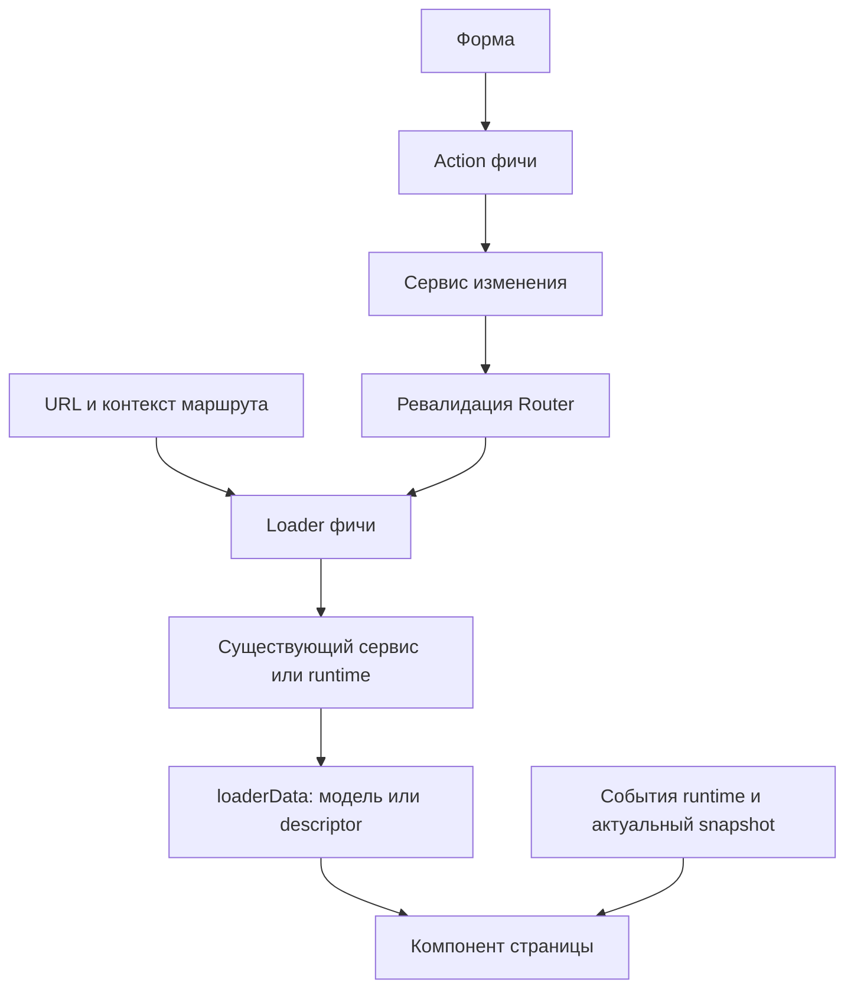

# Архитектурный паттерн веб-клиента

Практическое описание текущего кода: **страницы подготавливаются маршрутизатором, живые данные принадлежат runtime, оболочка собирает интерфейс из недоменных примитивов**. Документ объясняет, как части работают вместе и куда добавлять изменения; он не вводит новый публичный контракт и не объявляет миграцию или платформенную приёмку завершённой.

Требования остаются у владельцев: [поток данных и маршрутизация](data-flow.md), [API device](device-api.md), [общая оболочка и UI kit](README.md), [bootstrap диалогов](bootstrap.md). Мотивация разделения оболочки — в принятом решении (`docs/web/layout-refactor.md`).

Описание относится к веб-рефакторингу. В отдельной ветке правил линтинга его реализация может отсутствовать: пути в кодовом формате указывают на компоненты этого рефакторинга и не подтверждают их включение в текущую ветку.

## Состав и границы

| Часть                 | Ответственность                                                                                  | Пример текущего кода                                                                                                                                               |
| --------------------- | ------------------------------------------------------------------------------------------------ | ------------------------------------------------------------------------------------------------------------------------------------------------------------------ |
| Композиция приложения | Создание device, передача маршрутов и контекста; размещение долгоживущих владельцев выше страниц | [main.tsx](../../applications/web/src/main.tsx), [App.tsx](../../applications/web/src/app/App.tsx)                                                                 |
| Дерево маршрутов      | URL, доступ, вложенность, точки ленивой загрузки и метаданные раскладки                          | [routes.tsx](../../applications/web/src/app/routes.tsx), [session-middleware.ts](../../applications/web/src/app/session-middleware.ts)                             |
| Loader/action фичи    | Подготовка данных входа, валидация параметров, вызов сервиса, результат операции                 | loaders настроек (`applications/web/src/features/settings/loaders.ts`), [маршруты admin](../../applications/web/src/features/administration/routes.ts)             |
| Device                | Типизированный доступ к HTTP, сессии, устройству и платформенным возможностям                    | [shared/device](../../applications/web/src/shared/device/)                                                                                                         |
| Runtime и его модели  | Живое состояние, локальное хранение, синхронизация и события независимо от страницы              | DialogBootstrap (`applications/web/src/shared/dialogs/bootstrap.ts`), [DialogRuntime](../../applications/web/src/shared/dialogs/runtime.ts)                        |
| Страница фичи         | Отображение loaderData и подписок, шапка, действия пользователя, временное состояние интерфейса  | [переписка](../../applications/web/src/features/dialogs/DialogConversationRoute.tsx), [файлы](../../applications/web/src/features/settings/SettingsFilesRoute.tsx) |
| Оболочка app          | Общая геометрия, меню, viewport, уведомления и представление глобальных окон                     | app/layout (`applications/web/src/app/layout`)                                                                                                                     |
| UI kit                | DOM-примитивы, общие стили и визуальные токены                                                   | [shared/ui](../../applications/web/src/shared/ui/)                                                                                                                 |

`app` связывает части приложения, `features` содержат предметные экраны и операции, `shared` предоставляет переиспользуемые сервисы и примитивы. Из `shared` нет импортов в `features` или `app`. Страницы обращаются к платформенным возможностям через device; выбор browser/native и сырой bridge остаются в адаптерах.

Есть явная интеграционная зависимость текущего кода: loaders настроек и диалогов импортируют `applicationCore` из `app/router-context`. Это типизированное получение созданного device, а не отдельная фабрика сервисов. Данная структура не описывается как строгая слоистая архитектура с запретом любых импортов из features в app.

## Вход на страницу и дальнейшие обновления

Начальное чтение выполняется loader до рендера страницы при входе на маршрут. Device берётся из типизированного Router context; `sessionMiddleware` защищает ветку, профильный обработчик проверяет права и входные данные. Контекст каждого перехода/fetcher новый, экземпляр device общий. Компонент получает подготовленную модель или ссылки на device/runtime через loaderData, без глобального SDK и запуска начальной загрузки в эффекте.

В коде используются три формы этой схемы:

- **Данные страницы:** контакты и admin получают снимок через loaderData. Изменение admin выполняет action, после успеха Router ревалидирует данные. Отображающий компонент не создаёт синхронизируемую копию ответа в useState.
- **Живые данные:** loader диалогов (`applications/web/src/features/dialogs/loaders.ts`) проверяет dialogId, ждёт общий bootstrap, подготавливает локальные модели и начинает сверку. Возвращается descriptor `{ device, runtime, dialogId }`; список и переписка читают snapshots моделей через подписки. Локальная история показывается без ожидания сети; без неё loader ждёт первую попытку. Ошибка синхронизации принадлежит модели.
- **Состояние устройства:** loader настроек обновляет существующий observer через loadDeviceSettings (`applications/web/src/shared/device/load-settings.ts`). [useSettingsDevice](../../applications/web/src/features/settings/useSettingsDevice.ts) использует live snapshot и начальный результат loader, а после успешной команды вызывает revalidation. Список файловых доступов принадлежит loaderData; loader собирает все страницы выдачи.

Форма хранения результата определяется владельцем данных: loaderData для данных маршрута, runtime для изменяющейся модели, useState для локального ввода, открытия окна и состояния команды. Query provider, второй кеш или эффект копирования runtime в состояние страницы в эту схему не добавляются. Команды с user activation вызываются непосредственно в обработчике жеста через device; пользовательские отправки и черновики диалогов остаются у runtime/outbox. Подробные гарантии — в [потоке данных](data-flow.md#направление-данных).

## Время жизни и отмена

[DeviceProvider](../../applications/web/src/shared/device/react.tsx) подключает жизненный цикл и router. В `App` выше страниц находятся AuthProvider, NavigationProtectionRoot, BootstrapProvider и CallsProvider; входящий звонок и поверхность камеры также не принадлежат отдельной странице. Смена URL не создаёт заново сессию, WSS, медиадвижок или выбранный звонок.

`dialogBootstrap(device)` хранит одного владельца на экземпляр device в WeakMap. Он доступен loader до монтирования React, пересоздаёт runtime/storage при смене session scope и останавливается по lifecycle. React `BootstrapProvider` подписывается на того же владельца через useSyncExternalStore; ожидание loader не зависит от эффекта Provider.

`request.signal` отменяет ожидание перехода и предотвращает публикацию позднего результата. Отмена страницы не останавливает общий runtime; смена сессии, напротив, закрывает старый scope и скрывает его данные. Эффекты страниц остаются у подписок, видимости, выбора переписки, фокуса, скролла и очистки локальных ресурсов. Несохранённый ввод защищает общий blocker, а не отдельные подтверждения каждой платформы.

## Оболочка и метаданные маршрута

[AppLayout](../../applications/web/src/app/AppLayout.tsx) только собирает `LayoutProvider → LayoutOverlaysProvider → AppShell`.

`layoutRoute(section, scroll)` записывает типизированный handle в статическое дерево. LayoutProvider читает последний подходящий handle из `useMatches`, вычисляет текущий раздел, название области, доступное меню и presentation-параметры. Вложенный экран наследует метаданные родителя. Определение раздела не требует разбора pathname; скрытие admin-пункта меню не заменяет проверку доступа обработчика.

AppShell (`applications/web/src/app/layout/AppShell.tsx`) размещает индикатор перехода, возврат к звонку, viewport с PageContent/PageSurface и Outlet, нижнее меню и окна. Шапку с заголовком, возвратом и предметными действиями собирает сама страница через PageHeader.

Распределение прокрутки задаёт приложение: режим `page` использует общий внутренний viewport, `contained` оставляет скроллы панелям диалогов. Корневой документ зафиксирован стилями оболочки; LayoutViewport сбрасывает свой скролл при смене pathname. UI kit документом не управляет.

LayoutOverlaysProvider (`applications/web/src/shared/device/LayoutOverlaysProvider.tsx`) относится к React-интеграции device: хранит открытие диагностики и вычисляет её доступность из device-состояния. Он не импортирует доменный диалог. Представление и lazy import DiagnosticsDialog принадлежат `app/layout/LayoutOverlays`.

## Ленивые границы и состояния перехода

Таблица URL, middleware, handles и доступные границы ошибок остаются статическими. UI и обработчики загружаются отдельными импортами object-form `route.lazy`; UI не обязан импортироваться для выполнения loader. Вложенные маршруты выражают композицию через Outlet: список диалогов сохраняется при открытии переписки, admin-список — при открытии карточки. Каждый адресуемый экран настроек имеет отдельную точку импорта.

Панель без собственного URL использует React.lazy и локальную границу загрузки/ошибки. Загрузка карточки звонка или диагностики не управляет жизненным циклом звонкового владельца. Глобальный входящий контейнер сохраняет базовые действия и при недоступности тяжёлой панели.

Общий RoutePending показывает Router navigation/revalidation через недоменный LoadingBar. Минимальная длительность быстрых GET-переходов задаётся middleware layout-ветки; визуальное завершение полосы принадлежит UI. Сетевую загрузку и таймеры не дублируют в страницах. Точные длительности, анимация, reduced motion и прокрутка определены в [контракте оболочки](README.md).

## Примитивы и стили

В `shared/ui` один примитив хранится в одноимённом файле, `index.ts` содержит экспорты. Стили новых примитивов находятся рядом; `tokens.css` задаёт базовые шкалы и семантические значения. Примитив принимает DOM props, children и параметры представления, сохраняя нативную семантику и доступность. Он не загружает данные, не вызывает device и не выбирает маршрут.

Например, Card задаёт поверхность, Text — типографику, Button — общие варианты кнопки, PageHeader — геометрию шапки. Имя собеседника, ссылка назад, разрешённость звонка и обработчик остаются у страницы. Skeleton получает готовый признак loading; решение о загрузке, ошибке или пустом состоянии принадлежит потребителю. Разделы выбирают доменную композицию и используют общие токены; исключения для CSS queries и измеренных координат описаны в контракте UI kit.

## Как применять паттерн при следующем изменении

1. Найти профильный принятый контракт и убедиться, что поведение и критерии готовы к реализации. Это описание кода само по себе не согласует новую архитектуру.
2. Добавить URL в статическое дерево; выбрать защищённую ветку, handle раскладки и родительский Outlet. Подключить отдельные lazy-точки UI и обработчиков.
3. В loader валидировать ввод, получить device из Router context, передать отмену существующему сервису и вернуть модель либо descriptor. Для живых данных использовать текущего владельца и подписку.
4. На странице собрать PageHeader и содержимое из UI-примитивов. В state оставить пользовательский ввод и временное UI-состояние. Выбрать action/revalidation либо профильную runtime-команду; user activation сохранить в обработчике жеста.
5. Проверить прямой URL, повторный вход, отмену перехода, смену сессии, ошибку импорта и сохранение действующего звонка. Для раскладки проверить узкий экран и внутренний скролл; платформенная приёмка проводится отдельно.

Примеры проверок механизма уже находятся в тестах loader настроек (`applications/web/src/features/settings/loaders.test.ts`), тестах loader диалогов (`applications/web/src/features/dialogs/loaders.test.ts`), [маршрутных E2E](../../tests/e2e/tests/web/backoffice.e2e.ts), [диалоговых E2E](../../tests/e2e/tests/web/dialogs.e2e.ts) и [проверках адаптивности](../../tests/e2e/tests/web/responsive.e2e.ts). Ссылки указывают на существующие проверки, а не утверждают успешность их последнего запуска. Команды и подготовка стенда — в [README приложения](../../applications/web/README.md) и [README E2E](../../tests/e2e/README.md).
