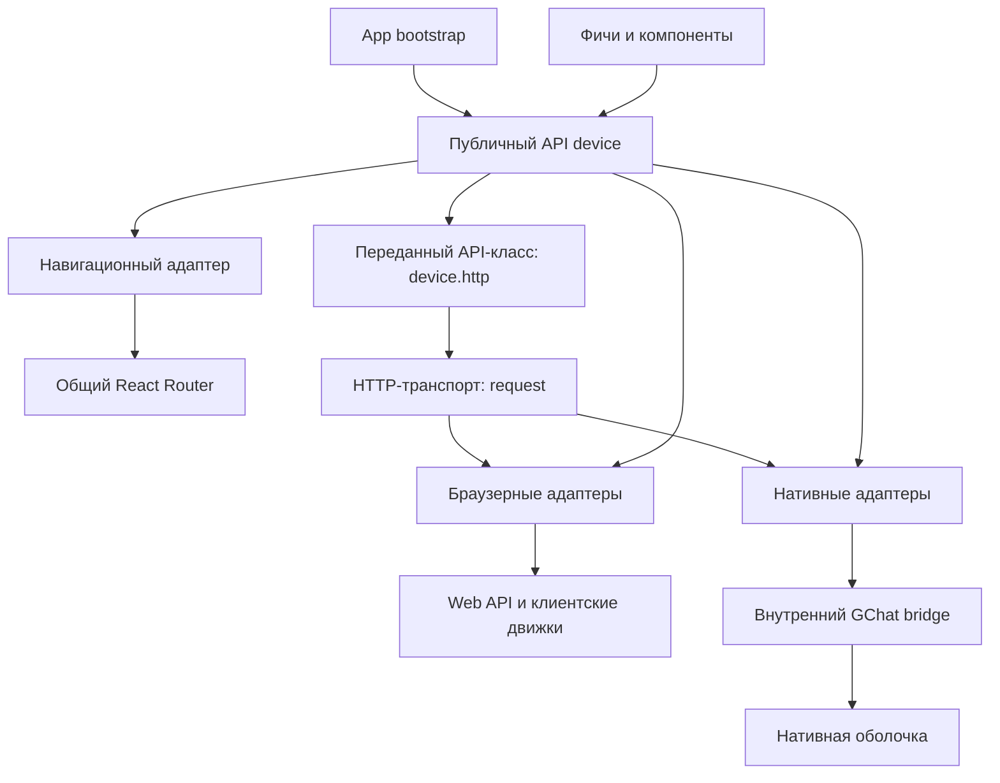

# Спецификация API device для Web

Единый публичный интерфейс GChat Web к браузеру и нативной оболочке. Документ задаёт требуемое поведение и TypeScript API. [Публичная фабрика](../../applications/web/src/shared/device/create.ts) подключена в основном Web: она владеет сессией, транспортом, звонками и одним Data router; разделы вызывают типизированные сервисы. HTTP, файлы, StorageService, permissions, notifications, updates и React-подписки собраны в общий объект device. Браузерная камера использует один video-only источник и сохраняет фото/потоковую запись в OPFS Data. Нативная камера реализует View/Call lifetime, preview под WKWebView, JPEG и H.264/MP4 в Data. Общие camera/PiP-компоненты подключены к настоящему владельцу DirectCalls в CallHarness. Native audio публикует системную громкость/выход, открывает системный выбор и MPVolumeView только при активном native VoIP owner.

Реализация остаётся partial: основная iOS-оболочка сообщает nativeCalls=false. Call lifetime, PiP и управление системной громкостью подключены к владельцу звонка в техническом CallHarness; включение этого владельца в основной оболочке остаётся за Gate 1 по [native calls](../ios/native-calls.md). Общий blocker реализован по [потоку данных](data-flow.md). Физическая приёмка камеры/PiP/аудиовыходов и полная матрица Gate 1 остаются отдельными проверками. Simulator-сборка и тестовый источник Chromium не заменяют эту приёмку.

**Статус — accepted.** Пользователь поручил самостоятельно закрыть оставшиеся решения, выбирая простую и качественную реализацию. Зафиксированные ниже решения готовы к реализации; [реестр решений](#реестр-решений) объясняет выбранные границы. Статус не подтверждает наличие кода или прохождение платформенной приёмки.

## Согласованные решения

| Область                | Решение                                                                                                                                                       |
| ---------------------- | ------------------------------------------------------------------------------------------------------------------------------------------------------------- |
| Публичное имя          | `device`; вложенности `device.device` нет                                                                                                                     |
| Форма API              | Типизированные сервисы с конкретными методами. Универсальный execute остаётся внутри транспорта                                                               |
| События                | Подписка явно указывает событие; имена событий оформляются enum, данные типизированы для каждого значения                                                     |
| HTTP                   | `device.http` имеет интерфейс переданного при инициализации API-класса; для GChat это сгенерированный BackendApi. Подменяется его Fetch-совместимый транспорт |
| HTTP в native          | Все HTTP-запросы приложения выполняются сетевым стеком нативной оболочки; WebView не отправляет их своим Fetch                                                |
| Файлы                  | Включены пользовательские файлы/папки и внутренние постоянные данные, временные файлы и кеш приложения                                                        |
| Граница файловой части | Управление файлами на устройстве. Серверная синхронизация, загрузка в GChat и модель привязки файлов к аккаунту/серверу сейчас за рамками                     |
| Камера                 | Фото, запись видео и доступ к живому потоку; фронтальная и основная камеры                                                                                    |
| Экран камеры           | Общий Web UI с предпросмотром и кнопками; устройством управляет device                                                                                        |
| Результат съёмки       | Фото и видеозапись возвращают FileRef и автоматически сохраняются постоянно во внутреннем хранилище приложения                                                |
| Камера при звонке      | Используемый Web-клиентом поток активного звонка не должен останавливаться из-за смены экрана или пересинхронизации WebView                                   |
| iOS при сворачивании   | Активный звонок с камерой автоматически переходит в PiP; техническая реализация и платформенная приёмка ещё требуются                                         |
| Аудио                  | Управление системной громкостью устройства во время звонка и выбор устройства воспроизведения: динамики, наушники и другие доступные выходы                   |
| Навигация              | Native управляет тем же Web-router через device. Bootstrap не управляет реализацией роутера в обход API                                                       |
| Проверки               | Системные и сервисные методы проверки работоспособности с типизированной понятной ошибкой                                                                     |

## Назначение и границы

Фичи и компоненты вызывают device, не выбирают browser/native и не импортируют Capacitor, raw plugin, embedded, nativeRuntime или конкретный транспорт. Платформенные проверки, преобразование запросов/ответов и нормализация ошибок находятся в адаптерах.

Таблица маршрутов, loaders/actions, экраны, переводы, формы и бизнес-сценарии принадлежат приложению и фичам. Устройство не становится владельцем административных списков или групп. Обычный DOM/CSS layout не требуется переносить в bridge. [Поток данных](data-flow.md) использует React Router Data mode с loader/action и сохранением Vite; TanStack Query удаляется после переноса потребителей.

Файловая часть ограничена локальными операциями. Она не определяет принадлежность файлов аккаунту, серверную синхронизацию или связанную с аккаунтом очистку. Действующие доменные правила DialogStorage остаются по [Bootstrap](bootstrap.md) и не становятся автоматически правилами всех файлов устройства.

Новые backend endpoints и протокол видеопередачи этим документом не задаются. Камера во время звонка требует интеграции с владельцем медиа; сам API устройства не считается реализацией нативного звонкового движка, доставки push или видеозвонков.

## Архитектура и создание device



Bootstrap создаёт device один раз на основной документ, передаёт конфигурацию маршрутов через публичную фабрику и подключает публичную React-интеграцию. Навигационный адаптер создаёт единственный router вне React state и владеет им. Прямой связи bootstrap → реализация router нет. Таблица маршрутов и обработчики передаются как зависимости, поэтому shared не импортирует app/features.

Режим выбирается до React и фиксируется на документ. Отказ native bridge даёт явную ошибку; browser fallback с созданием другой сессии, WSS или call engine не запускается. Перемонтирование страницы не пересоздаёт сервисы. Внутренние идентификаторы native-цикла и корреляции остаются внутри адаптера.

Публичный вход `src/shared/device/index.ts` экспортирует API и типы; `src/shared/device/react.tsx` — React-интеграцию. App передаёт конфигурацию, shared не импортирует app/features. Состав первой версии фиксирован:

```ts
export interface DeviceCore<THttp = unknown> {
  readonly http: THttp;
  readonly session: SessionService<THttp>;
  readonly transport: TransportService;
  readonly calls: CallsService;
  readonly notifications: NotificationsService;
  readonly updates: UpdatesService;
  readonly lifecycle: LifecycleService;
  readonly system: SystemService;
  readonly permissions: PermissionsService;
  readonly files: FilesService;
  readonly storage: StorageService;
  readonly camera: CameraService;
  readonly audio: AudioService;
  readonly navigation: NavigationService;
}
```

Фабрика создаёт сервисы синхронно, без сети, захвата и диалогов. `lifecycle.start()` готовит адаптеры/контекст сессии и затем создаёт единственный router; его loaders могут стартовать сразу. Start не ждёт завершения loaders и не превращает route error в ошибку device. `DeviceProvider` принимает запущенный device и монтирует его RouterProvider; второй Provider того же device возвращает INTEGRATION_ERROR. Размонтирование страницы не вызывает lifecycle.stop. Контекст React хранит ссылку на device, а не копии его состояния.

Browser/native реализации сессии, транспорта и звонкового движка переносятся из features в общие адаптеры/runtime без UI. Фичи сохраняют экраны и бизнес-сервисы. Композиция связывает существующих владельцев, shared не импортирует features даже ради временной обёртки. Старые контексты могут на время миграции читать device, но не создавать свои экземпляры адаптеров.

## Общие типы и правила вызовов

Все TypeScript-блоки далее описывают целевые декларации, а не существующие исходники.

FileRef, FileMetadata, PermissionState и состояние геопозиционного разрешения переиспользуются из [Device bridge](device-bridge.md) и [текущих типов](../../applications/web/src/shared/device/contract.ts). Алгоритмы файловых операций и ограничения размеров остаются у этого владельца. В листингах используются такие обозначения:

```ts
import type {
  DeviceState,
  FileRef,
  Metadata as FileMetadata,
  Resource as PermissionResource,
} from './contract';

export type PermissionReading = DeviceState['microphone'] | DeviceState['geolocation'];

export interface CallOptions {
  signal?: AbortSignal;
}

export type Unsubscribe = () => void;

export interface Versioned {
  readonly revision: number;
}

export interface EventSource<Events extends object> {
  on<E extends keyof Events>(event: E, handler: (data: Events[E]) => void): Unsubscribe;
}

// Экспорт React-входа; event всегда указан явно.
export declare function useDeviceState<TState extends Versioned, const TEvent extends string>(
  service: {
    getState(options?: CallOptions): Promise<TState>;
    on(event: NoInfer<TEvent>, handler: (state: NoInfer<TState>) => void): Unsubscribe;
  },
  event: TEvent,
): TState;

export type Selection<T> = { outcome: 'completed'; value: T } | { outcome: 'cancelled' };

export interface PageRequest {
  cursor: string | null;
  limit: number;
}

export interface Page<T> {
  entries: T[];
  nextCursor: string | null;
}
```

- Асинхронные операции возвращают Promise. Чтение состояния — `getState()`, подписки — `on(enumValue, handler)`. Состояние неизменяемо для потребителя; изменение выполняется только методом сервиса.
- Revision — монотонное безопасное целое для конкретного сервиса на время жизни device. Native-пересинхронизация не обнуляет публичную revision. Потребитель сначала подписывается, затем читает состояние; результат с меньшей revision отбрасывается. Внутренний cycle отбрасывает старые native-ответы до публикации. getState читает актуальный кеш адаптера, а не начинает системный prompt.
- `on` возвращает синхронную функцию отписки. Она снимает только конкретную подписку и не останавливает сервис или принадлежащий звонку ресурс. Внешний API не раскрывает PluginListenerHandle.
- Подписка регистрируется локально синхронно; один системный listener обслуживает потребителей. Отписка идемпотентна. Обработчики вызываются в порядке публикации; исключение одного обработчика не мешает остальным. Повторные события без изменения наблюдаемого состояния не создаются.
- AbortSignal объединяется с отменой актуального контекста. Отмена ожидания после начала изменения не доказывает откат: возможны PARTIAL_FAILURE и OUTCOME_UNKNOWN, без автоматического повтора.
- Отмена пользователем системного выбора представляется `Selection` с outcome cancelled. Отказ в разрешении — состояние denied/restricted; отмена жизненным циклом собственных сервисов — DeviceError с CANCELLED. HTTP сохраняет правила Fetch/SDK.
- Запросы разрешений, системный выбор файлов/аудиовыхода и разблокировка звука доходят до платформенного API непосредственно из пользовательского обработчика, без потери user activation.
- Аргументы, ответы и события bridge проходят runtime-валидацию. Сырые пути, bookmarks, токены и произвольные сообщения native не становятся данными UI. Проверка HTTP DTO определяется контрактом переданного SDK; общий фасад не добавляет её автоматически.

Внутренний native media v1 объявляется capability mediaVersion=1. Команды mediaCommand коррелируются по cycleId/requestId, требуют локальной native-сессии и проверяют auth revision до и после выполнения. Cancel останавливает ожидание и отменяемую подготовку; сохранённое изменение не объявляется отменённым. mediaEvent содержит безопасное состояние/непрозрачные ссылки, без кадров и путей. При смене цикла/сессии освобождаются View holds и UI выбора маршрута; публичная revision Web-адаптера сохраняется. Private camera.current читает текущий source/state/Call hold без захвата и prompt; revision native-снимка защищает от позднего ответа в том же cycle. State Web адаптера не откатывается, а подтверждённый RecordingSaved не теряется из-за более нового снимка. Компактный host принадлежит app-root, страничный preview имеет приоритет, native CGRect updates сериализуются и вытесняют устаревшие bounds того же preview. Старые оболочки без capability возвращают UNSUPPORTED_VERSION для нового медиаадаптера. Реализация — [NativeMediaController](../../applications/ios/App/App/NativeMediaController.swift) и [NativeCameraCapture](../../applications/ios/App/App/NativeCameraCapture.swift).

## Ошибки и системные проверки

Обычные операции собственных сервисов отклоняют Promise через DeviceError. Check/test возвращают CheckReport: обнаруженная неисправность — Failed, недоступная проверка — NotChecked. Некорректный вызов и отмена самой проверки отклоняют Promise через DeviceError. Так UI может показать несколько проблем за один вызов без Result-обёртки у каждого метода. Переданный HTTP-клиент сохраняет собственный контракт ошибок; его ApiError, ошибки разбора ответа, сети и отмены не переупаковываются в DeviceError. Session.run также сохраняет ошибку переданной HTTP-операции.

### Коды ошибок

Коды существующего bridge сохраняют смысл. INVALID_STATE обозначает недопустимое состояние ресурсного API.

```ts
export enum DeviceErrorCode {
  InvalidArgument = 'INVALID_ARGUMENT',
  InvalidState = 'INVALID_STATE',
  Unsupported = 'UNSUPPORTED',
  UnsupportedVersion = 'UNSUPPORTED_VERSION',
  IntegrationError = 'INTEGRATION_ERROR',
  BridgeUnavailable = 'BRIDGE_UNAVAILABLE',
  Unauthenticated = 'UNAUTHENTICATED',
  PermissionDenied = 'PERMISSION_DENIED',
  Restricted = 'RESTRICTED',
  AccessLost = 'ACCESS_LOST',
  NotFound = 'NOT_FOUND',
  WrongType = 'WRONG_TYPE',
  Busy = 'BUSY',
  Cancelled = 'CANCELLED',
  Timeout = 'TIMEOUT',
  DeviceUnavailable = 'DEVICE_UNAVAILABLE',
  AlreadyExists = 'ALREADY_EXISTS',
  Conflict = 'CONFLICT',
  StorageFull = 'STORAGE_FULL',
  IoError = 'IO_ERROR',
  PartialFailure = 'PARTIAL_FAILURE',
  OutcomeUnknown = 'OUTCOME_UNKNOWN',
  PushUnavailable = 'PUSH_UNAVAILABLE',
  NetworkError = 'NETWORK_ERROR',
  InvalidCredentials = 'INVALID_CREDENTIALS',
  Forbidden = 'FORBIDDEN',
  RateLimited = 'RATE_LIMITED',
  ServiceUnavailable = 'SERVICE_UNAVAILABLE',
  SecureStorageError = 'SECURE_STORAGE_ERROR',
  OperationFailed = 'OPERATION_FAILED',
}

export interface DeviceErrorDetails {
  settingsHint?: 'appSettings' | 'siteSettings' | 'none';
  outcome?: 'unknown' | 'partial';
  completedIds?: string[];
  destinationId?: string;
  reasonCode?: string;
  retryAfter?: number;
}

export interface DeviceFailure {
  code: DeviceErrorCode;
  service: string;
  operation: string;
  message: string;
  details?: DeviceErrorDetails;
}

export declare class DeviceError extends Error implements DeviceFailure {
  readonly code: DeviceErrorCode;
  readonly service: string;
  readonly operation: string;
  readonly details?: DeviceErrorDetails;
  constructor(failure: DeviceFailure);
}
```

Message — безопасное объяснение на русском из каталога `shared/device/messages.ts`, выбранное по code и operation; исходный текст ОС не передаётся. Этот текст достаточен для показа без дополнительного запроса. UI может локализовать его по code; неизвестный код получает общий безопасный текст. В ошибках нет файлового содержимого, абсолютных путей, токенов, SDP или ICE. Внутренняя причина остаётся в адаптере и не сериализуется в UI.

### SystemService и отчёт проверки

```ts
export enum CheckStatus {
  Passed = 'passed',
  Failed = 'failed',
  NotChecked = 'notChecked',
}

export type CheckItem = {
  service: string;
  check: string;
} & (
  | { status: CheckStatus.Passed }
  | { status: CheckStatus.Failed; error: DeviceFailure }
  | { status: CheckStatus.NotChecked; reason: string }
);

export interface CheckReport {
  checks: CheckItem[];
}

export interface SystemService {
  check(options?: CallOptions): Promise<CheckReport>;
}
```

`system.check()` проверяет готовность runtime, выбранного адаптера, связь/совместимость bridge там, где он нужен. В browser отсутствие native-плагина не является ошибкой. Обнаруженная неисправность, непроверенный ресурс и ошибка выполнения самой проверки различаются; один общий boolean не скрывает частичные результаты.

До Auth system.check проверяет только локальный runtime и совместимость bridge доверенного основного документа. Чтение разрешений, файлов и медиасостояния, требующее сессии по действующему bridge, возвращается NotChecked с reason `authenticationRequired`. После Auth проверяются готовность адаптеров и доступность их API; проверка сети не отправляет запросы. Bootstrap выбора сервера и вложенные/чужие документы доступа не получают. Недоступный ресурс активного звонка отмечается NotChecked с reason `resourceInUse`; test в этом случае возвращает Failed/BUSY. Остальные причины NotChecked: `permissionRequired`, `userConfirmationRequired`, `unsupported`. Это стабильные ключи для UI, а не тексты ОС.

`check()` не открывает камеру/микрофон, не проигрывает звук, не показывает системные диалоги и не меняет пользовательские файлы. Разрешение или наличие API не доказывает физическую работоспособность. Неизвестное отражается как NotChecked.

Фактический `test()` запускается по действию пользователя. Он проверяет конкретную операцию и не захватывает вторым владельцем ресурс активного звонка. Файловый тест использует выделенные внутренние тестовые данные с очисткой. Аудиотесты сохраняют длительность и ограничения текущего Device bridge; успешная отправка звука не доказывает слышимость без подтверждения пользователя. Успешная проверка не заменяет обработку отказа последующей операции.

## HTTP и подмена транспорта

Согласованная граница: приложение передаёт API-класс при инициализации библиотеки, а `device.http` становится его экземпляром с исходными методами, аргументами и типами результатов. Для GChat это [сгенерированный BackendApi](../packages/backend-api.md#публичный-api). Универсальный публичный `device.http.request(input, init)` поверх него не добавляется: Fetch-совместимый `request` служит внутренней точкой подмены транспорта.

Сигнатура транспорта — `typeof globalThis.fetch`: `request(input, init?)` возвращает `Promise<Response>`. Она совпадает с настройкой `BackendApiOptions.fetch` в [исходниках SDK](../../packages/backend-api/src/transport.ts). Общая основа — [Fetch API](https://fetch.spec.whatwg.org/#fetch-method), которым также пользуется [Node.js Fetch](https://nodejs.org/download/release/v24.15.0/docs/api/globals.html#fetch). Native реализует описанный ниже ограниченный профиль для SDK; Node/Undici dispatcher, прокси-настройки и потоковый upload в первую версию не входят.

### Конфигурация API-класса и маршрутов

Принимается конструктор с объектом настроек и параметром fetch. Routing получает device через типизированный контекст React Router: getContext помещает один экземпляр документа в новый RouterContextProvider для каждой навигации/fetcher. Loaders/actions читают context.get(deviceContext); при необходимости loader возвращает device компоненту в loaderData. Device не передаётся замыканием в фабрику маршрутов и не создаётся повторно для запросов. App нормализует разрешённые native-цели через resolveNativeLocation; маршруты не импортируются из shared.

```ts
export type HttpRequest = typeof globalThis.fetch;

import type { ReactElement } from 'react';
import type { RouteObject } from 'react-router';

export interface HttpClientRegistration<TOptions extends { fetch?: HttpRequest }, TClient> {
  client: new (options: TOptions) => TClient;
  options: Omit<TOptions, 'fetch'>;
}

export declare function createDevice<TOptions extends { fetch?: HttpRequest }, TClient>(config: {
  http: HttpClientRegistration<TOptions, TClient>;
  routing: {
    basename: string;
    createRoutes(): RouteObject[];
    resolveNativeLocation(to: string): string | null;
  };
}): DeviceCore<TClient>;

// Экспортируется из отдельного React-входа.
export declare function DeviceProvider<THttp>(props: { device: DeviceCore<THttp> }): ReactElement;
```

```typescript
import { BackendApi } from '@gchat/backend-api';

const configuredDevice = createDevice({
  http: {
    client: BackendApi,
    options: {
      baseUrl: '/api',
      getAccessToken: readCurrentAccessToken,
    },
  },
  routing: {
    basename: '/apps/client',
    createRoutes: createApplicationRoutes,
    resolveNativeLocation,
  },
});

await configuredDevice.lifecycle.start();
const groups = await configuredDevice.session.run((http, signal) => http.groupsList({ signal }));
```

`configuredDevice.http` выводится как BackendApi. Device передаёт внутренний request как fetch; пользовательская настройка fetch запрещена типом и runtime-валидацией. Провайдер readCurrentAccessToken принадлежит владельцу сессии и читает текущий контекст. Действующий доступ к native access token остаётся внутренним: UI и публичные снимки его не получают; native-транспорт подставляет актуальный токен своего владельца. Http-профиль доверенного API, базовый адрес и авторизация не настраиваются фичами. Для класса с другим конструктором приложение передаёт тонкий класс-адаптер с этим контрактом; дополнительные варианты фабрики не нужны.

### Выполнение запросов

| Среда   | Исполнение                                                                                                                                              |
| ------- | ------------------------------------------------------------------------------------------------------------------------------------------------------- |
| Browser | Выбранный адаптер вызывает браузерный Fetch с согласованными настройками и отменой контекста                                                            |
| Native  | Адаптер передаёт запрос оболочке; сетевое соединение и получение ответа выполняются на устройстве нативным HTTP-транспортом, например URLSession на iOS |

В native через этот путь должны проходить все HTTP-операции приложения, включая публичные и защищённые операции SDK. Уже принадлежащие native запросы Auth остаются у нативного владельца сессии. Фичи, loaders/actions и служебные потребители не обходят транспорт прямым `globalThis.fetch` или отдельно созданным SDK с транспортом по умолчанию. Загрузка документа/ресурсов WebView и WSS не относятся к этому модулю; файловая синхронизация по-прежнему за рамками файловой части.

Выбор browser/native централизован при создании device и фиксирован на документ. Неисправность native-транспорта не переключает запрос на Fetch WebView. Смена транспорта означает подмену реализации под одним SDK; публичный setter для переключения среды во время работы этим решением не вводится.

Транспорт возвращает Response со статусом, заголовками и телом, в том числе для HTTP 4xx/5xx. Решение о HTTP-ошибке, разбор DTO и ApiResult остаются у SDK по [его контракту ошибок](../packages/backend-api.md#ошибки). Отмена передаётся из вызова SDK до нативной операции и чтения ответа; она не доказывает откат на сервере. Транспорт не добавляет автоматических повторов бизнес-операций или самостоятельного refresh.

### Профиль native HTTP первой версии

- `string | URL | Request` и init нормализуются по Fetch, init имеет приоритет. Относительный URL разрешается от origin выбранного HTTPS-сервера; base path уже сформирован SDK. Разрешён только этот origin. URL с credentials/fragment и заголовки Cookie/Host отклоняются до отправки.
- Native использует отдельную URLSession без cookie storage и HTTP-кеша. Принимаются credentials `omit` и `same-origin` (токенная авторизация, без cookies), cache `default`/`no-store`; фактически всегда no-store. Другие credentials/cache, no-cors, integrity, keepalive, нестандартные поля и Undici-расширения отклоняются как неподдержанные. Нативный профиль не эмулирует браузерный cookie jar.
- Redirect-политика — `error`: ответы 301/302/303/307/308 отклоняются без второго запроса. При отсутствии настройки применяется эта политика; явно переданные follow/manual отклоняются. Для JSON API редирект не нужен, а правила переноса Auth между адресами не усложняют транспорт.
- Буферизуемые BodyInit сериализуются средствами Request в bytes, включая Content-Type FormData. Переданный ReadableStream как upload не поддерживается. Предел каждого тела запроса/ответа — 8 МиБ, превышение отклоняется; response читается с ограничением размера, без неограниченного накопления. Большие файлы и потоковая передача требуют отдельного расширения контракта.
- Bridge передаёт bytes как base64 с явным размером, заголовки — массивом пар. Envelope `{httpVersion: 1, cycleId, requestId, request: {url, method, headers, bodyBase64}}`; результат содержит те же идентификаторы и `{status, statusText, headers, bodyBase64, url}` либо `{kind, code}`. Значения kind: `network`, `aborted`, `timeout`, `unsupported`, `invalid`. Ограничение 8 МиБ применяется к декодированным данным; envelope допускает соответствующий base64 размер и не ограничивается лимитом WS-сообщения. Ответные Set-Cookie/Set-Cookie2 не выдаются в Web Headers.
- Нативный владелец сессии добавляет текущий Bearer только защищённой операции SDK. Адаптер использует маркер сформированного SDK заголовка Authorization для выбора защищённого запроса, заменяет значение на актуальное и не доверяет переданному Web токену. Публичные Auth-запросы выполняются только SessionService по действующему нативному контракту. Токен не попадает в события и снимки.
- Ответ полностью буферизуется до завершения Promise и превращается в настоящий Response; для 204/205/304 тело null. Чтение/clone работают средствами Response. Адаптер сохраняет url и type `basic` в обёртке Response, включая clone; redirected всегда false. Поток от Response доступен, но не означает сетевой streaming. Отсутствие HTTP-ответа не превращается в статус 0 или 200.
- Отмена Request.signal учитывается, если init.signal не переопределил её. Сигнал объединяется с отменой сессии/цикла; отмена посылает `http.cancel` для того же requestId и прекращает URLSessionTask. Отмена, пришедшая до регистрации задачи, запоминается для этого ID. Результат после отмены отбрасывается. Срок без системного диалога — 30 секунд, повторы отсутствуют.
- Сеть/timeout дают TypeError с безопасным message и структурированной cause `{code}`; отмена — DOMException AbortError; неподдержанный параметр/лимит/неверный аргумент — TypeError с code `UNSUPPORTED`/`INVALID_ARGUMENT` в cause. Прекращение bridge — TypeError/BRIDGE_UNAVAILABLE. Эти ошибки сохраняются SDK. Native-сигналы старого cycle не применяются.

Профиль намеренно покрывает запросы generated SDK и не объявляется полной реализацией Node Fetch. Browser использует обычный Fetch с no-store и объединённой отменой; ограничения native проверяются внутри адаптера, без ветвлений в фичах. Native capabilities включают httpVersion: 1 и navigationVersion: 1; их отсутствие/несовместимость останавливает инициализацию без fallback. Camera capability независим: её отсутствие даёт UNSUPPORTED для камеры, но не отключает Auth/HTTP. Все новые ресурсные команды используют внутренний version/cycle/request envelope существующего диспетчера; CameraSession/WriteSession добавляют внутренний leaseId/writeId, который не выбирает UI. Публичный source id камеры не является файловым доступом и не сохраняется между запусками.

Для HTTP плагин добавляет внутренние `httpRequest(envelope)` и `httpCancel({httpVersion, cycleId, requestId})`; обозначение http.cancel выше — эта отмена. Они доступны доверенному основному документу текущего cycle; отсутствие Auth допустимо только для публичного API. Native проверяет origin, цикл и размер до создания задачи. Эти методы не экспортируются фичам.

Текущий SDK уже допускает подмену Fetch. Нативные httpRequest/httpCancel и httpVersion: 1 реализованы в iOS; тестовый harness вызывает их напрямую. Fetch-совместимый [Web-адаптер](../../applications/web/src/shared/device/http.ts) с Response/clone подключён к SDK через createApi. NativeRuntime готовит и инвалидирует его контекст; Fetch WebView в native не вызывается. Общая композиция подключена через createDevice; фабрика создаёт SDK с внутренним Fetch-адаптером. iOS объявляет navigationVersion: 1, device.lifecycle.start готовит native-контекст и один router.

## Жизненный цикл

```ts
export enum LifecycleEvent {
  StateChanged = 'stateChanged',
  VisibilityChanged = 'visibilityChanged',
}

export interface LifecycleState extends Versioned {
  phase: 'starting' | 'ready' | 'error' | 'stopped';
  visibility: 'foreground' | 'background';
  error: DeviceFailure | null;
}

export interface LifecycleEvents {
  [LifecycleEvent.StateChanged]: LifecycleState;
  [LifecycleEvent.VisibilityChanged]: Versioned & {
    visibility: LifecycleState['visibility'];
  };
}

export interface LifecycleService extends EventSource<LifecycleEvents> {
  start(options?: CallOptions): Promise<void>;
  getState(options?: CallOptions): Promise<LifecycleState>;
  retry(options?: CallOptions): Promise<void>;
  stop(): Promise<void>;
}
```

Готовность окружения и авторизация различаются: login доступен после запуска без сессии. Start из starting возвращает тот же запуск, из ready ничего не делает; после ошибки требуется retry, после stopped — INVALID_STATE и новый device. Stop идемпотентен, отменяет Web-работы и освобождает их ресурсы, но не завершает самостоятельный native-звонок. Retry пересоздаёт только упавший адаптер и не дублирует живые ресурсы.

При native-возврате в foreground сохраняется пересинхронизация с отменой прежних Web-запросов и скрытием неактуальных пользовательских данных. Она не должна автоматически останавливать камеру, удерживаемую активным звонком. Фактическая остановка resource и отписка от старого Web-цикла различаются. Browser сохраняет источник при смене маршрутов, но закрытие/перезагрузка browser-документа освобождает его медиаресурсы; независимый от WebView native-владелец этим не подменяется.

## Разрешения

```ts
export enum PermissionEvent {
  Changed = 'changed',
}

export interface PermissionEvents {
  [PermissionEvent.Changed]: Versioned & {
    resource: PermissionResource;
    state: PermissionReading;
  };
}

export interface PermissionsService extends EventSource<PermissionEvents> {
  read(resource: PermissionResource, options?: CallOptions): Promise<PermissionReading>;
  request(resource: PermissionResource, options?: CallOptions): Promise<PermissionReading>;
  openSettings(options?: CallOptions): Promise<void>;
}
```

Семантика unknown/prompt/denied/restricted/granted/limited и геопозиционных признаков остаётся по [Device bridge](device-bridge.md#команды-разрешений-аудио-и-push). Request не равен тесту ресурса. Отказ пользователя возвращает denied/restricted, не ложный granted. Чтение и открытие экрана настроек не начинают съёмку и не получают координаты.

## Файлы и внутреннее хранилище

Включены обе локальные области. Предоставленный файловый доступ и его восстановление — по действующему [файловому контракту](device-bridge.md#файловые-команды). FileRef — непрозрачная ссылка, не путь или platform handle. Его persistence описывает сохранение доступа и не подменяет политику удаления содержимого.

### FilesService

```ts
export enum FileEvent {
  AccessChanged = 'accessChanged',
  Changed = 'changed',
}

export interface FileEvents {
  [FileEvent.AccessChanged]: Versioned & { refs: FileRef[] };
  [FileEvent.Changed]: Versioned & { ref: FileRef };
}

export interface ReadChunk {
  data: Uint8Array;
  bytesRead: number;
  eof: boolean;
  version: string | null;
}

export interface WriteSession {
  write(offset: number, data: Uint8Array, options?: CallOptions): Promise<{ bytesWritten: number }>;
  commit(options?: CallOptions): Promise<FileMetadata>;
  abort(): Promise<void>;
}

export interface FilesService extends EventSource<FileEvents> {
  check(ref?: FileRef, options?: CallOptions): Promise<CheckReport>;
  test(options?: CallOptions): Promise<CheckReport>;
  pick(
    selection: { multiple: boolean; accept: string[] },
    options?: CallOptions,
  ): Promise<Selection<FileMetadata[]>>;
  pickDirectory(options?: CallOptions): Promise<Selection<FileMetadata>>;
  listAccesses(page: PageRequest, options?: CallOptions): Promise<Page<FileRef>>;
  restoreAccess(ref: FileRef, options?: CallOptions): Promise<FileMetadata>;
  forgetAccess(ref: FileRef, options?: CallOptions): Promise<void>;
  stat(ref: FileRef, options?: CallOptions): Promise<FileMetadata>;
  list(directory: FileRef, page: PageRequest, options?: CallOptions): Promise<Page<FileMetadata>>;
  read(
    file: FileRef,
    range: { offset: number; length: number },
    options?: CallOptions,
  ): Promise<ReadChunk>;
  create(directory: FileRef, name: string, options?: CallOptions): Promise<FileMetadata>;
  createDirectory(directory: FileRef, name: string, options?: CallOptions): Promise<FileMetadata>;
  beginWrite(
    file: FileRef,
    write: { mode: 'replace' | 'update'; expectedVersion: string | null },
    options?: CallOptions,
  ): Promise<WriteSession>;
  copy(
    ref: FileRef,
    destination: { directory: FileRef; name: string },
    options?: CallOptions,
  ): Promise<FileMetadata>;
  move(
    ref: FileRef,
    destination: { directory: FileRef; name: string },
    options?: CallOptions,
  ): Promise<FileMetadata>;
  rename(ref: FileRef, name: string, options?: CallOptions): Promise<FileMetadata>;
  remove(ref: FileRef, remove: { recursive: boolean }, options?: CallOptions): Promise<void>;
  saveAs(
    file: FileRef,
    suggestedName: string,
    options?: CallOptions,
  ): Promise<Selection<FileMetadata>>;
  export(file: FileRef, suggestedName: string, options?: CallOptions): Promise<Selection<void>>;
}
```

Публичные байты — Uint8Array; base64 остаётся внутри JSON bridge. Соответствие методов старым командам однозначно: pick → file.pick, pickDirectory → directory.pick, listAccesses/restoreAccess/forgetAccess → file.access._, stat/list/read → file.stat/directory.list/file.read, beginWrite/write/commit/abort → file.write._, остальные — одноимённые file.* или directory.create. Native использует существующий диспетчер; новый публичный wait/cancel не добавляется.

Размер read/write chunk — до 262144 байт; page.limit — 1..200. WriteSession допускает последовательные команды одного владельца; конкурентная команда даёт BUSY. Abort идемпотентен, commit после завершения возвращает сохранённый результат в том же Web-цикле; неизвестный результат native-коммита не повторяется. Смена цикла закрывает staged writes. Ограничения курсоров/имён, expectedVersion, частичные/неизвестные исходы и атомарность остаются по Device bridge. Новая форма не усиливает гарантии провайдера.

Создание/копирование/переименование не выполняют скрытое перезаписывание. ForgetAccess удаляет сохранённую ссылку, а не пользовательский файл. Export подтверждает передачу системному механизму экспорта/загрузки; он не обещает наблюдаемую успешную запись браузером на диск.

События отражают известные адаптеру факты: Changed публикуется после подтверждённого изменения, AccessChanged — после изменения реестра/доступности ссылки. Контракт не обещает универсальный filesystem watcher внешних изменений: если платформа не сообщает их, актуальность проверяется операцией/повторным чтением.

### StorageService

```ts
export enum StorageArea {
  Data = 'data',
  Temporary = 'temporary',
  Cache = 'cache',
}

export interface StorageService {
  getRoot(area: StorageArea, options?: CallOptions): Promise<FileRef>;
  getUsage(
    area: StorageArea,
    options?: CallOptions,
  ): Promise<{ usedBytes: number | null; quotaBytes: number | null }>;
}
```

Root — ссылка на локальный каталог, абсолютный путь не выдаётся. Data хранит постоянные файлы; Temporary — данные одного Web-документа/процесса; Cache допускает потерю содержимого. На iOS используются Application Support, tmp и Caches. В browser — три каталога [OPFS](https://fs.spec.whatwg.org/#api): без OPFS getRoot и постоянная съёмка возвращают UNSUPPORTED, без скрытого перехода к session-файлам.

Data не очищается автоматически или при logout. Temporary удаляется при нормальном stop; остатки после сбоя удаляются при следующем запуске только после проверки, что нет живого владельца (Web Lock в browser). Cache очищает ОС либо приложение явным files.remove; собственный LRU/таймер уборки не вводится. Удалённая ссылка даёт NOT_FOUND. Каталоги других живых документов не очищаются.

Корни областей нельзя переименовать, переместить или удалить через files — INVALID_ARGUMENT; их содержимое управляется обычными методами. ListAccesses/forgetAccess относятся к внешнему предоставленному доступу, а не к реестру внутренних Data-файлов. Внутренние persistent FileRef разрешаются автоматически после запуска при наличии файла, без системного prompt.

Дополнительные квоты приложения не вводятся: действует квота платформы, отказ — STORAGE_FULL. GetUsage возвращает известную занятость области; неизвестное — null, quotaBytes — null, если ОС не даёт отдельной квоты области. Browser origin estimate не выдаётся за квоту одного каталога. Даже постоянные данные могут исчезнуть при удалении данных приложения/сайта; успех съёмки подтверждает запись, а не невозможность такой очистки. Предпочтения, SQL и модель принадлежности аккаунту сюда не входят.

На стороне iOS методы getRoot/getUsage реализованы внутренними командами `storage.getRoot` и `storage.getUsage` с `{area}` через существующий `executeDeviceCommand` и его version/cycle/request envelope. Возвращаются соответственно FileRef и `{usedBytes, quotaBytes}`. Доступ требует текущей native-сессии; пути не принимаются и не выдаются. Data/Cache сохраняют непрозрачные ссылки в отдельном реестре внутренних файлов, внешние bookmarks не переиспользуются. При смене Web-цикла/сессии Temporary очищается, Data/Cache и предоставленные внешние доступы сохраняются. Очистка остатков Temporary проверяет системную блокировку владельца и не затрагивает живые области. Типизированный [Web-фасад](../../applications/web/src/shared/device/storage.ts) вызывает эти команды; React-потребитель получает его как device.storage через DeviceProvider. BrowserFiles использует [OPFS-владельца](../../applications/web/src/shared/device/browser-storage.ts) и восстанавливает внутренние ссылки отдельно от внешних grants. Наличие этих сервисов не подтверждает оставшиеся критерии платформенной приёмки.

## Камера

Камера поддерживает фото, видеозапись и живой источник с фронтальной/основной камеры. Первая версия использует один физический источник, без одновременного захвата двух камер. Выбор из медиатеки не входит в съёмку. Camera не открывает микрофон и не перенастраивает аудиосессию звонка; видеозапись этой версии не содержит звука. Это позволяет использовать камеру во время аудиозвонка без второго владельца микрофона.

### Методы и ресурсные объекты

```ts
export enum CameraFacing {
  Front = 'front',
  Back = 'back',
}

export enum CameraLifetime {
  View = 'view',
  Call = 'call',
}

export enum CameraEvent {
  StateChanged = 'stateChanged',
  StreamInterrupted = 'streamInterrupted',
  RecordingSaved = 'recordingSaved',
  PictureInPictureChanged = 'pictureInPictureChanged',
  Error = 'error',
}

export interface CameraState extends Versioned {
  facing: CameraFacing;
  status: 'starting' | 'streaming' | 'interrupted' | 'error' | 'released';
  recording: 'idle' | 'recording' | 'stopping';
  format: { width: number; height: number; frameRate: number } | null;
  error: DeviceFailure | null;
}

export interface CameraStreamRef {
  readonly id: string;
}

export interface CameraPreviewProps<THttp = unknown> {
  device: DeviceCore<THttp>;
  source: CameraStreamRef;
  className?: string;
  visible?: boolean;
}

// React-вход; платформа выбирается внутри компонента.
export declare function DeviceCameraPreview<THttp>(props: CameraPreviewProps<THttp>): ReactElement;

export interface CameraEvents {
  [CameraEvent.StateChanged]: CameraState;
  [CameraEvent.StreamInterrupted]: Versioned & {
    reason: 'background' | 'resourceBusy' | 'systemPressure' | 'permissionLost' | 'unknown';
  };
  [CameraEvent.RecordingSaved]: Versioned & { file: FileRef };
  [CameraEvent.PictureInPictureChanged]: Versioned & {
    status: 'inactive' | 'starting' | 'active' | 'suspended' | 'error';
  };
  [CameraEvent.Error]: Versioned & { error: DeviceFailure };
}

export interface RecordingSession {
  stop(options?: CallOptions): Promise<FileRef>;
}

export interface CameraSession extends EventSource<CameraEvents> {
  getState(options?: CallOptions): Promise<CameraState>;
  getStream(options?: CallOptions): Promise<CameraStreamRef>;
  setFacing(facing: CameraFacing, options?: CallOptions): Promise<void>;
  takePhoto(options?: CallOptions): Promise<FileRef>;
  startRecording(options?: CallOptions): Promise<RecordingSession>;
  release(): Promise<void>;
}

export interface CameraService {
  check(facing?: CameraFacing, options?: CallOptions): Promise<CheckReport>;
  test(facing: CameraFacing, options?: CallOptions): Promise<CheckReport>;
  open(
    camera: { facing: CameraFacing; lifetime?: CameraLifetime },
    options?: CallOptions,
  ): Promise<CameraSession>;
  close(options?: CallOptions): Promise<void>;
}
```

Open создаёт удержание источника, а не новый захват для каждого потребителя. При совпадающей facing потребители делят источник. Open с другой facing возвращает BUSY; setFacing явно меняет общую камеру для всех потребителей. Release идемпотентно освобождает только удержание вызывающего; отписка не равна release. Последний владелец закрывает источник.

Lifetime по умолчанию View: ресурс принадлежит вызывающему и освобождается при release/уходе документа в фон/смене Web-цикла. Call разрешён только при текущем выбранном незавершённом звонке; runtime звонка получает отдельное удержание. Release Web-сессии и снятие preview это удержание не снимают. Камера выключается явным camera.close либо завершением звонка; close освобождает все удержания камеры и завершает запись, но не сам звонок. После close старые CameraSession дают INVALID_STATE, release остаётся безопасным. Новый Web-цикл получает новую сессию того же источника через open, без второго захвата.

CameraStreamRef — непрозрачный идентификатор источника, разрешаемый только внутри адаптера. Потребитель отображает его через DeviceCameraPreview; публичный MediaStream/OS handle и поток кадров через JSON не выдаются. В browser адаптер держит MediaStream вне React, подключает его к muted/playsInline video. В iOS AVCaptureSession с AVCaptureVideoDataOutput принадлежит native capture-owner; буферы идут в native preview/PiP, а при интеграции передачи — напрямую владельцу native-медиа. Web-код не является владельцем нативного захвата или фоновой передачи.

Native preview — прямоугольный UIView под прозрачной областью WKWebView, позиционируемый React-компонентом по DOM bounds. Страница рисует непрозрачный фон вне preview; Web-кнопки и диалоги остаются над ним. Компонент отслеживает размер/scroll/попадание в viewport; app задаёт visible=false при перекрывающем диалоге. Снятие/скрытие поверхности не останавливает источник. Первая версия поддерживает один видимый preview, без CSS transforms и непрямоугольных масок; второй даёт BUSY. PiP использует этот же native источник независимо от поверхности. Нативная поверхность реализована как UIView под WKWebView; общий Web host рисует фон вне прямоугольного cutout и скрывает preview при открытом dialog. Физическая проверка не заменяется сборкой Simulator.

Фото/видеозапись возвращают FileRef после постоянной записи в Data. Имя генерирует адаптер, публикация ссылки и RecordingSaved происходит после commit. До commit файл скрыт в staged storage. Ошибка/сбой удаляет незавершённый файл при ближайшем запуске; повреждённый результат не объявляется сохранённым. При финализируемом прерывании сохраняется корректная укороченная запись, которую возвращает stop; иначе stop отклоняется. Stop записи идемпотентен и возвращает тот же FileRef/отказ; запись принадлежит capture-owner, а не объекту preview.

Настройки v1 фиксированы: желаемые 1280×720/30 fps с ближайшим доступным форматом; фактические параметры — CameraState.format. Фото — JPEG текущего кадра с качеством 0.9 и нормализованной ориентацией. iOS пишет H.264/MP4 через AVAssetWriter; browser использует MediaRecorder с первым поддержанным типом из MP4/H.264, WebM/VP8, затем стандартным video-типом платформы. Проверка [isTypeSupported](https://www.w3.org/TR/mediastream-recording/#dom-mediarecorder-istypesupported) дополняется обработкой ошибки старта; реальный MIME и расширение сохраняются в FileMetadata. Транскодирование не вводится.

Одна запись на источник; остановка запускается по достижении 5 минут либо 256 МиБ. Финальный размер может включать последний encoder chunk и метаданные контейнера сверх порога. Адаптер завершает и сохраняет запись, публикует RecordingSaved; stop возвращает её. Данные пишутся порциями в staged storage, без накопления всего видео в памяти. SetFacing во время записи даёт BUSY; фото использует текущий кадр без остановки источника. Между камерами допустим краткий разрыв кадров при перенастройке, но логический источник сохраняется. Потеря разрешения/устройства отражается как interrupted/error, а не скрывается. При отсутствии точной facing возвращается DEVICE_UNAVAILABLE вместо незаметного выбора другой камеры.

### Камера во время звонка и PiP

Поток, используемый активным звонком, должен принадлежать долгоживущему runtime. Смена маршрута, снятие preview и пересинхронизация WebView не являются командами его остановки. Старые Web-запросы отменяются, но удерживаемый звонком native-источник сохраняется; новый Web-цикл подключается к актуальному состоянию без второго захвата.

Согласован автоматический PiP при сворачивании приложения на iOS, если активный звонок использует камеру. В foreground остаётся общий Web UI; PiP использует тот же источник через нативную интеграцию. Это не отдельный системный экран съёмки.

App-shell держит host активной Call-камеры выше страниц: при закрытии большого preview остаётся компактный preview разговора. Native source UIView и PiP controller живут у capture-owner, смена DOM-прямоугольника не пересоздаёт их. PiP использует AVPictureInPictureVideoCallViewController и AVSampleBufferDisplayLayer с буферами того же AVCaptureVideoDataOutput. Capture-owner включает multitasking camera access только при поддержке ОС. Захват камеры во время голосового разговора не меняет серверный протокол и сам по себе не отправляет видео собеседнику.

Apple описывает [камеру в PiP для видеосвязи](https://developer.apple.com/documentation/avkit/adopting-picture-in-picture-for-video-calls), [автоматический старт PiP](https://developer.apple.com/documentation/avkit/avpictureinpicturecontroller/canstartpictureinpictureautomaticallyfrominline) и [multitasking camera access](https://developer.apple.com/documentation/avfoundation/avcapturesession/ismultitaskingcameraaccessenabled). [Обычный background может прервать захват](https://developer.apple.com/documentation/avfoundation/avcapturesession/interruptionreason/videodevicenotavailableinbackground). Наличие звонка не доказывает доступность камеры во всех фоновых режимах.

Запрос PiP не считается успешным входом до фактического подтверждения. Живой native-захват не означает, что приостановленный JavaScript продолжает получать кадры. Физическая проверка владельца захвата и платформенных ограничений обязательна. Прерывание ОС отражается фактически, а не маскируется состоянием streaming.

При блокировке/системном прерывании Call-источник сохраняет требуемое состояние, но сообщает interrupted, если ОС остановила кадры. Возобновление автоматическое после окончания прерывания при foreground либо активном PiP, только если звонок ещё актуален и разрешение сохранено; новый prompt без действия пользователя не открывается. Если пользователь закрыл PiP, приложение не открывает его повторно в фоне: камера приостанавливается, аудиозвонок продолжается, возврат в foreground восстанавливает источник. При недоступном PiP применяется то же фактическое interrupted с понятной ошибкой; поддержка background не симулируется.

View-камера в фоне закрывается; запись финализируется в доступное ОС время, затем не продолжается автоматически. Call-запись продолжается только пока ОС предоставляет кадры через поддержанный PiP; прерывание завершает файл по правилу выше, после восстановления новая запись требует нажатия. Перезапуск процесса не восстанавливает захват автоматически. Проверка check заранее сообщает неподдержанный PiP/многозадачный доступ; отсутствие такой возможности не объявляется выполнением требования непрерывной фоновой камеры.

## Аудио

Поддерживаются системная громкость устройства во время звонка и выбор доступного устройства воспроизведения. Gain GChat не подменяет системный уровень; регулировка усиления микрофона за рамками v1.

```ts
export enum AudioEvent {
  StateChanged = 'stateChanged',
  VolumeChanged = 'volumeChanged',
  OutputChanged = 'outputChanged',
  OutputsChanged = 'outputsChanged',
  Error = 'error',
}

export enum AudioOutputKind {
  Speaker = 'speaker',
  Receiver = 'receiver',
  WiredHeadphones = 'wiredHeadphones',
  Bluetooth = 'bluetooth',
  Usb = 'usb',
  AirPlay = 'airPlay',
  Other = 'other',
  Unknown = 'unknown',
}

export interface AudioOutput {
  id: string;
  name: string | null;
  kind: AudioOutputKind;
}

export interface AudioState extends Versioned {
  volume: { level: number | null };
  output: AudioOutput | null;
  outputs: AudioOutput[] | null;
}

export interface AudioEvents {
  [AudioEvent.StateChanged]: AudioState;
  [AudioEvent.VolumeChanged]: Versioned & { level: number | null };
  [AudioEvent.OutputChanged]: Versioned & { output: AudioOutput | null };
  [AudioEvent.OutputsChanged]: Versioned & { outputs: AudioOutput[] | null };
  [AudioEvent.Error]: Versioned & { error: DeviceFailure };
}

export interface AudioVolumeService {
  showControl(options?: CallOptions): Promise<void>;
}

export interface AudioOutputsService {
  list(options?: CallOptions): Promise<AudioOutput[] | null>;
  pick(options?: CallOptions): Promise<Selection<AudioOutput>>;
  select(outputId: string, options?: CallOptions): Promise<void>;
}

export interface AudioService extends EventSource<AudioEvents> {
  readonly volume: AudioVolumeService;
  readonly outputs: AudioOutputsService;
  getState(options?: CallOptions): Promise<AudioState>;
  check(options?: CallOptions): Promise<CheckReport>;
  test(test: { kind: 'microphone' | 'sound' }, options?: CallOptions): Promise<CheckReport>;
}
```

Известный системный уровень нормализуется в 0..1; неизвестное значение — null. Аппаратные изменения публикуются как VolumeChanged. Приложение не сохраняет и не восстанавливает системный уровень. В browser уровень null, showControl возвращает UNSUPPORTED; UI предлагает использовать кнопки/настройки ОС.

В iOS [outputVolume доступна для чтения](https://developer.apple.com/documentation/avfaudio/avaudiosession/outputvolume). ShowControl открывает нативную панель с [MPVolumeView](https://developer.apple.com/documentation/mediaplayer/mpvolumeview), где пользователь меняет системную громкость. Отдельный setVolume не вводится. Панель использует активную аудиосессию CallKit/WebRTC, не создаёт и не активирует другую. Во время звонка изменение относится к текущей VoIP-сессии; соответствие проверяется физически. Вне звонка метод даёт INVALID_STATE. Успех означает показ контрола, изменение уровня подтверждает событие.

Выходы — реальные варианты платформы, id непрозрачен и действителен только в текущем контексте. Browser использует [Audio Output Devices API](https://www.w3.org/TR/audio-output/): list — доступные audiooutput, pick — selectAudioOutput с применением ко всем проигрывателям звонкового runtime, select — setSinkId. Если конкретного API нет, соответствующий метод возвращает UNSUPPORTED. Имена без разрешения могут быть null; отсутствие полного списка — null, достоверно пустой список — [].

На iOS list возвращает null: availableInputs не выдаётся за перечень выходов. Pick показывает одну нативную панель владельца звонка: встроенные speaker/receiver, когда доступны, и системный route picker для гарнитур/прочих разрешённых ОС маршрутов. Адаптер использует [currentRoute и route-change notification](https://developer.apple.com/documentation/avfaudio/audio-routing), не переустанавливает category/mode активной CallKit-сессии. Select по произвольному id возвращает UNSUPPORTED; UI использует pick. Закрытие панели без выбора — cancelled. Completed возвращается после подтверждённого route change; технический срок после выбора — 5 секунд, а ожидание выбора пользователя не ограничено. Невозможный выбор даёт DEVICE_UNAVAILABLE.

При отключении выбранного выхода ОС/browser выбирает фактический доступный маршрут. Адаптер публикует OutputChanged и OutputsChanged, сбрасывает подтверждение звукового теста; отсутствующий выход не выбирается снова автоматически. Приложение не сохраняет route id между запусками. Если автоматическое применение выхода browser не удалось, audioBlocked становится true и требуется пользовательское действие. При неподдержанной регулировке UI показывает системную инструкцию, а не фиктивный slider. [HTMLMediaElement.volume](https://html.spec.whatwg.org/multipage/media.html#dom-media-volume) и локальный gain не заменяют системный уровень. Audio работает с единственным владельцем аудиосессии; тесты разрешены вне звонка.

## Управление роутером из нативного приложения

Один router обслуживает Web, уведомления и native. Управление им проходит через device; bootstrap передаёт конфигурацию через публичную фабрику, а React-интеграция device монтирует RouterProvider. Link/Form и чтение loaderData используют тот же контекст. Native-адаптер отвечает за bridge, навигационный — за router; shared не импортирует app/features.

```text
Native → bridge → device.navigation → навигационный адаптер → общий router
                                                            → loader → сервис → модель страницы
```

### Методы и события

Первая версия предоставляет navigate и revalidate. Отдельные программные back/forward не вводятся: native передаёт целевой маршрут, а обычная история browser/Link продолжает работать через Router. Это исключает выход за пределы истории документа из команды оболочки.

```ts
export enum NavigationEvent {
  Started = 'started',
  Completed = 'completed',
  LocationChanged = 'locationChanged',
}

export enum NavigationOutcome {
  Committed = 'committed',
  Redirected = 'redirected',
  Blocked = 'blocked',
  Superseded = 'superseded',
  Failed = 'failed',
}

export interface DeviceLocation {
  pathname: string;
  search: string;
  hash: string;
}

export interface NavigationResult {
  id: string;
  outcome: NavigationOutcome;
  location: DeviceLocation;
  error?: DeviceFailure;
}

export interface NavigationState extends Versioned {
  location: DeviceLocation;
  status: 'idle' | 'loading' | 'submitting';
}

export interface NavigationEvents {
  [NavigationEvent.Started]: Versioned & { id: string; to: string };
  [NavigationEvent.Completed]: Versioned & { result: NavigationResult };
  [NavigationEvent.LocationChanged]: Versioned & { location: DeviceLocation };
}

export interface NavigationService extends EventSource<NavigationEvents> {
  getState(options?: CallOptions): Promise<NavigationState>;
  navigate(to: string, options?: CallOptions & { replace?: boolean }): Promise<NavigationResult>;
  revalidate(options?: CallOptions): Promise<void>;
}
```

Логический путь не содержит origin или deployment basename. Native принимает только допустимые внутренние маршруты и разрешённые параметры; router применяет basename. Данные загружаются и проверяются так же, как при Web-переходе. Доступ к данным проверяют сервисы/loaders, а не только родительский UI.

Указание auth-route сначала обновляет внутренний контекст по действующему bridge-контракту. Access token извлекается до навигации и не входит в router, URL, history.state или события навигации.

Для native-команды нужны внутренние версия/cycle/id, проверка допустимой цели и коррелированный результат. Приём команды, завершение перехода, redirect, блокировка, вытеснение и ошибка загрузки различаются. Повтор одной команды не создаёт вторую запись истории; старый cycle не применяется. Уведомление об изменившемся маршруте не запускает обратную навигацию по кругу.

Wire-envelope: `{navigationVersion: 1, cycleId, requestId, command: 'navigate', args: {to, replace}}`. UUID выбирает отправитель. Плагин доставляет его Web-адаптеру событием navigationCommand; Web отвечает через внутренний completeNavigation с теми же идентификаторами и result либо error. Result — NavigationResult, его id равен requestId; error — DeviceFailure при отказе до Started. Старый cycle получает INVALID_STATE без перехода. Lifecycle-start сообщает навигационную готовность после установки сессии и router. До ready хранится только последняя команда текущего cycle, предыдущая получает Superseded; при ошибке запуска — Failed. Результаты последних 128 завершённых requestId хранятся до смены cycle; повтор возвращает результат без нового перехода, активный повтор присоединяется к тому же ожиданию. Native не повторяет вытесненные из этого окна команды.

Допустим внутренний абсолютный путь длиной до 4096 UTF-8 байт, без origin, `//`, обратного слеша, dot segments, encoded separators и hash. App resolveNativeLocation проверяет совпадение с маршрутами и нормализует query по [таблице потока данных](data-flow.md#модели-маршрутов). Неизвестный параметр отклоняется, токены/пароли запрещены. Web-ссылки сохраняют обычную поддержку hash. Auth-route сначала обновляет/инвалидирует сессию внутри адаптера; токен не помещается в navigation envelope.

Новая навигация вытесняет незавершённую предыдущую; её результат Superseded, отмена loader не означает откат action. Navigate ждёт idle, решения blocker или ошибки: Committed — целевой адрес применён, Redirected — Router выбрал другой, Failed — ошибка загрузчика/интеграции; ошибка входного аргумента отклоняет Promise до Started. Ошибки маршрута остаются видимы через errorElement. Уже отменённый signal не начинает переход. Abort после передачи Router прекращает ожидание с CANCELLED, но принятый переход может завершиться и публикует фактический Completed. История не откатывается; загрузки предыдущего перехода отменяет новая навигация штатным механизмом Router. Revalidate объединяет одновременные запросы и ждёт idle, без новой записи истории; отмена ожидания не останавливает общую ревалидацию.

App держит один общий useBlocker для грязных форм/несохранённого постоянного черновика. Link, POP истории, device.navigate и native проходят через него. Pending-команда ждёт выбора пользователя; отказ даёт Blocked, подтверждение продолжает тот же переход. Для unload применяется beforeunload без обещания гарантированного сохранения. Обязательная смена/инвалидация сессии обходит blocker, отменяет старые операции и скрывает их данные; правила сохранения диалогов — по Bootstrap. Публикация LocationChanged не трактуется как входная команда.

Нативный контур реализован в [NativeNavigation](../../applications/ios/NativeCore/Sources/GChatCore/NativeNavigation.swift) и [GChatPlugin](../../applications/ios/App/App/GChatPlugin.swift); Web-адаптеры — [DeviceNavigation](../../applications/web/src/shared/device/navigation.ts) и [NativeNavigationBinding](../../applications/web/src/shared/device/navigation-native.ts). Внутренний navigationReady принимает `{navigationVersion: 1, cycleId, phase: 'ready', location}` либо `{navigationVersion: 1, cycleId, phase: 'failed'}`. Router и revision сохраняются при пересинхронизации цикла. В тестовом приложении адаптер подключён к настоящему Data router с basename; основной Web также подключён к одному Data router через NavigationHost и использует navigationReady/completeNavigation. NativeRuntime получает auth-контекст через прежний route, а прежний NativeBoundary удалён. Данные контактов/admin перенесены в loaders/actions, Query удалён; публичная композиция device подключена; прочие критерии потока данных проверяются отдельно. Legacy auth-route сохранён для установки контекста сессии и совместимости.

## Сессия, соединение и связанные сервисы

Это фасады существующих владельцев, без новой серверной модели и второго runtime. Общие типы не импортируются из features: Call берётся из уже общего [callSchema](../../applications/web/src/shared/api/call.ts). Политики Auth, DirectCalls, Bootstrap и обновлений остаются у своих владельцев.

```ts
export interface SessionIdentity {
  id: string;
  login: string;
  displayName: string;
  role: 'user' | 'admin';
}

export enum SessionEvent {
  StateChanged = 'stateChanged',
}
export interface SessionState extends Versioned {
  status: 'starting' | 'anonymous' | 'authenticated' | 'error';
  identity: SessionIdentity | null;
  generation: number;
  error: DeviceFailure | null;
}
export interface SessionService<THttp> extends EventSource<{
  [SessionEvent.StateChanged]: SessionState;
}> {
  getState(options?: CallOptions): Promise<SessionState>;
  login(credentials: { login: string; password: string }, options?: CallOptions): Promise<void>;
  logout(options?: CallOptions): Promise<void>;
  run<T>(
    operation: (http: THttp, signal: AbortSignal) => Promise<T>,
    options?: CallOptions,
  ): Promise<T>;
}

export enum TransportEvent {
  StateChanged = 'stateChanged',
}
export interface TransportState extends Versioned {
  status: 'offline' | 'connecting' | 'online';
  owner: boolean;
  error: DeviceFailure | null;
}
export interface TransportService extends EventSource<{
  [TransportEvent.StateChanged]: TransportState;
}> {
  getState(options?: CallOptions): Promise<TransportState>;
}

export type DeviceCall = import('zod').infer<typeof import('../api/call').callSchema>;
export enum CallEvent {
  StateChanged = 'stateChanged',
}
export interface CallsState extends Versioned {
  call: DeviceCall | null;
  control: 'available' | 'otherWindow' | 'unavailable';
  muted: boolean;
  busy: boolean;
  audioBlocked: boolean;
  error: DeviceFailure | null;
}
export interface CallsService extends EventSource<{
  [CallEvent.StateChanged]: CallsState;
}> {
  getState(options?: CallOptions): Promise<CallsState>;
  dial(peerId: string, options?: CallOptions): Promise<void>;
  accept(options?: CallOptions): Promise<void>;
  end(options?: CallOptions): Promise<void>;
  setMuted(muted: boolean, options?: CallOptions): Promise<void>;
  activateAudio(options?: CallOptions): Promise<void>;
  takeControl(options?: CallOptions): Promise<void>;
  dismissEnded(options?: CallOptions): Promise<void>;
  clearError(): void;
}

export type NotificationIntent =
  { id: string; kind: 'dialog'; dialogId: string } | { id: string; kind: 'call'; callId: string };
export enum NotificationEvent {
  StateChanged = 'stateChanged',
  IntentReceived = 'intentReceived',
}
export interface NotificationsState extends Versioned {
  settings: DeviceState['push'];
  pendingIntent: NotificationIntent | null;
}
export interface NotificationsService extends EventSource<{
  [NotificationEvent.StateChanged]: NotificationsState;
  [NotificationEvent.IntentReceived]: Versioned & { intent: NotificationIntent };
}> {
  getState(options?: CallOptions): Promise<NotificationsState>;
  enable(options?: CallOptions): Promise<void>;
  disable(options?: CallOptions): Promise<void>;
  acknowledge(id: string, options?: CallOptions): Promise<void>;
}

export enum UpdateEvent {
  StateChanged = 'stateChanged',
}
export interface UpdatesState extends Versioned {
  status: 'unsupported' | 'idle' | 'available' | 'waiting' | 'applying' | 'error';
  error: DeviceFailure | null;
}
export interface UpdatesService extends EventSource<{
  [UpdateEvent.StateChanged]: UpdatesState;
}> {
  getState(options?: CallOptions): Promise<UpdatesState>;
  apply(options?: CallOptions): Promise<{ outcome: 'scheduled' | 'deferred' }>;
}
```

Session.run дожидается окончания начальной синхронизации; anonymous даёт UNAUTHENTICATED, без ожидания будущего входа. Фиксируются generation и Web-cycle. Callback получает signal, объединённый из options.signal и текущей сессии/цикла; каждый вызов SDK обязан передать его в аргументах. До вызова, refresh/повтора и после результата проверяются signal и контекст. Контекст разных одновременных run не хранится в общей изменяемой переменной. Callback содержит одну HTTP-операцию без иных побочных действий. Только подтверждённый ACCESS_TOKEN_EXPIRED разрешает один refresh владельца и повтор callback: backend не выполнил защищённую операцию. Другие ошибки, сеть и неизвестный результат не повторяются. Login/logout не передаются через run. Возвращается исходный результат callback, включая ApiResult; разворачивание data выполняет сервис фичи. Прямой вызов device.http сохраняет поведение SDK без автоматического refresh; защищённые сервисы приложения используют run.

Login использует выбранный доверенный сервер; смена сервера/локальное стартовое приложение остаются по iOS-контракту. Native выполняет login/refresh/logout и хранит сессию; browser сохраняет Web Locks, request_id refresh и межвкладочную координацию. Generation меняется при смене/инвалидации сессии, но не при обычной ротации access token. Поздние ответы предыдущего generation отбрасываются. До authenticated identity равна null; access/refresh token не входят в публичное состояние. Повторный logout безопасен.

TransportService показывает безопасное состояние единственного WSS. Send/сырые события не экспортируются в UI: Calls и DialogRuntime получают внутренний типизированный транспорт при композиции. TakeControl меняет владельца по действующим Web Locks только без незавершённого звонка. В native без прошедшего приёмку call engine control=unavailable; команды дают UNSUPPORTED без browser fallback. End отменяет свой исходящий ringing, отклоняет входящий ringing или завершает выбранный разговор по текущему состоянию; отсутствие звонка — INVALID_STATE. SetMuted задаёт требуемое значение, повтор безопасен. DismissEnded убирает только терминальное представление. Dial сначала готовит микрофон из пользовательского жеста, затем один раз вызывает call.create; неполученный результат не повторяется. Медиапротокол, version/sequence и серверные сроки не меняются.

NotificationsService отображает существующие push-настройки и нормализует intent по Bootstrap. Enable запрашивает разрешение только по нажатию, disable снимает регистрацию данного контура, не отзывает системное разрешение. Intent остаётся pending до acknowledge; повтор id не создаёт вторую обработку. App проверяет сессию/доступ к диалогу или актуальный звонок, вызывает device.navigation, затем подтверждает intent даже при его устаревании. Push не вызывает автоматический ответ на звонок. SDP/ICE и содержимое сообщения в intent не передаются.

UpdatesService оборачивает существующий PWA update-flow: apply требует действия пользователя, ожидает безопасный барьер всех вкладок, черновиков и начатых операций. При блокировке возвращает deferred и состояние waiting, применяет уже подтверждённое обновление после снятия барьера; scheduled означает начало применения, а не завершённую перезагрузку. Активный звонок не прерывается. Native без механизма обновления показывает unsupported; apply возвращает UNSUPPORTED. Viewport, клавиатура, clipboard и произвольное share в v1 не добавляются: они не нужны для завершения текущего контракта, новые сервисы требуют отдельного объёма.

## Примеры использования

Использование целевых сигнатур:

```typescript
const offVolume = device.audio.on(AudioEvent.VolumeChanged, ({ level }) => {
  renderVolume(level);
});

const camera = await device.camera.open({ facing: CameraFacing.Front });
const photo: FileRef = await camera.takePhoto();
const metadata = await device.files.stat(photo);

const recording = await camera.startRecording();
const video: FileRef = await recording.stop();

await device.audio.outputs.pick();
await device.audio.volume.showControl();
await device.navigation.navigate('/calls', { replace: true });

await camera.release();
offVolume();
```

Обработчик получает данные своего enum без обязательного повторного чтения сервиса. React-вход предоставляет `useDeviceState(service, event)`, например `useDeviceState(device.calls, CallEvent.StateChanged)`: один кеш на пару service/event, подписка до начального чтения, проверка revision и Suspense/error boundary для первоначального ожидания/ошибки. Hook принимает только событие с полным состоянием соответствующего getState; VolumeChanged с одним level для него не подходит. Внутри допустим useSyncExternalStore; этот механизм не становится публичным безымянным subscribe. Для специализированных событий используется on. Компоненты не синхронизируют копии аппаратного состояния цепочкой эффектов.

## Интеграция и переход

### Что уже существует и что меняется

| Владелец                                                                                             | Текущее правило / необходимое изменение                                                                                                                                                                |
| ---------------------------------------------------------------------------------------------------- | ------------------------------------------------------------------------------------------------------------------------------------------------------------------------------------------------------ |
| [Web](README.md#встроенный-web-и-capacitor-bridge)                                                   | Платформенные адаптеры выбираются в createDevice; разделы используют типизированные сервисы без изменения продуктовых доступов                                                              |
| [Device bridge](device-bridge.md)                                                                    | Публичный execute и wait/cancel заменяются методами/enum-событиями нового фасада; внутренний диспетчер может сохраниться. Нынешняя громкость средствами ОС и ограничение выбора выхода iOS расширяются |
| [D011](../architecture/decisions/D011-native-device-settings.md)                                     | Сохраняет мотивацию командного bridge; публичную форму и добавленный объём определяет этот контракт                                                                                                    |
| [Bootstrap](bootstrap.md)                                                                            | Сохраняются DialogStorage, scope/CAS/epoch, outbox и fallback. Общая интеграция не создаёт второй WSS; требуемый единый фасад транспорта доводится до потребителей                                     |
| [Backend API](../packages/backend-api.md)                                                            | Сохраняются сгенерированный класс, DTO, ApiResult и ошибки. Его существующая настройка fetch подключается к выбранному транспорту device; общий native HTTP bridge требуется реализовать               |
| [D007](../architecture/decisions/D007-web-routing.md) и [поток данных](data-flow.md)                 | Основной Web использует Data mode и loaders/actions, Query удалён; остальные критерии data-flow принимаются отдельно                                                                                                |
| [D008](../architecture/decisions/D008-capacitor-bridge.md) и [iOS](../../applications/ios/README.md) | Камера/PiP требуют нативной реализации и физической проверки; наличие TypeScript API не закрывает native call engine и Gate 1/2                                                                        |

CommandBridge остаётся текущей реализацией и внутренним механизмом на время миграции. При расхождении публичной формы/потока данных целевые требования определяют этот документ и data-flow; остальные доменные правила владельцев сохраняются. Новые декларации не выдаются за существующий код.

### Связанные сервисы

Перенос выполняется через интерфейсы [связанных сервисов](#сессия-соединение-и-связанные-сервисы), без пустых заглушек или ложного успешного Promise:

| Область                | Сохраняемая граница                                                                                                                                                                                                |
| ---------------------- | ------------------------------------------------------------------------------------------------------------------------------------------------------------------------------------------------------------------ |
| session                | Login, refresh, logout и хранение native-сессии остаются у native; browser сохраняет координацию refresh. Провайдер актуального токена и отмена контекста подключаются к HTTP-клиенту без второго владельца сессии |
| http                   | Переданный API-класс сохраняет интерфейс; Fetch-совместимый транспорт выбирается внутри device. Native выполняет все HTTP-операции своим сетевым стеком по [HTTP-контракту](#http-и-подмена-транспорта)            |
| transport              | Один WSS, регистрация устройства и reconnect; подписки Calls/Dialogs не создают соединений                                                                                                                         |
| calls                  | Независимый от GChatClient контракт состояния и действий. Место управления Web/native выражено смысловым состоянием; неподдерживаемое действие даёт типизированный отказ                                           |
| notifications          | Нормализация intent, привязка по действующему Bootstrap, дедупликация и подтверждение. Приложение проверяет диалог перед переходом через device.navigation                                                         |
| updates / presentation | Защита активного звонка, черновиков и storage handles при обновлении; нужные UI признаки без embedded                                                                                                              |

Clipboard, системное share, внешние links и viewport/клавиатура не входят в v1. Обычное браузерное копирование остаётся в shared helper без выбора native; собственный native clipboard-сервис не добавляется. Новая функциональность не подразумевается пустым интерфейсом.

### Порядок реализации

1. Подготовить публичные типы/фабрику и адаптеры существующих владельцев; сохранить регрессионные сценарии до переключения потребителей.
2. Собрать device поверх существующих адаптеров и подключить публичную композицию, без второго владельца ресурсов. Передать API-класс и подключить выбранный HTTP-транспорт; реализовать native bridge для запросов и ответов.
3. Перенести Files/Permissions/Storage и события; добавить согласованные проверки/ошибки.
4. Реализовать Camera/Audio и native-интеграцию, затем проверить поток, системную громкость и PiP на физических устройствах.
5. Подключить navigation и согласованную интеграцию session/transport/calls/notifications; убрать прямые платформенные импорты и переходные экспорты.
6. Провести маршрутную, межвкладочную и платформенную приёмку. Браузерный этап не объявляется готовностью native.

## Критерии приёмки и проверки

- Фичи/компоненты не импортируют raw plugin, embedded, nativeRuntime, browserTransport или внутренние адаптеры. Публичный execute отсутствует; shared не импортирует app/features.
- Основные вызовы и enum-события одинаково типизируются в browser/native; неверная пара события/данных отклоняется. Runtime-валидация проверяет внешние сообщения и отбрасывает старый контекст.
- Отсутствующий/несовместимый native bridge даёт понятную ошибку без browser fallback. Повторный запуск/подписки/навигация не создают второй runtime, refresh, WSS, capture или call engine.
- Тип device.http совпадает с переданным API-классом; существующие методы, DTO, ApiResult и ошибки сохраняются. Browser/native выполняют одинаковые операции SDK через разные Fetch-совместимые транспорты. В native запросы, включая auth, идут нативным сетевым стеком без Fetch WebView и без fallback; проверяются статус/заголовки/тело, HTTP-отказ, отмена и неизвестный исход без автоматического повтора.
- Проверки различают Passed/Failed/NotChecked по согласованной модели. Check не вызывает захват/системный prompt/изменение пользовательских файлов; test не прерывает активный звонок и не объявляет доказанную слышимость без пользователя.
- Файловая матрица текущего Device bridge сохраняется: доступы, пустые/большие файлы, staged write, версии, отмена, частичный и неизвестный исход, восстановление после перезапуска и ограничения provider. Export не выдаётся за подтверждённую запись браузером на диск.
- Фото/видео возвращают FileRef только после постоянного локального сохранения. При сохранности данных приложения файл доступен после повторного запуска; временный/неуспешный результат не объявляется сохранённым.
- Камера активного звонка сохраняется при смене маршрута, снятии preview и новом Web-цикле. На iOS проверяются автоматический PiP, тот же источник и фактическое состояние; native-захват не выдаётся за работающий приостановленный Web.
- Системная громкость и выбранный выход отражают состояние ОС, а не локальную имитацию gain. Проверяются внешние изменения, отказ выбора и согласованное поведение при отключении устройства.
- Bootstrap использует публичную композицию device. Web/native/уведомления работают с одним router; loaders получают актуальную сессию, прямые URL и история сохраняются, старый native cycle и повтор команды не создают лишнюю навигацию.
- Проверяются конкурентные session.run с разными сигналами, initial-read/event race, отписка, resync без обнуления публичной revision и недоступный native capability без fallback. Native HTTP проверяет границы размера, отмену до регистрации задачи, 204/304, clone/headers и отсутствие cookies/redirect; тест не выдаётся за физическую сетевую приёмку.
- Camera проверяется на общий источник, close/release, запись без микрофона, смену камеры, лимиты и финализацию после прерывания. Native preview не получает кадры через JSON; блокировка/PiP и одновременный аудиозвонок проверяются на устройстве.
- Сохраняются user activation, изоляция существующего DialogStorage, политика неизвестного результата звонка, барьеры обновления и отсутствие секретов в UI/диагностике.
- Для кода выполняются typecheck, build и относящиеся тесты по [README Web](../../applications/web/README.md); маршрутные/межвкладочные сценарии — по [E2E](../../tests/e2e/README.md). Реальные iPhone, звук, provider, PiP и push принимаются отдельно. Изменения документации проверяются `pnpm docs:check`.

## Реестр решений

Все O1–O10 закрыты в текущем объёме. Таблица связывает прежний вопрос с выбранным решением; ограничения v1 не являются открытыми вариантами.

| ID  | Решение                                                                                                                | Причина                                                                                |
| --- | ---------------------------------------------------------------------------------------------------------------------- | -------------------------------------------------------------------------------------- |
| O1  | DeviceError для операций; CheckReport для check/test; безопасный русский message и локализация по code                 | Один обычный путь async-ошибки, возможность показать несколько диагностических проблем |
| O2  | getState + on(enum, handler), идемпотентная отписка, revision на время документа                                       | Устраняет гонку чтения/события без публичной универсальной шины                        |
| O3  | Фиксированный DeviceCore, createDevice с классом SDK/маршрутами, отдельный React-вход                                  | Явная композиция без глобального клиента и обратных импортов                           |
| O4  | Один источник, CameraSession-удержания, логический ref и DeviceCameraPreview; native-владелец вне WebView              | Не дублирует capture и не передаёт поток кадров через bridge                           |
| O5  | Фиксированные форматы/лимиты, запись без звука, автоматический PiP Call-источника, фактические interruption/recovery   | Минимум настроек и отсутствие конкуренции с микрофоном звонка                          |
| O6  | Existing file algorithms + Uint8Array, OPFS/native roots, Data без auto-delete, временные данные с проверкой владельца | Переиспользование рабочего контракта без новой файловой модели                         |
| O7  | MPVolumeView в active call, null для неизвестного, browser setSinkId и native route picker                             | Используются поддержанные механизмы ОС без фиктивных уровней/устройств                 |
| O8  | navigate/revalidate, одна очередь latest, cycle/id и окно дедупликации, общий blocker                                  | Нет второй истории или отдельной навигационной логики оболочки                         |
| O9  | Типизированные фасады существующих runtime; Data mode и удаление Query по data-flow                                    | Один владелец live-данных и один способ загрузки данных страницы                       |
| O10 | Инъекция класса с fetch, native URLSession, ограниченный буферизованный профиль, отмена и без повторов                 | Покрывает generated SDK без эмуляции всего Node/браузерного Fetch                      |

Нереализованные возможности и физическая приёмка отслеживаются как работа по этому контракту. Новые backend-видеосценарии, raw camera frames в JavaScript, запись звука камерой, потоковый HTTP и файловая синхронизация не входят в v1; их отсутствие не маскируется заглушкой или browser fallback.
